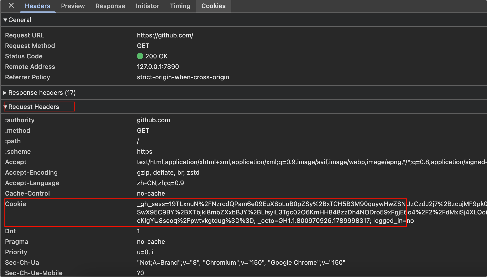
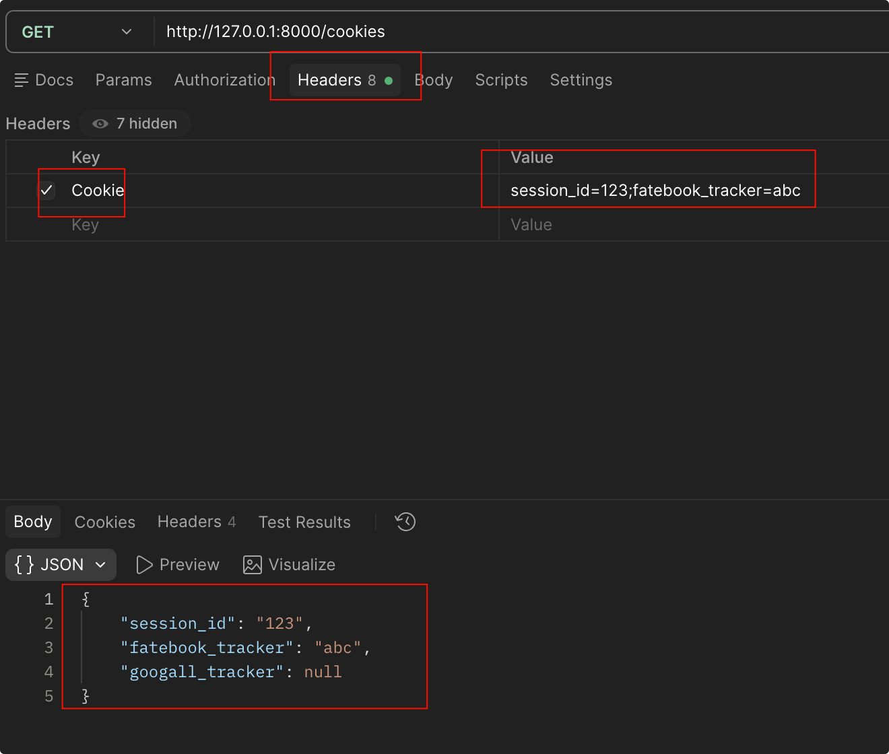
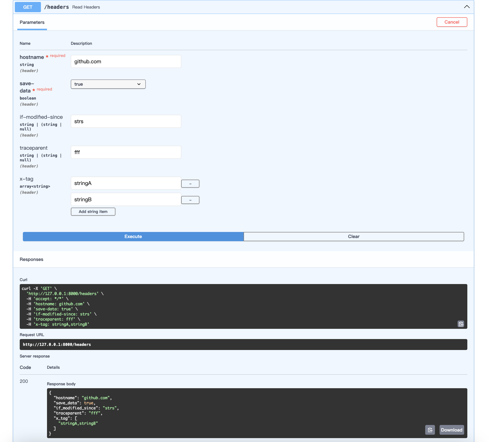

# Cookie&Header参数获取

## Cookie

### 介绍

**Cookie** 是服务器发送到用户浏览器并保存在本地的一小块数据。它就像网站发给你的“临时身份卡”——浏览器每次发起请求时，都会自动带上这张卡，让服务器能认出你是谁。

比如访问：https://github.com/



### 获取Cookie

示例：
```python
from typing import Annotated

from fastapi import FastAPI, Cookie
from pydantic import BaseModel

# 定义FastAPI实例
app = FastAPI()

# 获取Cookie
class Cookies(BaseModel):
    # 必填，请求里必须有名为 session_id 的 Cookie
    session_id: str
    # 可选，没有则为 None
    fatebook_tracker: str | None = None
    # 可选，没有则为 None
    googall_tracker: str | None = None

# Annotated 的作用：把类型（Cookies）和元数据（Cookie()）绑定一起，是 FastAPI 推荐的写法
# 比旧式 cookies: Cookies = Cookie() 更清洗
# 如果不指定参数来源，默认从查询参数里去获取
@app.get("/cookies")
async def read_cookies(cookies: Annotated[Cookies, Cookie()]):
    return cookies
```

由于浏览器不允许通过javascript操作cookie，所以只能通过Postman来测试



## Header

### 介绍

HTTP请求头部(Header)是一组包含请求信息的键值对，用来描述HTTP请求的各种属性和特征。

### 获取Header

示例：

```python
from typing import Annotated

from fastapi import FastAPI, Header
from pydantic import BaseModel

# 定义FastAPI实例
app = FastAPI()

# 获取Header
class CommonHeaders(BaseModel):
    hostname: str
    save_data: bool
    if_modified_since: str | None = None
    traceparent: str | None = None
    x_tag: list[str] = []

@app.get("/headers")
async def read_headers(headers: Annotated[CommonHeaders, Header()]):
    return headers
```


