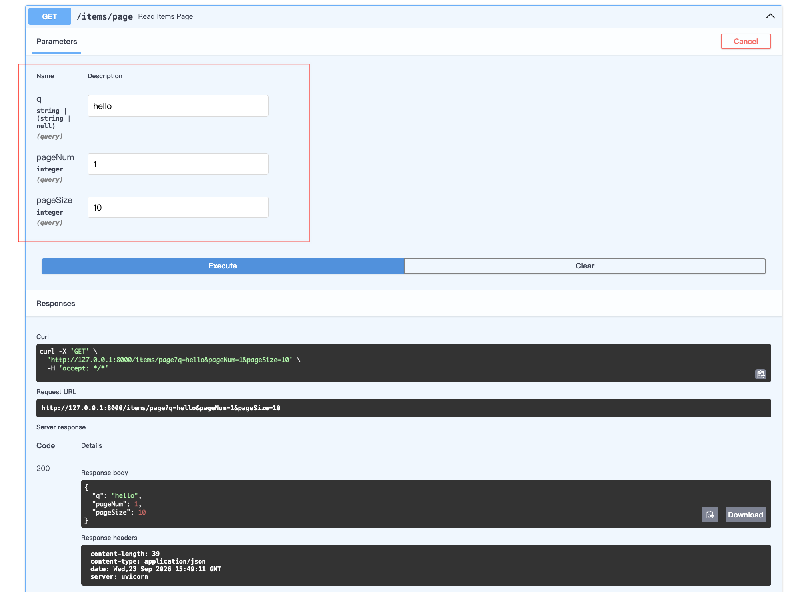

# 依赖注入

## 定义

依赖注入（Dependency Injection, DI）是一种设计模式，核心思想是将**对象的创建与使用分离**，通过外部注入的方式为组件提供所需的依赖，而不是在组件内部直接实例化。

在 FastAPI 中，依赖注入系统让你可以在路径操作函数中**声明**自己需要什么资源（如数据库连接、用户认证、配置等），FastAPI 框架会**自动准备**这些资源并“注入”到你的函数中。

## 优点

| 优势         | 说明                                                         |
| :----------- | :----------------------------------------------------------- |
| **代码复用** | 将通用逻辑（如认证、数据库连接）抽取为可复用的依赖，避免重复代码 |
| **解耦**     | 业务逻辑与基础设施（数据库、外部服务）分离，降低组件间的耦合度 |
| **简化测试** | 测试时可以轻松 Mock 依赖项，隔离被测代码，无需实际连接数据库或调用外部服务 |
| **类型安全** | 结合 Python 类型注解，支持 IDE 静态检查，避免运行时类型错误  |
| **自动文档** | 依赖参数会自动出现在 Swagger API 文档中                      |

## 基本使用

### 语法

FastAPI 通过 `Depends` 实现依赖注入。你定义一个**依赖函数**（可以是普通函数或异步函数），然后在路径操作函数的参数中使用 `Depends(依赖函数)` 来注入。

### 依赖函数

依赖函数和普通的路径操作函数几乎一样——它可以接收路径参数、查询参数、请求体等，也可以使用 `async/await`。它的返回值会作为参数传递给路径操作函数。

### 示例

定义一个公共分页方法 common_parameters，其他地方可以通过Depends注入。

```python
# 依赖注入
async def common_parameters(
        q: str | None = None,
        pageNum: int = 1,
        pageSize: int = 10):
    return {"q": q, "pageNum": pageNum, "pageSize": pageSize}

@app.get("/items/page")
async def read_items_page(commons: Annotated[dict, Depends(common_parameters)]):
    return commons

@app.get("/users/page")
async def read_users_page(commons: Annotated[dict, Depends(common_parameters)]):
    return commons

#======输出======
INFO:     127.0.0.1:59332 - "GET /items/page?q=hello&pageNum=1&pageSize=10 HTTP/1.1" 200 OK
```


浏览器请求：`http://127.0.0.1:8000/docs`


