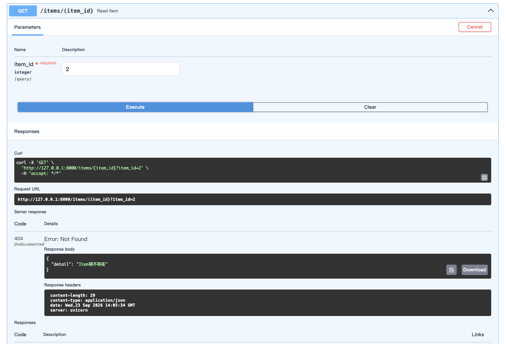

# 异常错误处理

## 介绍

在 FastAPI 中，**HTTPException** 是一个内置的异常类，用于在 API 处理过程中**主动抛出 HTTP 错误响应**。当你的业务逻辑遇到问题（如资源不存在、权限不足、参数无效等）时，你可以抛出 HTTPException，FastAPI 会捕获它并自动将其转换为符合 HTTP 规范的 JSON 错误响应（包含状态码和详细信息）。

## 优势

使用 HTTPException 的核心优势：

- **标准化错误响应**：返回标准的 HTTP 状态码和错误信息，方便客户端处理。
- **自动生成文档**：异常信息会出现在 OpenAPI 文档中（如果声明了 `responses`），提高 API 的可理解性。
- **与依赖注入等机制无缝集成**：可以在依赖项、中间件等任何位置抛出。

## 参数说明

- `status_code`：HTTP 状态码（如 400、404、403、500 等），可以是整数或 `fastapi.status` 中定义的常量（推荐使用）。
- `detail`：错误描述信息，可以是字符串或可转为 JSON 的对象（如字典、列表）。
- `headers`（可选）：可以添加自定义响应头。

## 基础使用

```python
from fastapi import FastAPI, HTTPException

# 定义FastAPI实例
app = FastAPI()

@app.get("/items/(item_id}")
async def read_item(item_id: int):
    if item_id < 1:
        # 抛出 HTTPException 状态码 400 并附带详细信息
        raise HTTPException(status_code=400, detail="ID必须大于0")
    # 模拟查询，假设只有 id=1 存在
    if item_id != 1:
        raise HTTPException(status_code=404, detail="Item项不存在")
    return {"item_id": item_id, "name": "Sample Item"}
```

然后打开浏览器访问 `http://127.0.0.1:8000/docs`，进行测试


