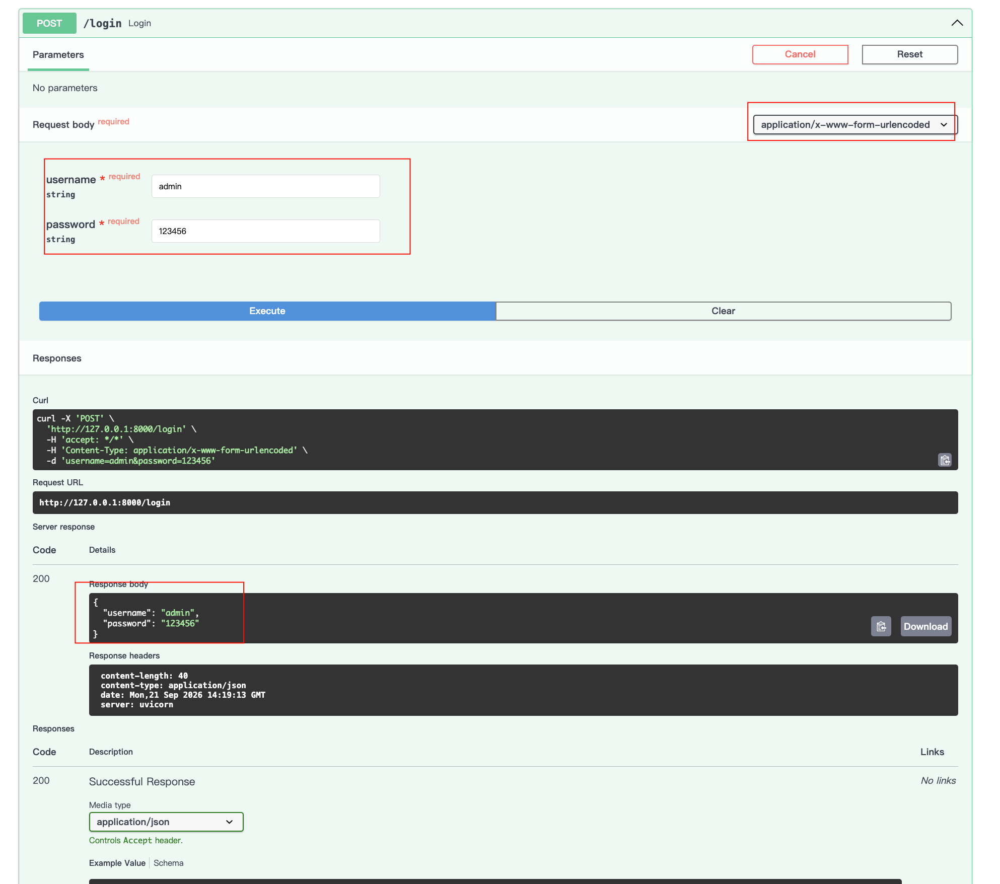
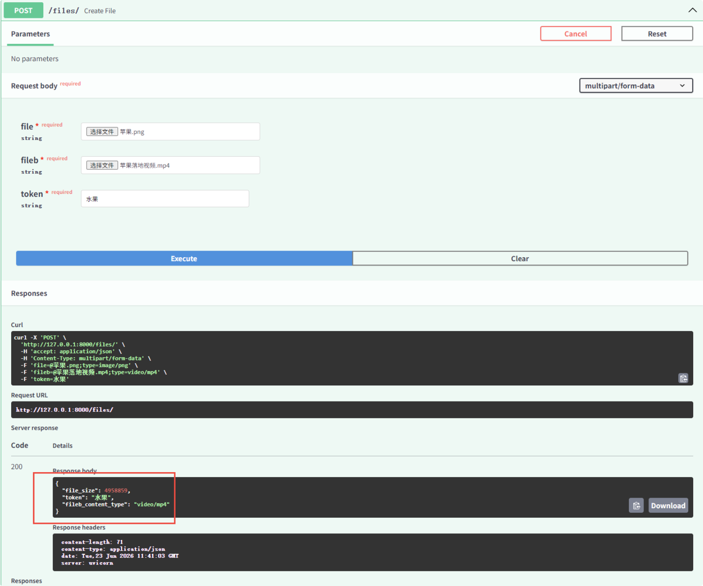

# form表单与文件上传

## 表单数据与模型

当你需要接收表单字段而不是 JSON 时，可以使用 `Form`

使用Form之前需要先安装 `python-multipart`

`pip install python-multipart --trusted-host pypi.tuna.tsinghua.edu.cn`

示例：

```python
from typing import Annotated

from fastapi import FastAPI, Form
from pydantic import BaseModel

# 定义FastAPI实例
app = FastAPI()

# from表单
class FormData(BaseModel):
    username: str
    password: str

@app.post("/login")
async def login(data: Annotated[FormData, Form()]):
    return data
```

然后打开浏览器访问 `http://127.0.0.1:8000/docs`，进行测试，注意，这里请求信息类型已经是form表单类型了。



## 请求表单与文件

FastAPI 支持同时使用 `File` 和 `Form` 定义文件和表单字段。

文件类型有两种，分别是bytes 整个文件一次性读进内存，和UploadFile 文件流式上传，适合大文件

示例：

```python
# Form文件上传
@app.post("/files")
async def create_file(
        file: Annotated[bytes, File()], # 整个文件一次性读进内存
        fileb: Annotated[UploadFile, File()], # 文件流式上传，适合大文件
        token: Annotated[str, Form()]
):
    return {
        "file_size": len(file), # 获取文件大小
        "fileb_content_type": fileb.content_type, # 获取文件类型
        "token": token # 获取表单普通参数
    }
```

然后打开浏览器访问 `http://127.0.0.1:8000/docs`，进行测试


