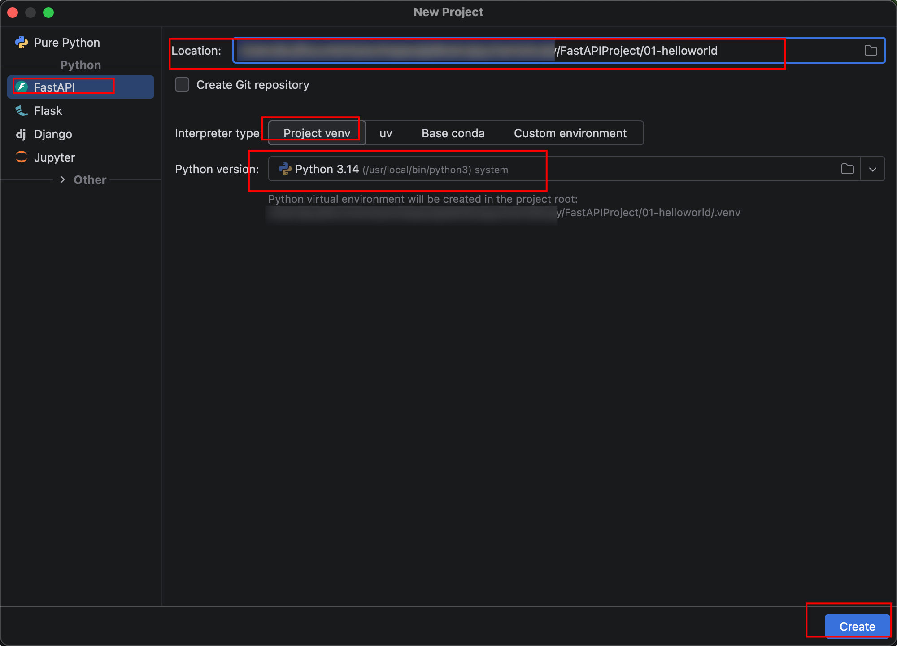
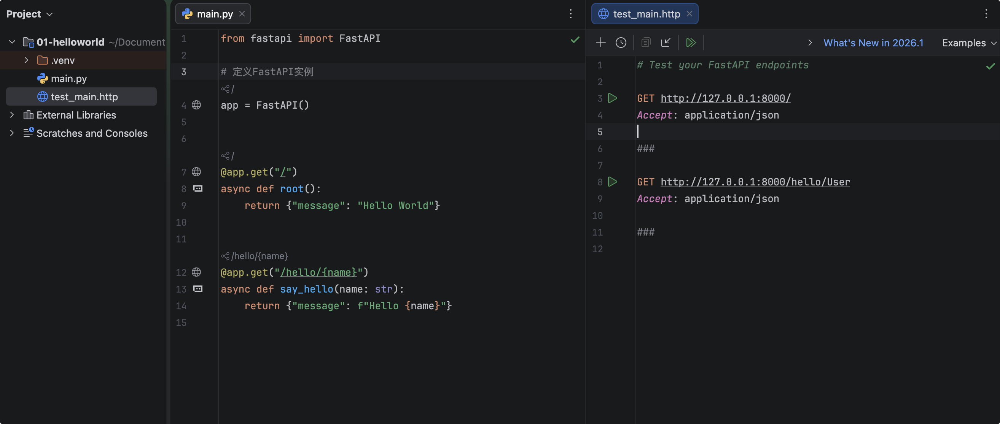
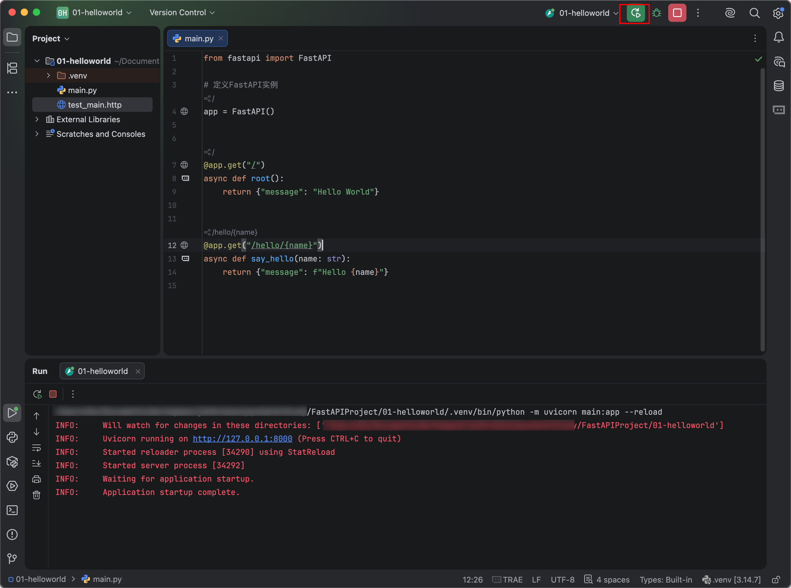
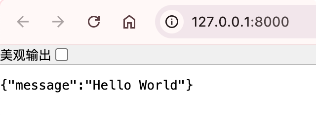

# 编写HelloWorld项目

## 创建项目

然后打开PyCharm，点New Project，左侧选FastAPI，选择目录，以及选虚拟环境，Python版本，最后点Create创建项目。



### 目录结构

左侧venv是虚拟环境，包括配置和第三方库，main.py是项目启动入口文件，test_main是项目测试文件。



## 启动项目

### 命令行启动

定位到项目目录下，执行：

`uvicorn main:app --reload`

- **uvicorn**：**Uvicorn是一个基于ASGI（异步服务器网关接口）规范的Python Web服务器**，以其“闪电般快速”的性能而闻名。它相当于Python异步Web框架（如FastAPI）的“运行引擎”，负责处理底层的网络连接、HTTP请求解析和响应发送。

- **main**：指的是`main.py`这个Python文件名（注意，不需要加`.py`后缀）。
- **app**：指的是`main.py`文件中创建的**应用实例变量**。在FastAPI中，通常是`app = FastAPI()`这行代码创建的对象。
- 如果文件名是`server.py`，实例叫`application`，这里就要改成`server:application`。
- **reload**：这是一个**开关参数**，意为“重载”。当加上它后，Uvicorn会监听项目目录下的所有Python文件变化。

```sh
FastAPIProject/01-helloworld ❯ uvicorn main:app --reload                                             
INFO:     Will watch for changes in these directories: ['FastAPIProject/01-helloworld']
INFO:     Uvicorn running on http://127.0.0.1:8000 (Press CTRL+C to quit)
INFO:     Started reloader process [32366] using StatReload
INFO:     Started server process [32371]
INFO:     Waiting for application startup.
INFO:     Application startup complete.
```

### Pycharm启动

点击右上角 绿色 三角形 启动项目，接着控制输出，启动成功。



浏览器运行 http://127.0.0.1:8000

{width=400}

### 命令解释

点击按钮运行，相当于执行了  `python -m uvicorn main:app --reload`

这个命令是**用Python模块方式启动Uvicorn服务器**，来运行一个名为`main.py`文件里的FastAPI（或任意ASGI）应用，并开启了**热重载**功能。

- `python`：这是Python解释器的可执行文件

- `-m`：这是Python的命令行选项，全称是 **“module”**（模块）。它的作用是告诉Python：“**不要执行一个脚本文件，而是去执行一个库（模块）**”。它会去Python的安装路径下寻找名为`uvicorn`的文件夹，并运行里面的`__main__.py`文件。

  - 不加`-m`，通常需要写完整路径，比如`python /uvicorn/__main__.py ...`。

  - 加了`-m`，Python会自动帮你在`sys.path`（系统路径）中搜索这个模块，用起来更简洁、更标准。

- `uvicorn`：这是要运行的**模块名称**。当Python收到`-m uvicorn`时，它会去执行Uvicorn库的入口代码，相当于启动了这个Web服务器程序。

- `main:app`：这是告诉Uvicorn**具体要去启动哪个应用**，它由两部分组成，用冒号`:`隔开：

  - **main**：指的是`main.py`这个Python文件名（注意，不需要加`.py`后缀）。

  - **app**：指的是`main.py`文件中创建的**应用实例变量**。在FastAPI中，通常是`app = FastAPI()`这行代码创建的对象。

  - 如果你的文件名是`server.py`，实例叫`application`，这里就要改成`server:application`。

- `--reload`：这是一个**开关参数**，意为“重载”。当加上它后，Uvicorn会监听项目目录下的所有Python文件变化。

  - **作用**：当你修改了`main.py`或其他导入的代码并保存文件时，Uvicorn会自动检测到变动，并优雅地关闭旧进程、启动新进程。

  - **适用场景**：**仅在开发调试阶段使用**，能极大提升开发效率，省去手动重启服务器的麻烦。

  - **警告**：**在生产环境（线上服务器）绝对不要加这个参数**，因为文件监听会消耗大量服务器资源，且自动重启可能导致服务中断或状态丢失。


