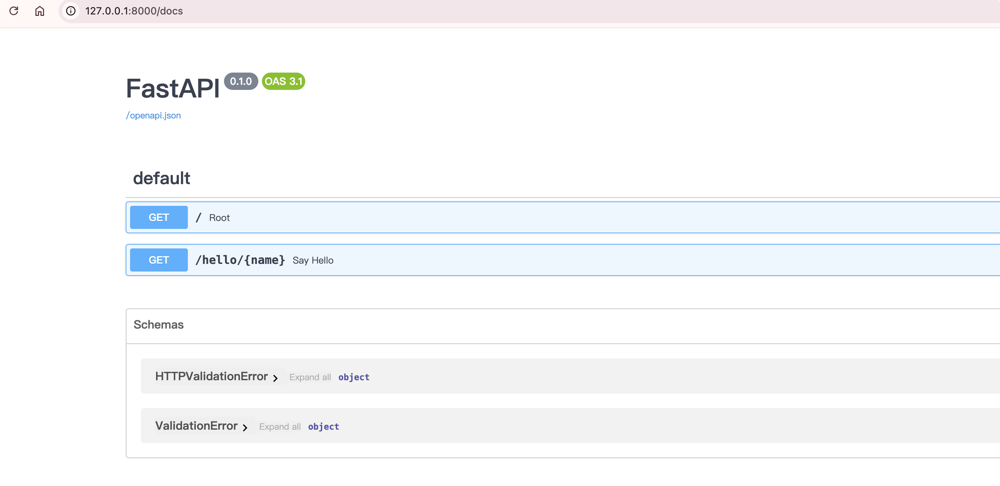
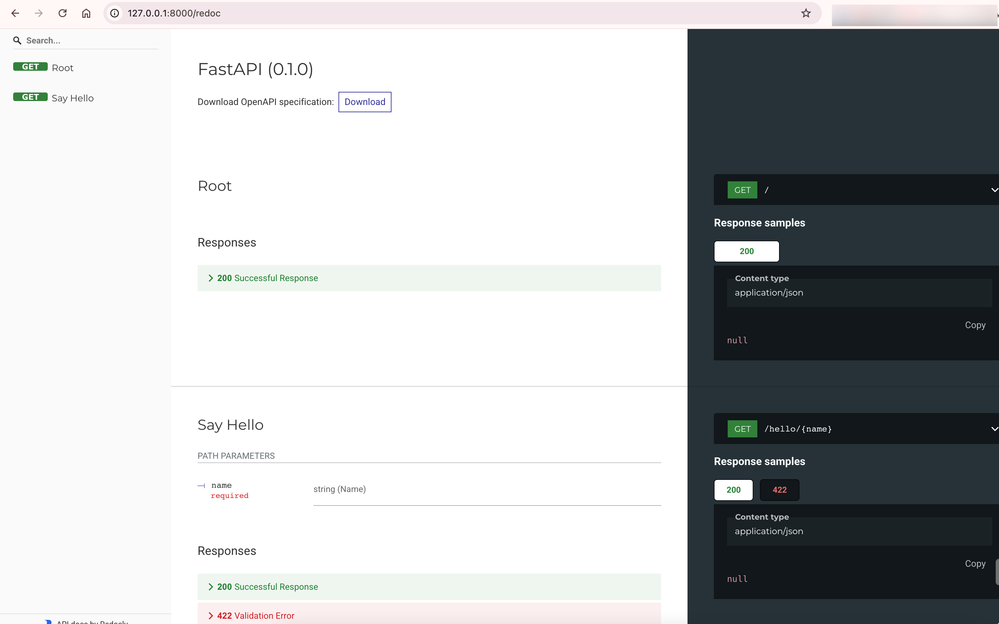

# 自动生成交互式API文档

FastAPI 最引人注目的特性之一，就是它能**根据你的代码自动生成交互式 API 文档**。这意味着你不再需要手动维护一份可能随时过时的独立文档，因为代码本身就是文档的唯一真实来源。

## 它是如何工作的

这一强大功能的核心在于 FastAPI 遵循的 **OpenAPI** 标准。

1. **生成 OpenAPI 模式**：当你使用 Python 的类型提示（Type Hints）定义 API 的路径、参数和请求体时，FastAPI 会在后台自动提取这些信息，并生成一个符合 OpenAPI 规范的 JSON 或 YAML 文件。这个文件是一份关于你 API 所有端点的结构化蓝图。
2. **渲染成交互式界面**：基于这份 OpenAPI 蓝图，FastAPI 内置了两种广受欢迎的用户界面来将其渲染成交互式文档。你可以直接在你的应用地址后加上特定路径来访问它们。

## 两大核心文档界面

FastAPI 默认提供了两种交互式 API 文档界面，你可以根据需要选择。

**Swagger UI (/docs)**
这是最常用的一种。它提供了一个可视化的、可交互的界面，清晰地列出了所有 API 端点、请求方法、参数和响应模型。
其最大的亮点是支持 **“Try it out”** 功能，你可以直接在浏览器中填写参数并点击执行，向你的 API 发送真实请求并查看返回结果。这对于开发和调试 API 极其方便。

**ReDoc (/redoc)**
这是一个备选的 API 文档方案。它的界面风格与 Swagger UI 不同，更侧重于提供一份结构清晰、易于阅读的文档，非常适合用来作为 API 的参考手册。它同样基于你代码生成的 OpenAPI 模式，因此也是实时更新的。

## 如何访问

启动 FastAPI 应用后，在浏览器中访问以下地址即可：

- **Swagger UI**: `http://你的地址/docs`
- **ReDoc**: `http://你的地址/redoc`

进入Swagger UI

进入Redoc

## 核心优势

- **零成本维护**：API 文档与代码同步更新，永远保持最新。
- **提升协作效率**：清晰、准确的文档极大方便了前后端协作和团队沟通。
- **简化测试流程**：交互式界面让开发者可以快速进行自测和联调，无需借助 Postman 等第三方工具。
- **基于开放标准**：基于 OpenAPI 和 JSON Schema 标准，生成的文档还可以用来为多种编程语言自动生成客户端 SDK。
