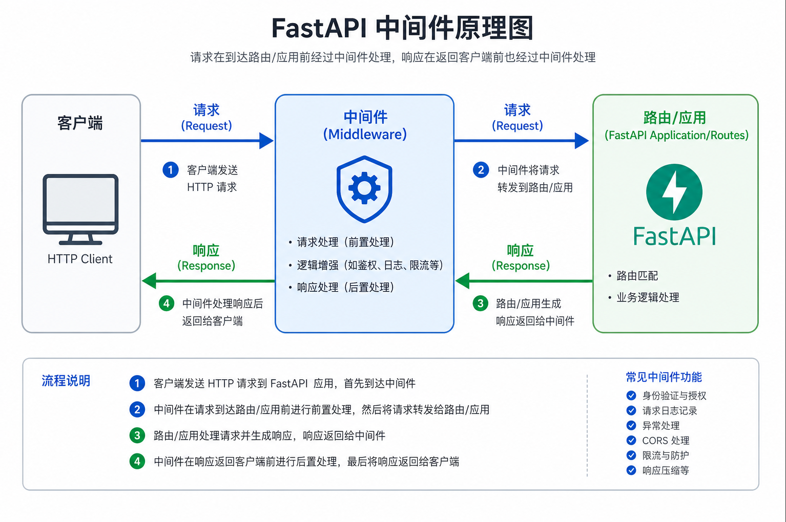
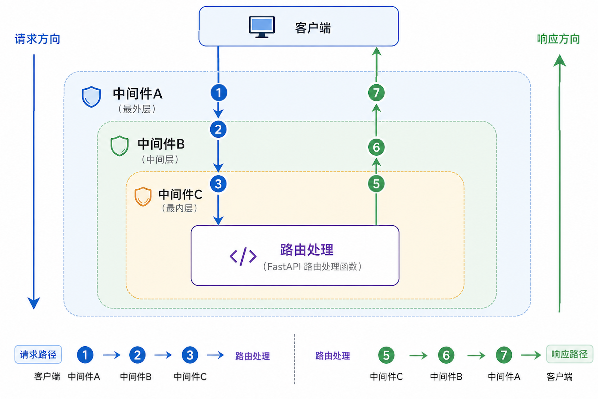

# 中间件

## 定义

**中间件（Middleware）** 是在 HTTP 请求到达路由处理函数**之前**，以及响应返回客户端**之前**，插入的一层可编程逻辑。

你可以把它理解为请求/响应管道中的「拦截器」：

- **请求阶段**：从外到内依次执行，可对请求做校验、日志、鉴权等
- **响应阶段**：从内到外依次返回，可对响应做压缩、加 Header、统一格式化等

FastAPI 基于 **Starlette** 实现，中间件机制与 Starlette 完全一致。

## 工作原理



### 核心流程

```
客户端
  │  HTTP Request
  ▼
┌─────────────────┐
│   Middleware    │  ← 请求进入：预处理（日志、鉴权、计时…）
└────────┬────────┘
         ▼
┌─────────────────┐
│  FastAPI 路由   │  ← 执行业务逻辑（path operation）
└────────┬────────┘
         │  HTTP Response
         ▼
┌─────────────────┐
│   Middleware    │  ← 响应返回：后处理（加 Header、压缩…）
└────────┬────────┘
         ▼
       客户端
```

### 关键概念

| 概念        | 说明                                                     |
| ----------- | -------------------------------------------------------- |
| `call_next` | 调用下一个中间件或最终路由，必须 `await`                 |
| 洋葱模型    | 多个中间件像洋葱一样层层包裹，请求由外向内，响应由内向外 |
| ASGI        | FastAPI 是 ASGI 应用，中间件需支持异步                   |

## 多个中间件的执行顺序



### 注册顺序与执行顺序

**重要规则：后注册（`add_middleware` 后调用）的中间件，在请求阶段最先执行。**

假设注册顺序为：

```python
app.add_middleware(MiddlewareA)  # 第 1 个注册
app.add_middleware(MiddlewareB)  # 第 2 个注册
app.add_middleware(MiddlewareC)  # 第 3 个注册（最后注册）
```

实际执行顺序：

| 阶段         | 执行顺序         |
| ------------ | ---------------- |
| **请求进入** | C → B → A → 路由 |
| **响应返回** | 路由 → A → B → C |

### 洋葱模型示意

```
        ┌──────────────────────────────┐
        │         Middleware C         │  ← 最后注册，请求最先经过
        │  ┌────────────────────────┐│
        │  │      Middleware B      ││
        │  │  ┌──────────────────┐  ││
        │  │  │   Middleware A   │  ││
        │  │  │  ┌────────────┐  │  ││
        │  │  │  │  路由处理   │  │  ││  ← 核心逻辑
        │  │  │  └────────────┘  │  ││
        │  │  └──────────────────┘  ││
        │  └────────────────────────┘│
        └──────────────────────────────┘

请求：C → B → A → 路由
响应：路由 → A → B → C
```

## 基础使用

语法：使用 `@app.middleware("http")`注解即可实现中间件。

### 单中间件

**所有请求处理方法都共享中间件**

```python
from fastapi import FastAPI

# 定义FastAPI实例
app = FastAPI()

@app.middleware("http")
async def my_middleware1(request, call_next):
    print("中间件1 -> 执行前")
    response = await call_next(request)
    print("中间件1 -> 执行后")
    return response

@app.get("/")
async def root():
    print("Hello middleware")
    return {"message": "Hello middleware"}
```

浏览器请求 `http://127.0.0.1:8000`和`http://127.0.0.1:8000/hello_middleware`

控制台输出：

```
中间件1 -> 执行前
Hello middleware
中间件1 -> 执行后
INFO:     127.0.0.1:51018 - "GET / HTTP/1.1" 200 OK
中间件1 -> 执行前
你好， middleware
中间件1 -> 执行后
INFO:     127.0.0.1:51969 - "GET /hello_middleware HTTP/1.1" 200 OK
```

### 多中间件

**后注册(代码靠后)中间件的是先执行。**

```python
from fastapi import FastAPI

# 定义FastAPI实例
app = FastAPI()

@app.middleware("http")
async def my_middleware1(request, call_next):
    print("中间件1 -> 执行前")
    response = await call_next(request)
    print("中间件1 -> 执行后")
    return response

@app.middleware("http")
async def my_middleware2(request, call_next):
    print("中间件2 -> 执行前")
    response = await call_next(request)
    print("中间件2 -> 执行后")
    return response
@app.get("/")
async def root():
    print("Hello middleware")
    return {"message": "Hello middleware"}

@app.get("/hello_middleware")
async def hello_middleware():
    print("你好， middleware")
    return {"message": "你好， middleware !"}
```

浏览器请求 `http://127.0.0.1:8000/hello_middleware`

控制台输出：

```
中间件2 -> 执行前
中间件1 -> 执行前
你好， middleware
中间件1 -> 执行后
中间件2 -> 执行后
INFO:     127.0.0.1:52482 - "GET /hello_middleware HTTP/1.1" 200 OK
```

