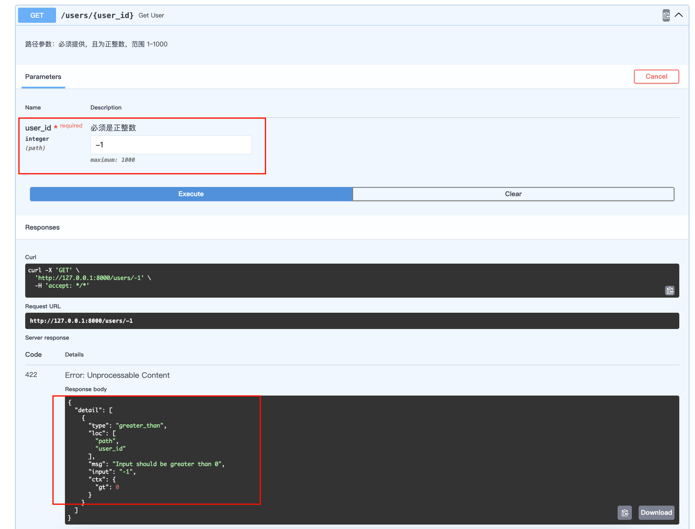
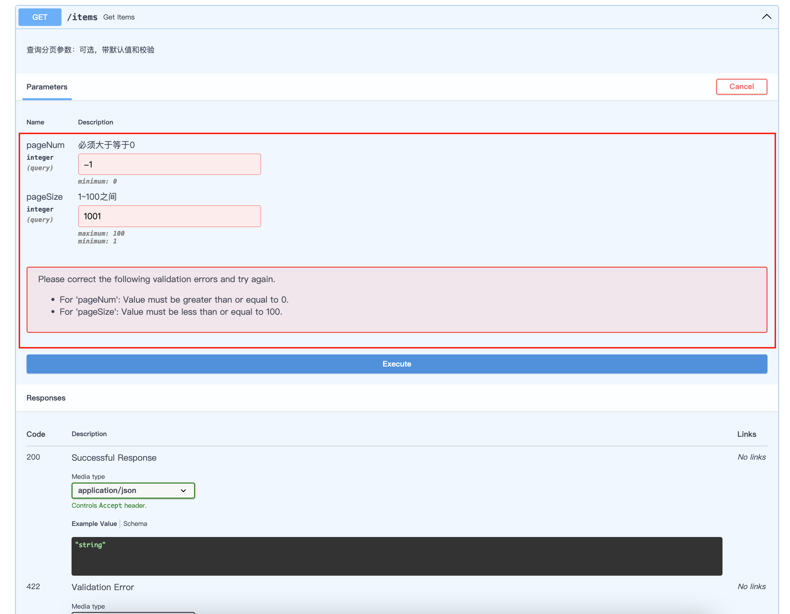
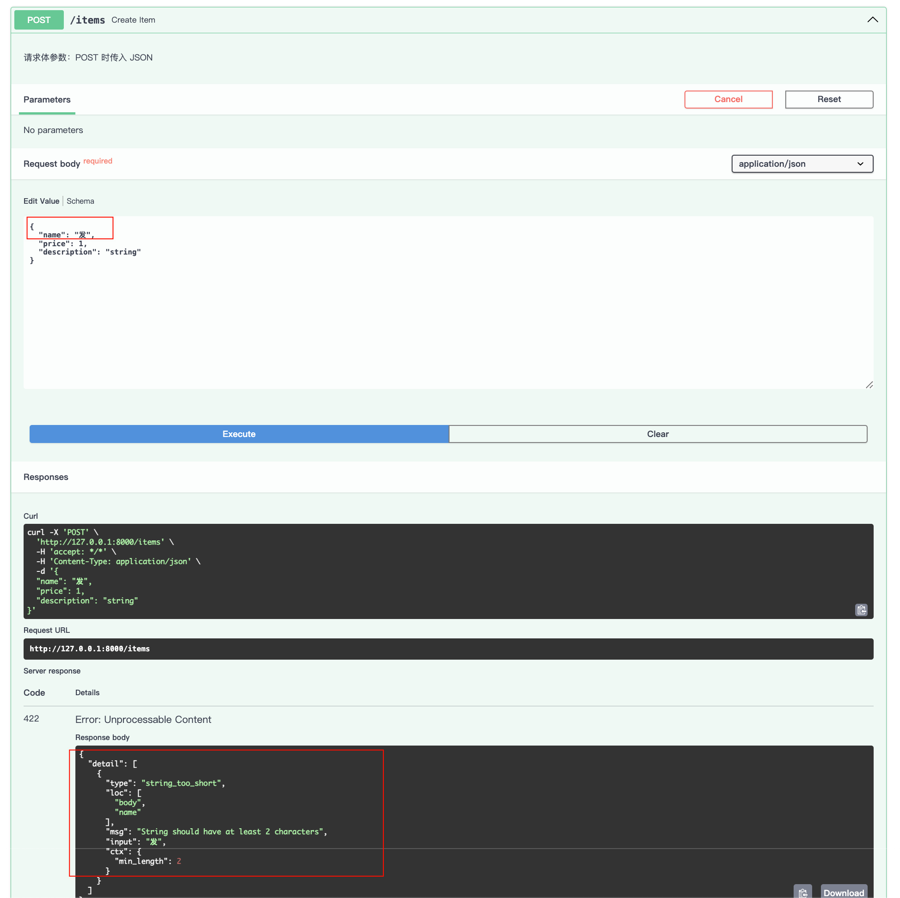

# 参数校验

**FastAPI 参数校验**，就是分别针对**路径参数**、**查询参数**和**请求体**，使用 `Path`、`Query` 和 `Field` 进行额外约束和校验。

## 常见校验参数一览

| 参数名                      | 适用对象 | 作用                           |
| :-------------------------- | :------- | :----------------------------- |
| `gt` / `ge`                 | 数字     | 大于 / 大于等于                |
| `lt` / `le`                 | 数字     | 小于 / 小于等于                |
| `min_length` / `max_length` | 字符串   | 字符串长度范围                 |
| `regex`                     | 字符串   | 正则表达式匹配                 |
| `min_items` / `max_items`   | 列表     | 列表元素个数                   |
| `...`（省略号）             | 所有     | 表示该字段必须提供（无默认值） |
| `default`                   | 所有     | 设置默认值                     |
| `title` / `description`     | 所有     | 用于生成 API 文档              |

## 路径参数-Path

**路径参数（Path Parameters）**是 URL 中必需的一部分，比如 `/users/{user_id}`。默认情况下，FastAPI 会根据类型注解进行简单类型转换（如 `int`），但我们可以借助 `Path` 增加校验规则，例如：

- 限定数值范围（`gt`、`ge`、`lt`、`le`）
- 设置描述信息（用于 OpenAPI 文档）
- 甚至使用正则表达式（`regex`）校验字符串路径参数（不过路径参数通常是数字或短字符串）

示例：
```python
from fastapi import FastAPI, Path

# 定义FastAPI实例
app = FastAPI()

@app.get("/users/{user_id}")
async def get_user(
        user_id: int = Path(..., title="用户ID", gt=0, le=1000, description="必须是正整数"),
):
    """路径参数：必须提供，且为正整数，范围 1~1000"""
    return {"user_id": user_id, "name": f"用户-{user_id}"}
```

打开浏览器访问 `http://127.0.0.1:8000/docs`，进行测试：如果输入范围不对，就会报错



## 查询参数-Query

**查询参数（Query Parameters）**是 URL 中 `?` 后面的键值对，通常是可选的，也可以设置默认值。用 `Query` 可以：

- 设置默认值（当然直接赋值也可）
- 校验最大/最小值、字符串长度
- 使用 `regex` 校验字符串格式
- 设置 `deprecated` 等

示例：

```python
from fastapi import FastAPI, Path, Query

# 定义FastAPI实例
app = FastAPI()

@app.get("/items")
async def get_items(
    pageNum: int = Query(0, title="页码", ge=0, description="必须大于等于0"),
    pageSize: int = Query(10, title="每页条数", ge=1, le=100, description="1~100之间")
):
    """查询分页参数：可选，带默认值和校验"""
    return {"pageNum": pageNum, "pageSize": pageSize, "items": ["item1", "item2", "item3"]}
```

打开浏览器访问 `http://127.0.0.1:8000/docs`，进行测试：如果输入范围不对，就会报错



## 请求体-Field

**请求体（Request Body）**通常使用 Pydantic 的 `BaseModel` 定义结构，并在字段上使用 `Field` 添加校验：

- 必填/可选（通过默认值控制）
- 字符串长度（`min_length`、`max_length`）
- 数值范围（`gt`、`ge`、`lt`、`le`）
- 正则匹配（`regex`）
- 描述信息等

示例：

```python
from fastapi import FastAPI
from pydantic import BaseModel, Field

# 定义FastAPI实例
app = FastAPI()

class ItemCreate(BaseModel):
    name: str = Field(..., title="物品名称", min_length=2, max_length=50, description="2~50个字符")
    price: float= Field(..., title="价格", gt=0, le=9999.99, description="必须大于0，最多9999.99")
    # 增加可选字段
    description: str = Field(None, max_length=200, description="可选描述，最长200字符")

@app.post("/items")
async def create_item(item: ItemCreate):
    """请求体参数：POST 时传入 JSON"""
    return {"message": "Item created", "item": item}
```

打开浏览器访问 `http://127.0.0.1:8000/docs`，进行测试：如果输入字符个数范围不对，就会报错


