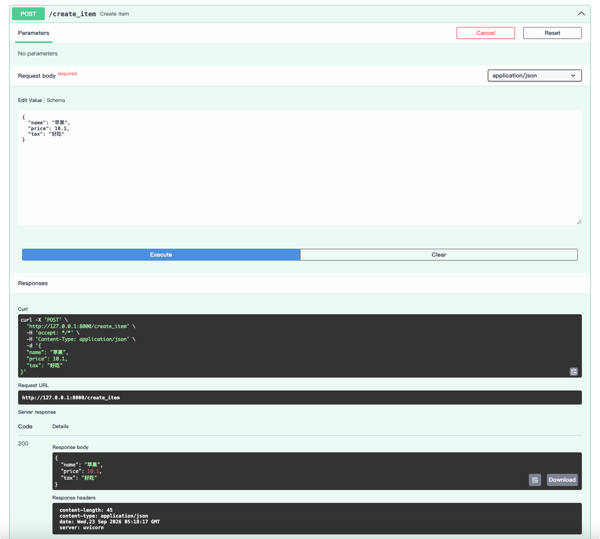
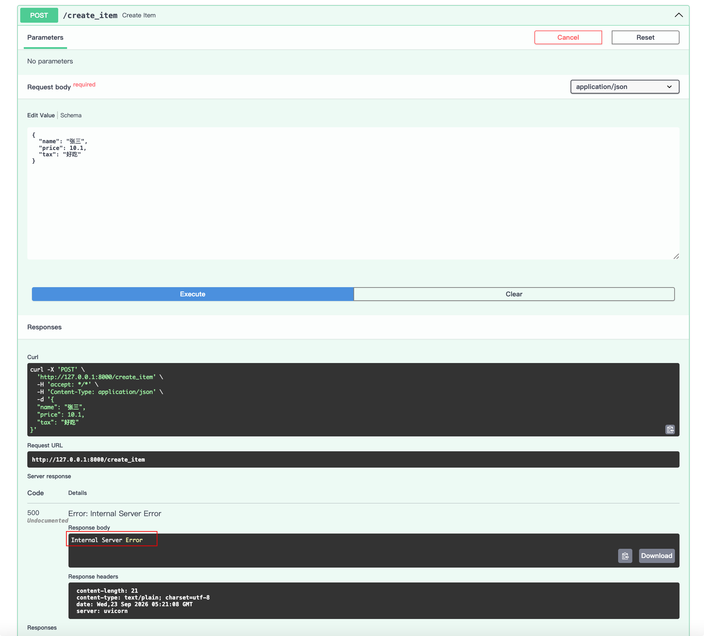
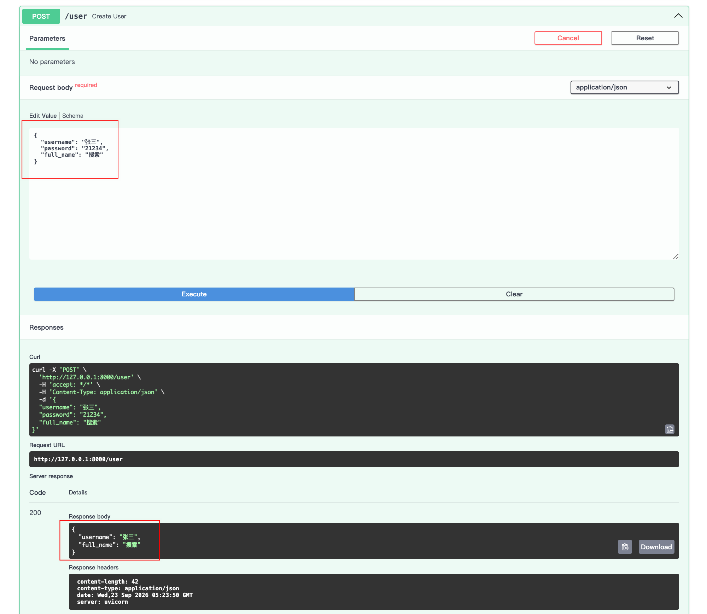

# 响应模型

## 定义

在 FastAPI 中，**响应模型**指的是你声明的、用于**规定 API 接口返回数据应遵循的格式和结构**的 Pydantic 模型。你可以通过在路径操作函数的**返回类型注解**或**装饰器的 response_model 参数**来声明它。

## 优点

- **数据校验与安全保障**：FastAPI 会自动校验返回的数据是否符合模型定义。如果数据无效（例如缺少必填字段），FastAPI 会返回服务器错误，而不是将错误数据返回给客户端。更重要的是，它会**将输出数据限制并过滤为模型中所定义的内容**，这可以避免意外返回敏感信息（如密码），对安全性至关重要。
- **自动生成 API 文档**：响应模型会为你的 API 生成清晰的 JSON Schema，并自动在 Swagger UI (`/docs`) 等交互式文档中展示，方便前端或第三方开发者查看。
- **数据序列化与过滤**：FastAPI 会使用 Pydantic 将你的返回数据（可以是字典、数据库对象等）自动**序列化**为符合模型的 JSON 格式。同时，你可以利用模型的 `exclude`、`include` 等参数精细控制哪些字段出现在最终的响应中。

## 基本使用

### 字段缺少

示例：

```python
from fastapi import FastAPI
from pydantic import BaseModel

# 定义FastAPI实例
app = FastAPI()

class Item(BaseModel):
    name: str
    price: float
    # 可选字段，默认值为 None
    tax: str | None = None

# 在装饰器中通过 response_model 指定
@app.post("/create_item", response_model=Item)
async def create_item(item: Item):
    # 假设这里进行了数据库操作，然后返回了一个字典
    # FastAPI 会使用 Item 模型来校验和过滤这个字典
    return {"name": item.name, "price": item.price, "tax": item.tax}
```

打开浏览器访问 `http://127.0.0.1:8000/docs`，进行测试



如果我们把return里的price属性去掉，就会报错

```python {18}
from fastapi import FastAPI
from pydantic import BaseModel

# 定义FastAPI实例
app = FastAPI()

class Item(BaseModel):
    name: str
    price: float
    # 可选字段，默认值为 None
    tax: str | None = None

# 在装饰器中通过 response_model 指定
@app.post("/create_item", response_model=Item)
async def create_item(item: Item):
    # 假设这里进行了数据库操作，然后返回了一个字典
    # FastAPI 会使用 Item 模型来校验和过滤这个字典
    return {"name": item.name, "tax": item.tax}
```

打开浏览器访问 `http://127.0.0.1:8000/docs`，进行测试



### 字段过滤

示例：用户返回信息不带密码，重新定义一个新的用户类UserOut作为返回类型。

```python
from fastapi import FastAPI
from pydantic import BaseModel

# 定义FastAPI实例
app = FastAPI()

class UserIn(BaseModel):
    username: str
    password: str
    full_name: str | None = None
    
class UserOut(BaseModel):
    username: str
    full_name: str | None = None

@app.post("/user", response_model=UserOut)
async def create_user(user: UserIn):
    return user
```

打开浏览器访问 `http://127.0.0.1:8000/docs`，进行测试


