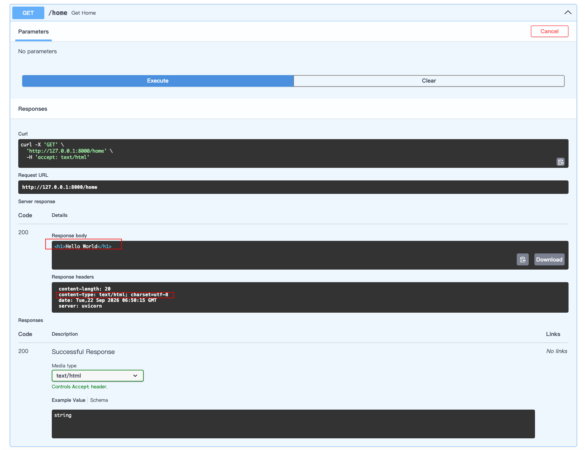
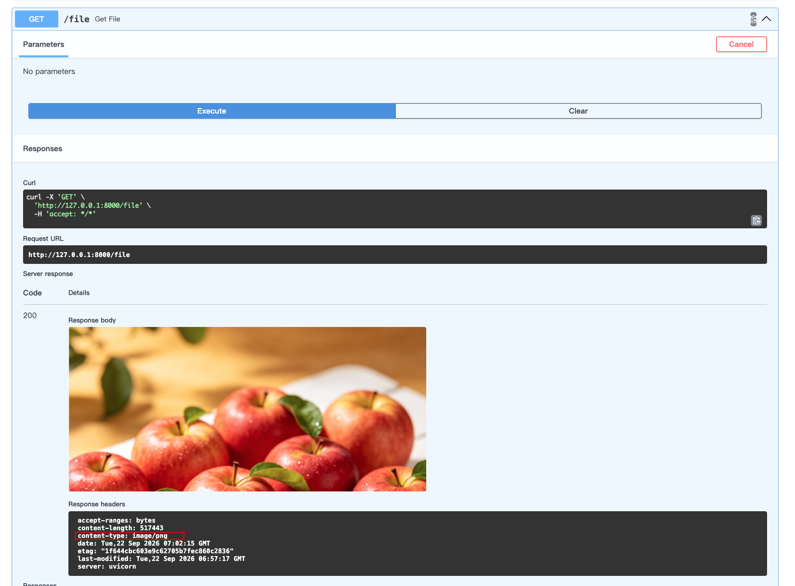
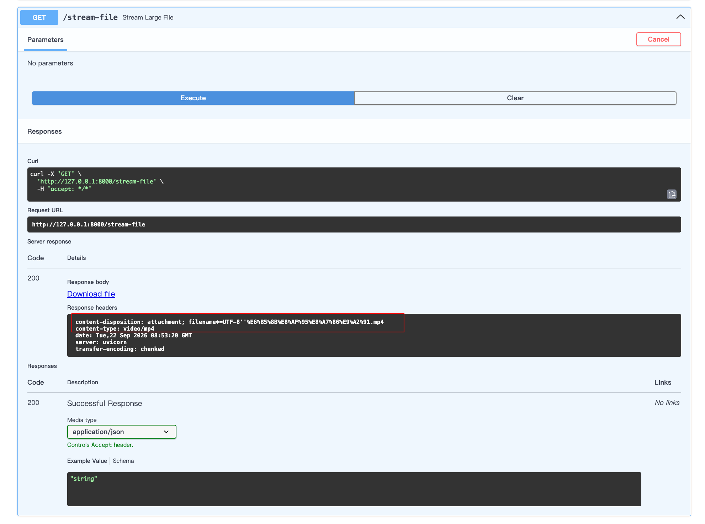

# 响应类型

在FastAPI中，除了默认的JSON响应，你可以通过`response_class`参数或直接返回特定的响应对象，来灵活地返回HTML、文件、纯文本、流媒体等各种类型的内容。

## 响应类型设置方式

在FastAPI中，主要有两种方式来指定非JSON的响应类型：

1. **通过 response_class 参数声明**：在路由装饰器（如 `@app.get()`）中使用 `response_class` 参数，可以声明该接口的响应媒体类型。这会在OpenAPI文档中自动生成相应的说明。
2. **直接返回响应对象**：在路径操作函数中，直接实例化并返回一个具体的响应对象（如 `FileResponse`、`StreamingResponse`）。这种方式更加灵活，适用于需要动态决定响应类型的场景。

## 返回HTML

示例：

```python
from fastapi import FastAPI
from starlette.responses import HTMLResponse

# 定义FastAPI实例
app = FastAPI()

@app.get("/home", response_class=HTMLResponse)
async def get_home():
    return "<h1>Hello World</h1>"

@app.get("/home2")
async def get_home():
    return HTMLResponse("<h1>Hello World</h1>")
```

然后打开浏览器访问 `http://127.0.0.1:8000/docs`，进行测试，返回的是html文件类型



## 返回File

示例：

```python
from fastapi import FastAPI, UploadFile
from starlette.responses import FileResponse

# 定义FastAPI实例
app = FastAPI()

@app.get("/file")
async def get_file():
    return FileResponse("./files/苹果.png")
```

然后打开浏览器访问 `http://127.0.0.1:8000/docs`，进行测试，返回的是image文件类型



## 返回流式文件

示例：
```python
import mimetypes
import os.path
from typing import Annotated
from urllib.parse import quote

from fastapi import FastAPI, Path, Query, Cookie, Header, Form, File, UploadFile
from starlette.responses import StreamingResponse

# 定义FastAPI实例
app = FastAPI()

@app.get("/stream-file")
async def stream_large_file():
    file_path = "./files/测试视频.mp4"
    media_type, _ = mimetypes.guess_type(file_path) # 获取文件类型

    def iterfile():
        with open(file_path, "rb") as file_like:
            # 每次读取 1MB 并 yield 出去
            while chunk := file_like.read(1024 * 1024):
                # yield 是 Python 中用来定义生成器（Generator） 的关键字。它可以让一个函数“暂停”并“记住”当前的状态，
                yield chunk

    # 对文件名进行 URL 编码
    filename = quote(os.path.basename(file_path))
    return StreamingResponse(
        iterfile(),
        media_type=media_type or "application/octet-stream",
        headers={"Content-Disposition": f"attachment; filename*=UTF-8''{filename}"},
    )
```

然后打开浏览器访问 `http://127.0.0.1:8000/docs`，进行测试，返回的是流媒体文件类型



## 请求重定向

```python
@app.get("/redirect")
async def redirect():
    return RedirectResponse(url="https://github.com")
```

请求 `http://localhost:8000/redirect`,直接跳转 `https://github.com`

## FastAPI 响应类型清单与实例

| 响应类型              | 用途                                                         | 入门实例 (代码片段)                                          |
| :-------------------- | :----------------------------------------------------------- | :----------------------------------------------------------- |
| **JSONResponse**      | **默认响应类型**，自动将字典、列表等 Python 对象转换为 JSON 格式。 | `python<br>from fastapi.responses import JSONResponse<br><br>@app.get("/json")<br>async def get_json():<br> # 直接返回字典，FastAPI 会自动使用 JSONResponse<br> return {"message": "Hello World"}<br> # 或者显式返回 JSONResponse 对象<br> # return JSONResponse(content={"message": "Hello World"})<br>` |
| **HTMLResponse**      | 返回 HTML 内容，浏览器会将其渲染为网页。                     | `python<br>from fastapi.responses import HTMLResponse<br><br>@app.get("/html", response_class=HTMLResponse)<br>async def get_html():<br> html_content = """<br> <html><body><h1>Hello, FastAPI!</h1></body></html><br> """<br> return html_content<br>` |
| **PlainTextResponse** | 返回纯文本内容。                                             | `python<br>from fastapi.responses import PlainTextResponse<br><br>@app.get("/text", response_class=PlainTextResponse)<br>async def get_text():<br> return "This is a plain text response."<br>` |
| **FileResponse**      | **返回文件**（如图片、PDF）供下载或预览。**异步读取整个文件**，适合大小适中的文件。 | `python<br>from fastapi.responses import FileResponse<br><br>@app.get("/image")<br>async def get_image():<br> # 返回图片文件，浏览器会直接显示或下载<br> return FileResponse("path/to/your/image.png")<br>`  # 也可以自定义下载文件名和MIME类型 @app.get("/download") async def download_file(): return FileResponse("path/to/file.pdf", filename="custom_name.pdf", media_type="application/pdf") |
| **StreamingResponse** | **流式传输**大文件、实时数据等。**逐块读取和发送数据**，内存占用低，适合大文件或动态生成的内容。 | `python<br>from fastapi.responses import StreamingResponse<br><br>@app.get("/large-file")<br>async def stream_large_file():<br> def iterfile(): # 定义一个生成器函数<br> with open("large_file.zip", mode="rb") as file_like:<br> yield from file_like # 逐块读取并产出数据<br> return StreamingResponse(iterfile(), media_type="application/zip")<br>` |
| **RedirectResponse**  | 将请求重定向到另一个 URL。                                   | `python<br>from fastapi.responses import RedirectResponse<br><br>@app.get("/old-page")<br>async def redirect():<br> return RedirectResponse(url="https://example.com/new-page")<br>` |
| **ORJSONResponse**    | 一个高性能的 JSON 响应类，使用 `orjson` 库进行序列化。       | `python<br>from fastapi.responses import ORJSONResponse<br><br>@app.get("/orjson", response_class=ORJSONResponse)<br>async def get_orjson():<br> return {"data": "This is serialized by orjson"}<br>` **注意**：需要先安装 `orjson` (`pip install orjson`)。 |

