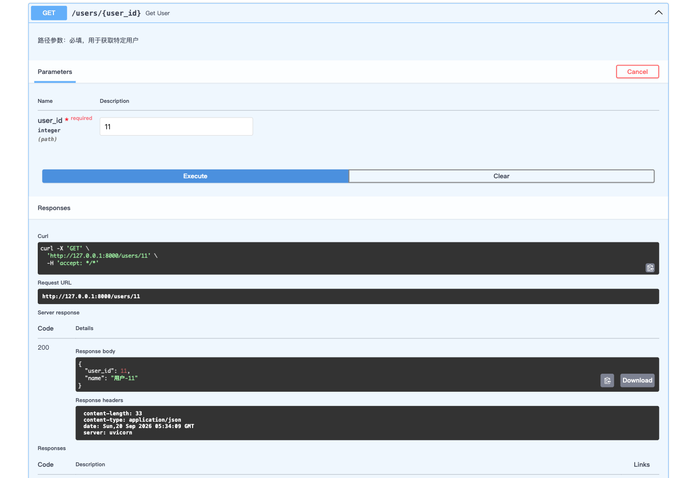
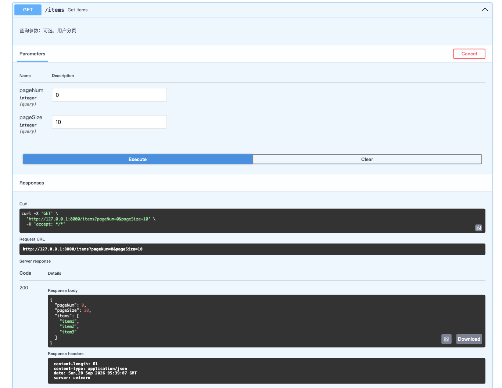
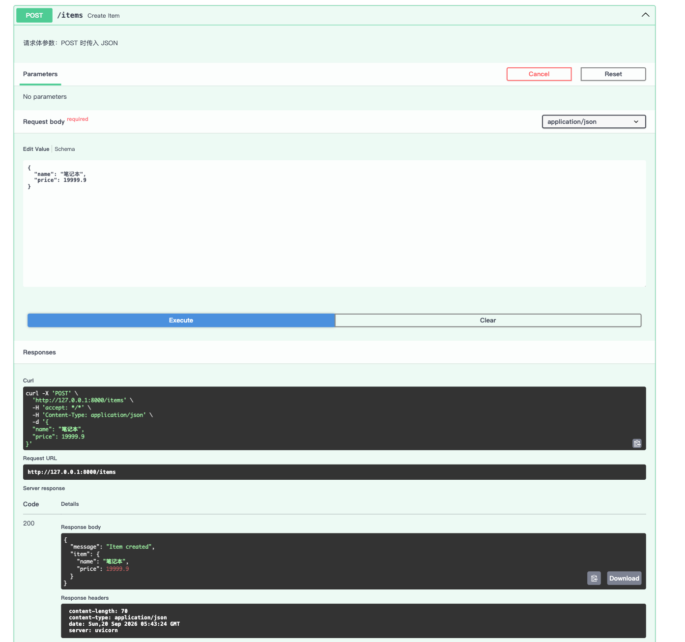

# 路由与参数

## 路由

简单来说，**路由（Routing）就是“根据请求找对应代码”的映射关系**。

在 Web 开发中，它可以拆解为三个核心要素的绑定：

1. **请求方法**（GET、POST、PUT 等）
2. **URL 路径**（如 `/users`、`/items/123`）
3. **处理函数**（执行具体业务逻辑的代码）

**路由的本质**就是定义一张“查找表”：**当客户端用“方法 A”访问“路径 B”时，服务器自动执行“函数 C”**。

## 参数

以下是 FastAPI 中**路径参数**、**查询参数**和**请求体参数**的详细对比表格，帮你从定义、位置、用途到代码写法一目了然：

| 对比维度                         | **路径参数 (Path Parameters)**                               | **查询参数 (Query Parameters)**                              | **请求体参数 (Request Body)**                                |
| :------------------------------- | :----------------------------------------------------------- | :----------------------------------------------------------- | :----------------------------------------------------------- |
| **定义（是什么）**               | URL路径中**固定占位**的动态变量，用于定位具体资源。          | URL路径 **? 之后**的键值对，用于过滤、排序或分页。           | 放在 HTTP **请求体（Body）** 中的完整数据，通常为 JSON 格式。 |
| **在 URL 中的位置**              | 属于路径的一部分，例如： `/users/`**123**                    | 属于路径末尾的查询字符串，例如： `/users?`**age=18&page=1**  | **不在 URL 中**，位于请求报文的独立数据区域（浏览器看不到）。 |
| **常用 HTTP 方法**               | 所有方法（GET、POST、PUT、DELETE）                           | 主要是 **GET** 请求（也可用于 DELETE）                       | 主要是 **POST、PUT、PATCH**（GET 强烈不推荐带 Body）         |
| **典型使用场景**                 | **指定特定资源**： 获取 ID 为 123 的用户，或修改 ID 为 5 的文章。 | **筛选和辅助**： 查询第 2 页、每页 10 条、按价格排序。       | **提交复杂数据**： 注册新用户（包含用户名、密码、邮箱等完整对象），或编辑一篇文章的全文。 |
| **数据复杂度**                   | 简单数据类型（`int`、`str`、`UUID`）                         | 简单数据类型（`int`、`str`、`bool`、`float`）                | **复杂结构**（嵌套对象、数组，通常用 Pydantic 模型定义）     |
| **是否必须传递**                 | **必须**（URL 中缺了它，路由无法匹配，直接报 404）           | **非必须**（可选），除非你显式声明为必填（`...`）            | 取决于业务逻辑，通常业务需要时必填，但框架层面默认可选。     |
| **数据安全性**                   | 较高（只暴露资源 ID）                                        | **较低**（明文显示在浏览器地址栏，易被收藏/记录，**不传敏感信息**） | **高**（数据在 Body 中，适合传输密码、身份证号等隐私内容）   |
| **在 FastAPI 中的定义方式**      | 写在路径字符串的 `{}` 中： `@app.get("/users/{user_id}")` 函数参数同名即可。 | 定义为**非路径参数**的函数参数： `def list(skip: int = 0)`   | 定义为 **Pydantic 模型** 类型： `def create(item: Item)` （其中 `Item` 继承自 `BaseModel`） |
| **能否在函数参数中省略类型注解** | 可以，但**强烈建议加上**（方便数据自动转换和校验）。         | 可以，但不加注解会被视为 `str` 类型。                        | **必须使用类型注解**（否则 FastAPI 会把它当作查询参数）。    |

### 路径参数

路径参数：**URL 路径中的可变部分，用于定位具体资源**（如 `/users/123` 中的 `123`）。

示例：

```python
from fastapi import FastAPI

# 定义FastAPI实例
app = FastAPI()

# -------- 1. 路径参数 --------
@app.get("/users/{user_id}")
async def get_user(user_id: int):
    """
    路径参数：必填，用于获取特定用户
    """
    return {"user_id": user_id, "name": f"用户_{user_id}"}
```

打开浏览器访问 `http://127.0.0.1:8000/docs`，进行测试：



### 查询参数

查询参数：URL 问号后面的键值对，用于**过滤、排序、分页**（如 `/items?start=10&limit=20`）。

示例：

```python
# -------- 2. 查询参数 --------
@app.get("/items")
async def get_items(pageNum: int = 0, pageSize: int = 10):
    """查询参数：可选，用户分页"""
    return {"pageNum": pageNum, "pageSize": pageSize, "items": ["item1", "item2", "item3"]}
```


打开浏览器访问 `http://127.0.0.1:8000/docs`，进行测试：



### 请求体参数

请求体参数：HTTP 请求体（Body）中携带的数据，通常是 JSON，用于**提交/修改复杂数据**（如注册新用户）。

示例：

```python
from pydantic import BaseModel

# -------- 3. 请求体参数 --------
class ItemCreate(BaseModel):
    name: str
    price: float
    
@app.post("/items")
async def create_item(item: ItemCreate):
    """请求体参数：POST 时传入 JSON"""
    return {"message": "Item created", "item": item}
```


打开浏览器访问 `http://127.0.0.1:8000/docs`，进行测试：


