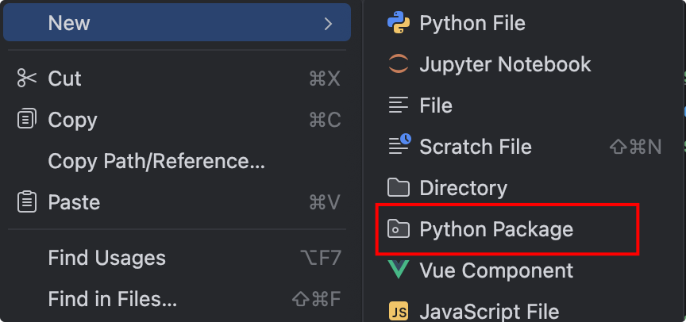
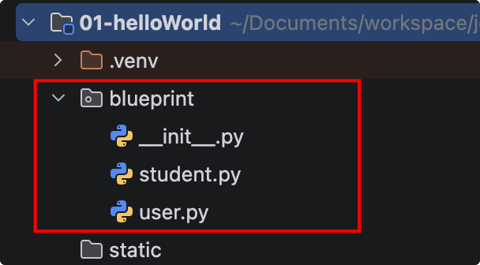
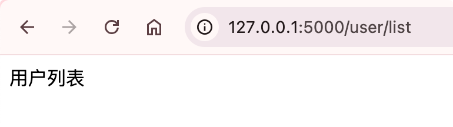

# 模块化blueprint配置

我们在项目开发的时候，多多少少会划分几个或者几十个业务模块，如果把这些模块的视图方法都写在app.py里面，那太可怕了，又冗长，有难以维护。

所以我们有必要实现模块划分，模块化开发项目。 

我们可以通过flask3提供的`blueprint(蓝图)`实现。 

## 基础使用

首先我们在项目目录下新建一个python包，取名一般是项目名称，我们这里就取名blueprint

{width=400}

然后再新建两个python文件，模拟学生模块和用户模块

{width=400}

user.py模块，创建用户蓝图对象，以及视图函数

```python
from flask import Blueprint

# 创建用户蓝图对象
user_bp = Blueprint('user', __name__, url_prefix = '/user')

@user_bp.route('/list')
def list():
    return '用户列表'
```


student.py模块，创建学生蓝图对象，以及视图函数

```python
from flask import Blueprint

# 创建学生蓝图对象
student_bp = Blueprint('student', __name__, url_prefix = '/student')

@student_bp.route('/list')
def list():
    return '学生列表'
```


最后app.py里面注册蓝图模块，这样就可以使用了。

```python
# 注册模块蓝图
app.register_blueprint(user_bp)
app.register_blueprint(student_bp)
```


{width=400}

{width=400}
