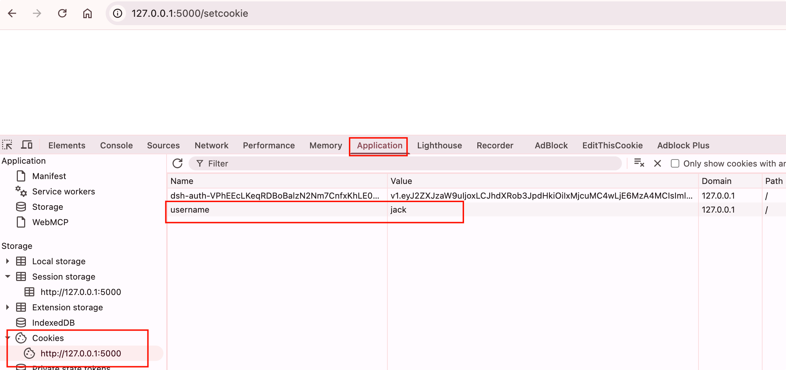
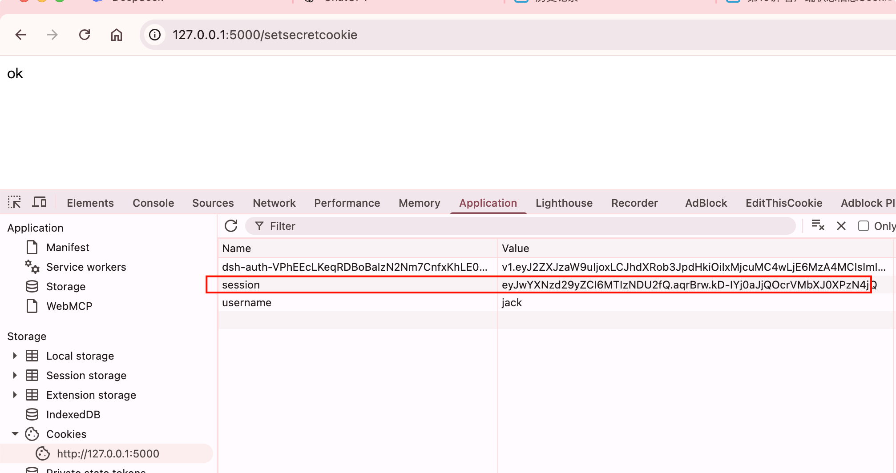

# 客户端状态信息Cookie

## cookie定义

HTTP是无状态(stateless)协议。也就是说，在一次请求响应结束后，服务器不会留下任何关于对方状 态的信息。但是对于某些Web程序来说，客户端的某些信息又必须被记住，比如用户的登录状态，这样才可以根据用户的状态来返回不同的响应。

为了解决这类问题，就有了Cookie技术。Cookie技术通过 在请求和响应报文中添加Cookie数据来保存客户端的状态信息。

Cookie其实就是保存在客户端浏览器 上的小型文本数据。

## 基本使用

我们通过响应对象response的`set_cookie()`方法来实现添加cookie。

set_cookie()方法的参数有：

| 属性     | 说明                                                         |
| -------- | ------------------------------------------------------------ |
| key      | cookie的键(名称)                                             |
| value    | cookie的值                                                   |
| max_age  | cookie被保存的时间数，单位为秒;默认在用户会话结束(即关闭浏览器)时过期 |
| expires  | 具体的过期时间，一个datetime对象或UNIX时间戳                 |
| path     | 限制cookie只在给定的路径可用，默认为整个域名                 |
| domain   | 设置cookie可用的域名                                         |
| secure   | 如果设为True，只有通过HTTPS 才可以使用                       |
| httponly | 如果设为True，禁止客户端JavaScript获取cookie                 |

### 设置未加密cookie

```python
# 设置未加密cookie
@app.route('/setcookie')
def set_cookie():
    response = make_response()
    response.set_cookie('username', 'jack')
    return response
```



### 获取未加密cookie

可以通过请求对象request的cookies属性对象的get()方法获取

```python
# 获取未加密cookie
@app.route('/getcookie')
def get_cookie():
    return request.cookies.get('username')
```

{width=400}

### 设置加密cookie

但是我们发现会发现个问题，用明文存储在客户端浏览器数据，很容易被窃取泄露数据。不安全。 所以我们有必要对数据进行加密

flask提供了会员对象session来实现cookie加密。

首先我们设置秘钥，随机串即可，越复杂越安全，然后直接用session对象存cookie

```python
# 设置加密cookie
# 设置密钥
app.secret_key = 'ssgejio332t5@jfeois'
@app.route('/setsecretcookie')
def set_secret_cookie():
    session['password'] = 123456
    return 'ok'
```



### 获取加密cookie

```python
# 获取加密cookie
# 设置密钥
app.secret_key = 'ssgejio332t5@jfeois'
@app.route('/getsecretcookie')
def get_secret_cookie():
    print('password', session['password'])
    return 'ok'

#======输出======
password 123456
```

