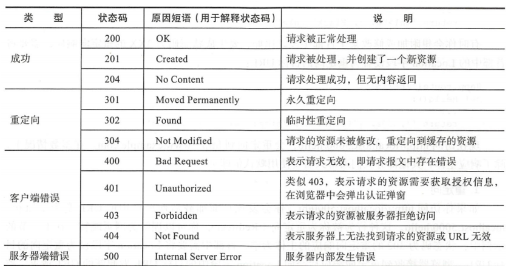
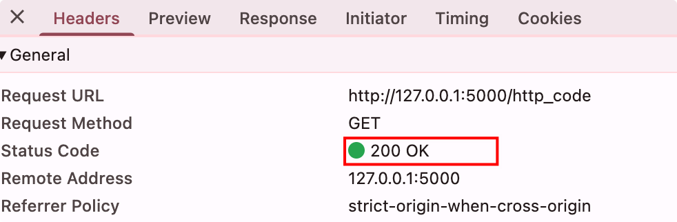
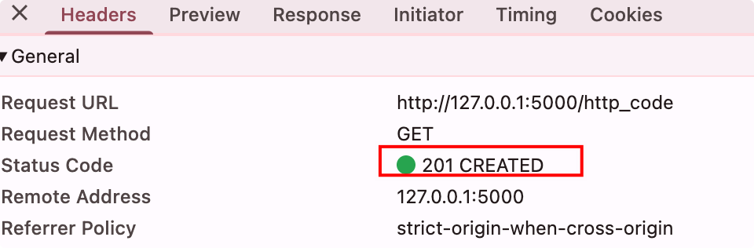

# http响应状态码

在Flask程序中，客户端发出的请求触发相应的视图函数，获取返回值会作为响应的主体，最后生成完整的响应，即响应报文。

响应报文主要由协议版本、状态码( status code)、原因短语(reason phrase)、响应首部和响应主体组成。

常见Http状态码：



示例：默认请求成功状态是 200 OK
```python
# http响应状态码
@app.route('/http_code')
def http_code():  # put application's code here
    return 'Hello World!'
```

{width=400}

如果我们要修改返回的状态值，只需要return 再加个状态参数即可;

```python
# http响应状态码
@app.route('/http_code')
def http_code():  # put application's code here
    return 'Hello World!', 201
```

{width=400}
