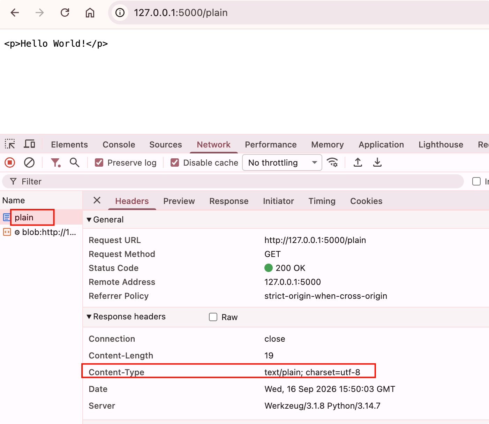
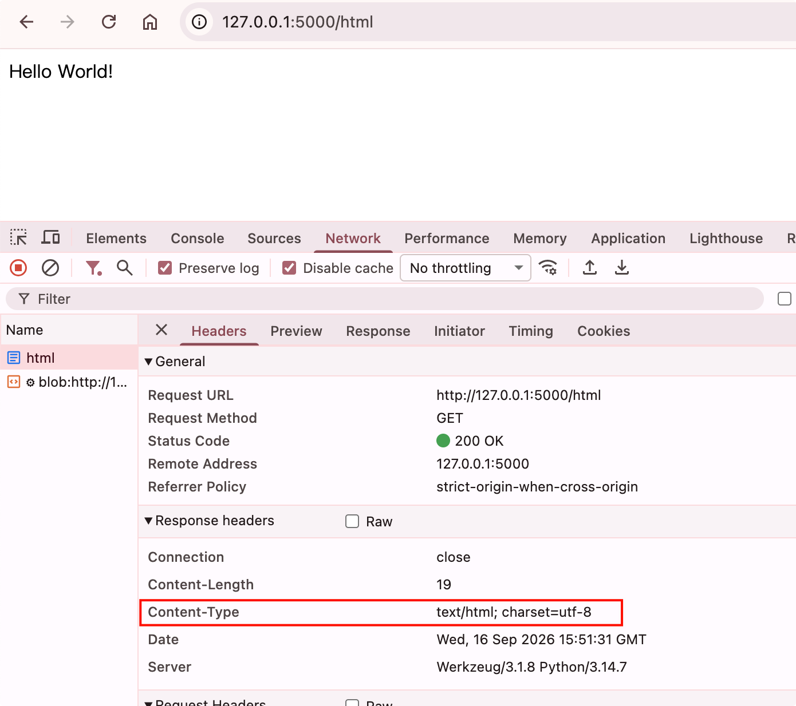
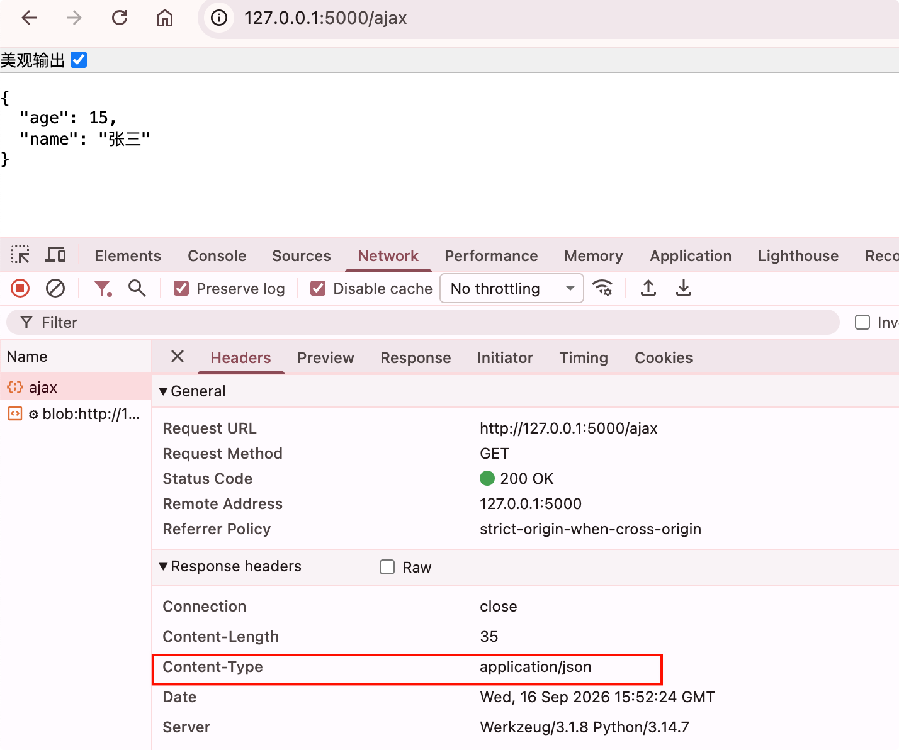
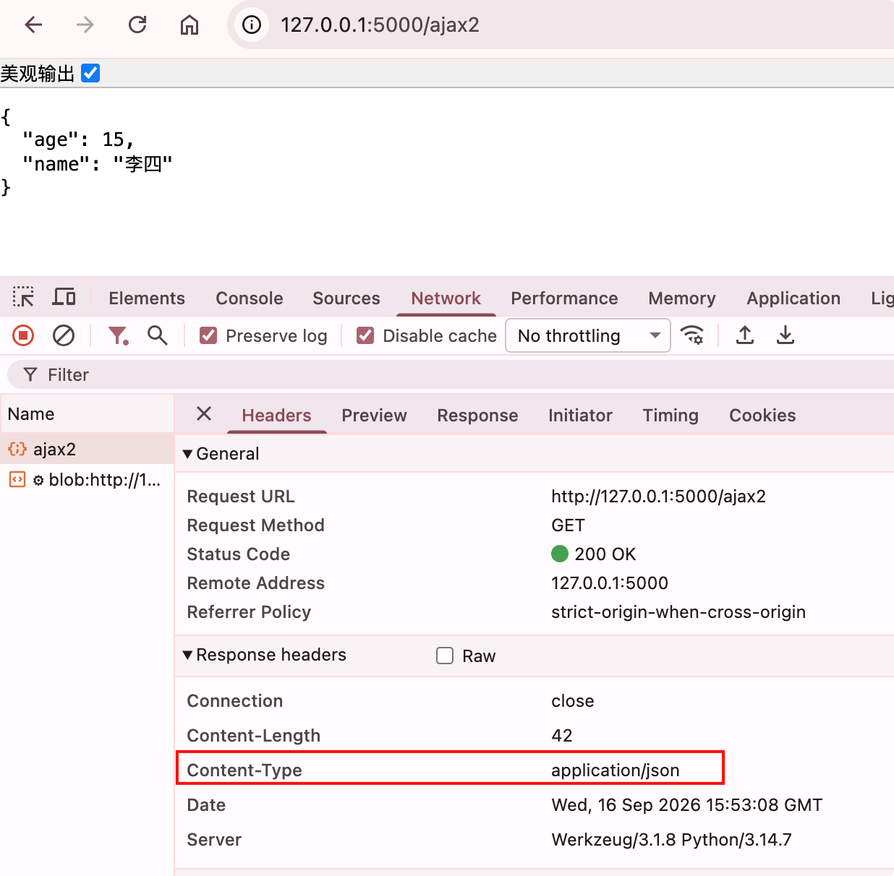

# response响应格式

在HTTP响应中，数据可以通过多种格式传输。大多数情况下，我们会**使用HTML格式，这也是Flask中 的默认设置**。在特定的情况下，我们也会使用其他格式。

不同的响应数据格式需要设置不同的MIME类型，MIME类型在首部的Content-Type字段中定义，以默认的HTML类型为例：`content-type: text/html; charset=utf-8`

常见的数据格式有纯文本，HTML，JSON格式

## 纯文本类型

```python
# response响应格式
# 纯文本类型
@app.route('/plain')
def plain():
    response = make_response('<p>Hello World!</p>')
    response.mimetype = 'text/plain'
    return response
```

{width=400}

## html类型

```python
# html类型
@app.route('/html')
def html():
    response = make_response('<p>Hello World!</p>')
    response.mimetype = 'text/html'
    return response
```

{width=400}

## json类型

示例一：
```python
# json类型
@app.route('/ajax')
def ajax():
    data = {
        'name': '张三',
        'age': 15
    }
    response = make_response(json.dumps(data))
    response.mimetype = 'application/json'
    return response
```

{width=400}

示例二：简化版

```python
# josn类型简写
@app.route('/ajax2')
def ajax2():
    return jsonify(name='李四', age=15)
```

{width=400}
