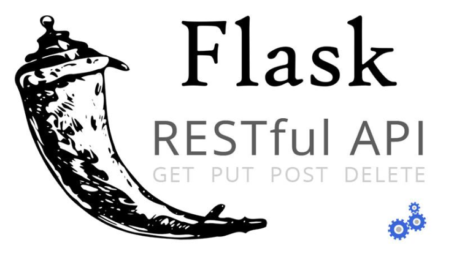
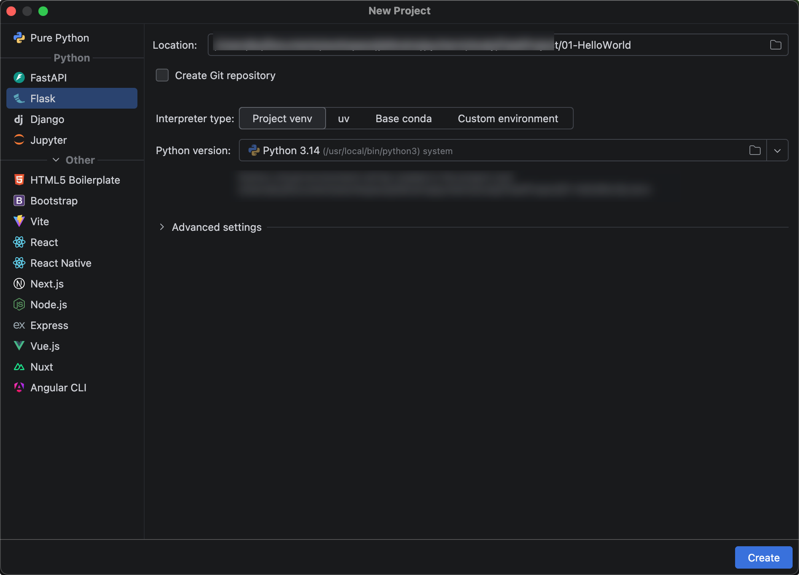
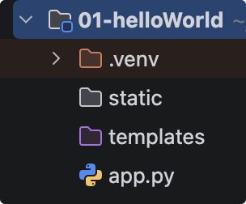
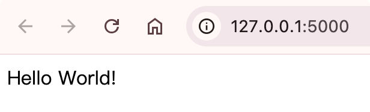
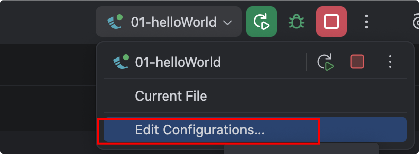
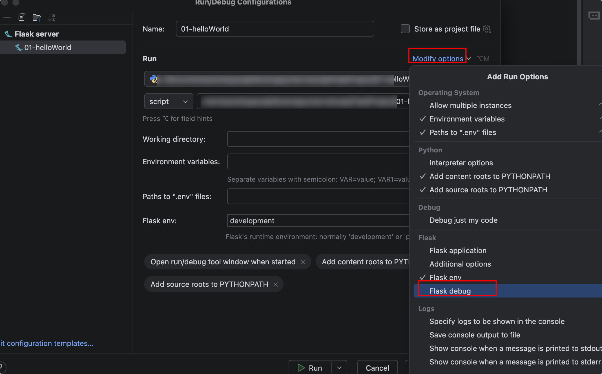

# 初识Flask3

## 简介

Flask是一个轻量级的可定制框架，使用Python语言编写，较其他同类型框架更为灵活、轻便、安全且容易上手。它可以很好地结合MVC模式进行开发，开发人员分工合作，小型团队在短时间内就可以完成功能丰富的中小型网站或Web服务的实现。另外，Flask还有很强的定制性，用户可以根据自己的需求来添加相应的功能，在保持核心功能简单的同时实现功能的丰富与扩展，其强大的插件库可以让用户实现个性化的网站定制，开发出功能强大的网站。目前最新版本3.1.3

Flask 的官方网站地址是:https://flask.palletsprojects.com

{width=400}

## 编写HelloWorld项目

打开Pycharm，点击新建项目，选Flask，先确定项目路径，Python版本用3.14，然后这里我们可以选择虚拟环境。



创建项目完成后，有几个目录出现

- static是静态文件目录
- templates是模板文件
- app.py是项目启动入口主模块

{width=400}

app.py文件：

```python
# 从flask包中导入Flask类
from flask import Flask

# 使用Flask类创建app对象
app = Flask(__name__)

# __name__：模块或者包名称，这里是app.py模块名字
print("__name__", __name__)

# 注册路由，路由绑定视图函数
@app.route('/')
def hello_world():  # put application's code here
    return 'Hello World!'


if __name__ == '__main__':
    app.run()

```

浏览器地址栏输入:http://127.0.0.1:5000

{width=400}

## debug模式开启

默认情况，项目开发是普通模式，也就是你修改了代码，必须重启项目，新代码才生效，这种模式开发效率比较低，我们可以开启debug模块，只要你修改了代码，保存文件，则自动重启项目，直接看到修改后的运行效果。大大提高我们的开发效率。

右上角，点击编辑配置

{width=400}

FLASK_DEBUG，勾选下即可。

