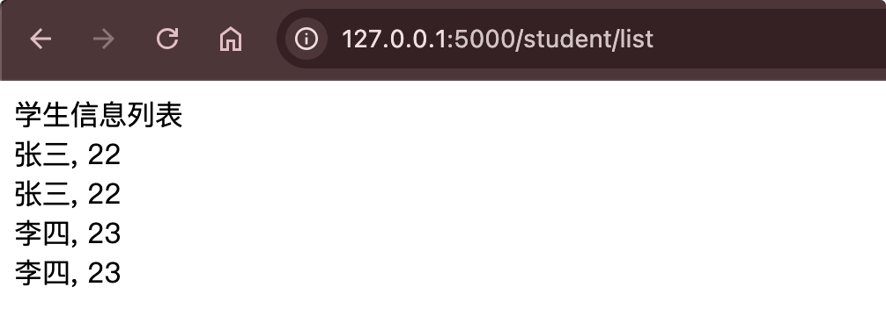

# 模板访问对象

如果渲染模板传的是对象，如果如何来访问呢? 

语法：

```html
{{ 对象.属性名 }}或者{{ 对象[属性] }}
```

示例：

```python
class Student:

    def __init__(self, name, age):
        self.name = name
        self.age = age
   
@student_bp.route('/list')
def list():
    title = '学生信息列表'
    student = Student(name = '张三', age = 22)
    lisi = {
        'name': '李四',
        'age': 23,
    }
    return render_template('student.html', title = title, student = student, lisi = lisi)
```

```html
<!DOCTYPE html>
<html lang="en">
<head>
    <meta charset="UTF-8">
    <title>学生信息</title>
</head>
<body>
{{ title }} <br/>
{{ student.name }}, {{ student.age }} <br/>
{{ student['name'] }}, {{ student['age'] }} <br/>
{{ lisi.name }}, {{ lisi.age }} <br/>
{{ lisi['name'] }}, {{ lisi['age'] }}
</body>
</html>
```

{width=400}