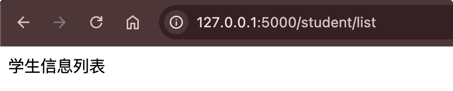

# 模板基本使用

## 引入

我们平时开发web系统，必须用到网页，单纯的静态网页无法满足我们的需求。我们可以使用模版引擎技术，数据+模板=网页。

`Jinja2`是Python下被广泛应用的模版引擎，他的设计思想来源于Django的模板引擎，并扩展了其语法和一系列强大的功能。其中最显著的一个是增加了沙箱执行功能和可选的自动转义功能，这对大多应 用的安全性来说是非常重要的。

## 使用

渲染一个模板，就是执行模板中的代码，并传入所有在模板中使用的变量，渲染后的结果就是我们要返回给客户端的HTML 响应。

在视图函数中渲染模板时，我们并不直接使用Jinja2提供的函数，而是使用 Flask提供的渲染函数`render_template()`。用` {{ }}` 表达式可以调用字符串、变量、函数等。

示例：

在templates下新建模版student.html

```html
<!DOCTYPE html>
<html lang="en">
<head>
    <meta charset="UTF-8">
    <title>学生信息</title>
</head>
<body>
{{ title }}
</body>
</html>
```

在student.py编辑视图函数：

```python
@student_bp.route('/list')
def list():
    title = '学生信息列表'
    return render_template('student.html', title = title)
```

{width=400}