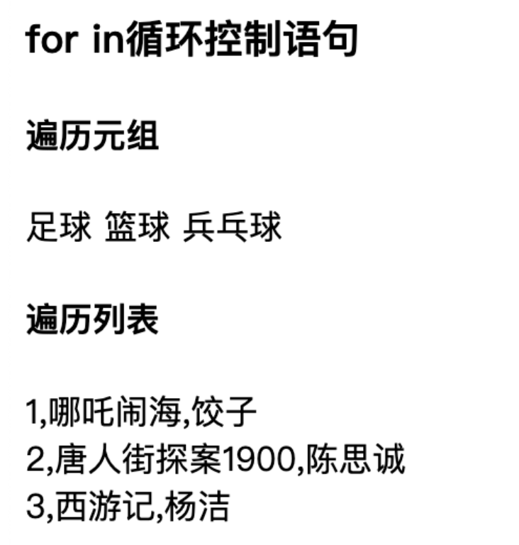

# 模板条件和循环控制语句

## if条件语句

::: code-group

```python [student.py]
@student_bp.route('/list')
def list():
    lisi = {
        'name': '李四',
        'age': 23,
    }
    return render_template(
        'student.html',
        lisi=lisi)
```


```python [student.html]
<h3>if条件语句</h3>

    婴幼儿

    青少年

    成年人

```

:::

{width=400}

## for循环语句

for函数模板内置变量有：

| Variable           | Description                                  |
| ------------------ | -------------------------------------------- |
| loop.index         | 循环的当前迭代(索引从1开始)                  |
| loop.index0        | 循环的当前迭代(索引从0开始)                  |
| loop.revindex      | 循环结束时的迭代次数(索引从1开始)            |
| loop.revindex0     | 循环结束时的迭代次数(索引从0开始)            |
| loop.first         | 如果是第一次迭代，就为True                   |
| loop.last          | 如果是最后一次迭代，就为True                 |
| loop.length        | 序列中的项目数，即循环总次                   |
| loop.cycle         | 辅助函数,用于在序列列表之间循环              |
| loop.depth         | 当前递归循环的深度，从1级开始                |
| loop.depth0        | 当前递归循环的深度，从0级开始                |
| loop.previtem      | 上一次迭代中的对象                           |
| loop.nextitem      | 下一次迭代中的对象                           |
| loop.changed(*val) | 若上次迭代的值与当前迭代的值不同，则返回True |

::: code-group

```python [student.py]
@student_bp.route('/list')
def list():
    hobbies = ('足球', '篮球', '兵乓球')
    movies = [
        {'name': '哪吒闹海', 'director': '饺子'},
        {'name': '唐人街探案1900', 'director': '陈思诚'},
        {'name': '西游记', 'director': '杨洁'}
    ]
    return render_template(
        'student.html',
        hobbies=hobbies,
        movies=movies)
```


```python [student.html]
<h3>for in循环控制语句</h3>
<h4>遍历元组</h4>

	{{ hobby }}


<h4>遍历列表</h4>

	{{ loop.index }},{{ movie.name }},{{ movie.director }} <br/>

```

:::

{width=400}