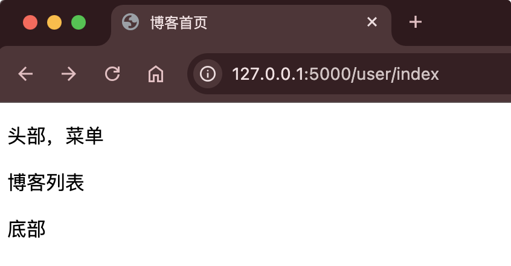
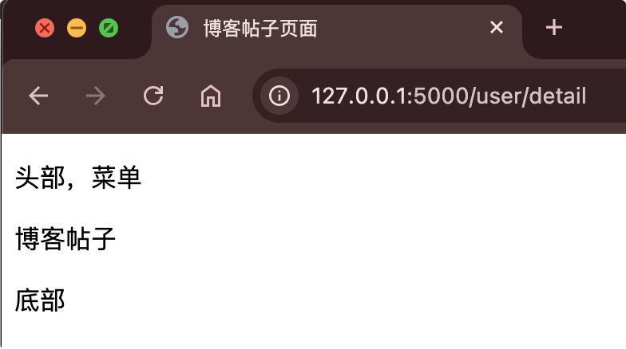

# 模板继承和include标签使用

不管是开发网站还是后台管理系统，我们页面里多多少少有公共的模块。

比如博客网站，就有公共的头部，菜单和底部栏。每个页面都有，我们往往要抽取出这些公共模块，然后统一维护。

JinJa2提供了**模板继承和include标签**。

语法：

``

``

``

示例：

templates文件夹里：

把顶部信息和菜单抽取新建一个header.html

底部信息页抽取新建一个footer.html

公共的父模版base.html

博客首页 index.html

博客详情页 detail.html

::: code-group

```html [header.html]
<!DOCTYPE html>
<html lang="en">
<head>
    <meta charset="UTF-8">
    <title>Title</title>
</head>
<body>
<p>头部，菜单</p>
</body>
</html>
```

```html [footer.html]
<!DOCTYPE html>
<html lang="en">
<head>
    <meta charset="UTF-8">
    <title>Title</title>
</head>
<body>
<p>底部</p>
</body>
</html>
```

```html [base.html]
<!DOCTYPE html>
<html lang="en">
<head>
    <meta charset="UTF-8">
    <title>默认标题</title>
</head>
<body>


	默认内容


</body>
</html>
```

```html [index.html]


	博客首页


	博客列表

```

```html [detail.html]


	博客帖子页面


	博客帖子

```

```python [user.py]
@user_bp.route('/index')
def index():
    return render_template('index.html')

@user_bp.route('/detail')
def detail():
    return render_template('detail.html')
```

:::

{width=400}

{width=400}