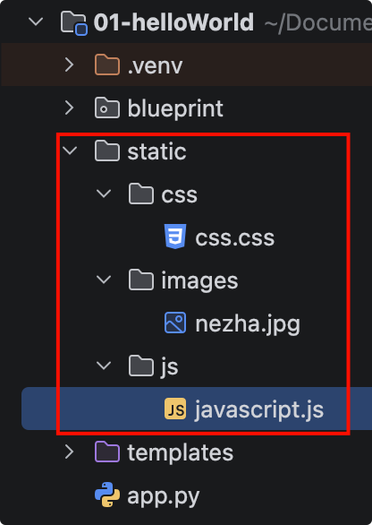

# 模板加载静态文件

一个Web项目不仅需要HTML模板，还需要许多静态文件，比如 CSS、JavaScript文件、图片以及音频等。

在Flask程序中，默认我们需要将静态文件存储在与主脚本(包含程序实例的脚本)同级目录的static 文件夹中。

在Jinja2模板引擎中，我们可以使用url_for()函数来加载静态资源。 

示例: 首先在static目录下放css,js和一个图片文件。目录结构如下:

{width=400}

::: code-group

```css [css.css]
body {
    background-color: red;
}
```

```js [javascript.js]
alert("这个是哪吒！")
```

```html [student.html]{6,7,11}
<!DOCTYPE html>
<html lang="en">
<head>
    <meta charset="UTF-8">
    <title>学生信息</title>
    <script src="{{ url_for('static', filename='js/javascript.js') }}"></script>
    <link rel="stylesheet" href="{{ url_for('static', filename='css/css.css') }}"/>
</head>
<body>
<h3>加载静态文件</h3>

</body>
</html>
```

:::

{width=400}