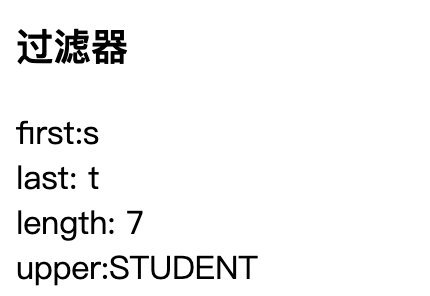
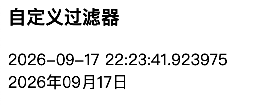

# 模板过滤器使用

在Jinja2中，过滤器(`filter`)是一些可以用来修改和过滤变量值的特殊函数，过滤器和变量用一个竖线 ' `|`'(管道符号)隔开，需要参数的过滤器可以像函数一样使用括号传递。

## 使用默认过滤器

 Jinja2常用过滤器如下表格:

好的，这是图片中的内容转换成的 Markdown 表格：

| 过滤器    | 说明                           |
| :-------- | :----------------------------- |
| abs       | 设置数值的绝对值               |
| default   | 设置默认值                     |
| escape    | 转义字符，转成HTML的语法       |
| first     | 获取上下文的第一个元素         |
| last      | 获取上下文的最后一个元素       |
| length    | 获取上下文的长度               |
| join      | 功能与Python的join语法一致     |
| safe      | 将上下文转义处理               |
| int       | 将上下文转换为int类型          |
| float     | 将上下文转换为float类型        |
| lower     | 将字符串转换为小写             |
| upper     | 将字符串转换为大写             |
| replace   | 字符串的替换                   |
| truncate  | 字符串的截断                   |
| striptags | 删除字符串中所有的HTML标签     |
| trim      | 截取字符串前面和后面的空白字符 |
| string    | 将上下文转换成字符串           |
| wordcount | 计算长字符串的单词个数         |

示例：

::: code-group


```python [student.py]{39,47}
@student_bp.route('/list')
def list():
    titleA = 'student'
    return render_template(
        'student.html',
        titleA=titleA)

```

```html [student.html]{34-38}
<h3>过滤器</h3>
first:{{ titleA | first }}<br/>
last: {{ titleA | last }}<br/>
length: {{ titleA | length }}<br/>
upper:{{ titleA | upper }}
```

:::

{width=400}

## 自定义过滤器

有时候，jinjia2默认提供的过滤器不够我们用，我们还可以自定义过滤器。

先自定义处理函数，然后通过add_template_filter添加自定义过滤器

示例：格式化日期

::: code-group

```python [app.py]
# 格式化日期
def date_format(value, format='%Y年%m月%d日'):
    return value.strftime(format)

# 添加自定义的过滤器
app.add_template_filter(date_format, 'dateformat')
```

```python [student.py]
@student_bp.route('/list')
def list():
    timeA = datetime.now()
    return render_template(
        'student.html',
        timeA=timeA)

```

```html [student.html]
<h3>自定义过滤器</h3>
{{ timeA }}<br/>
{{ timeA | dateformat }}
```

:::

{width=400}