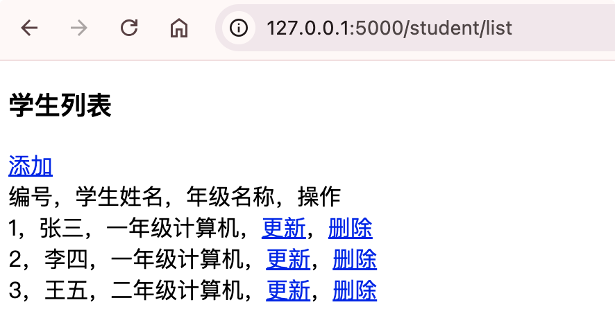
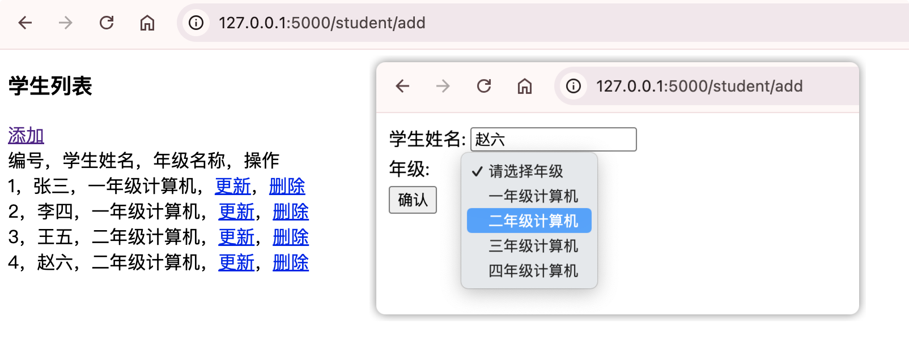

# 关联表增删查改数据操作

## 数据查询操作

我们现在开发学生模块，学生模块和班级模块的关系是多对一。

student.py里：

- 新建学生模型StudentModel，id主键,name学生名称，grade_id外键关联t_grade表主键，以及定义grade，建立与Grade的外键关联关系。

- 定义list视图函数，实现学生信息查询

```python
from flask import Blueprint, render_template

from exts import db

# 创建学生蓝图对象
student_bp = Blueprint('student', __name__, url_prefix='/student')

# 创建学生数据库模型
class StudentModel(db.Model):
    '''
    年级模型
    '''
    __tablename__ = 't_student'
    id = db.Column(db.Integer, primary_key=True, autoincrement=True) # 主键id
    name = db.Column(db.String(50), nullable=False) # 学生姓名
    grade_id = db.Column(db.Integer, db.ForeignKey('t_grade.id')) # 年级外键id
    grade = db.relationship('GradeModel') # 简历外键关联

@student_bp.route('/list')
def list():
    studentList = StudentModel.query.all()
    return render_template('student/list.html', studentList=studentList)

#======输出======
2026-09-19 16:50:55,309 INFO sqlalchemy.engine.Engine SELECT DATABASE()
2026-09-19 16:50:55,309 INFO sqlalchemy.engine.Engine [raw sql] {}
2026-09-19 16:50:55,312 INFO sqlalchemy.engine.Engine SELECT @@sql_mode
2026-09-19 16:50:55,312 INFO sqlalchemy.engine.Engine [raw sql] {}
2026-09-19 16:50:55,314 INFO sqlalchemy.engine.Engine SELECT @@lower_case_table_names
2026-09-19 16:50:55,314 INFO sqlalchemy.engine.Engine [raw sql] {}
2026-09-19 16:50:55,317 INFO sqlalchemy.engine.Engine BEGIN (implicit)
2026-09-19 16:50:55,317 INFO sqlalchemy.engine.Engine DESCRIBE `db_flask`.`t_grade`
2026-09-19 16:50:55,317 INFO sqlalchemy.engine.Engine [raw sql] {}
2026-09-19 16:50:55,320 INFO sqlalchemy.engine.Engine DESCRIBE `db_flask`.`t_student`
2026-09-19 16:50:55,320 INFO sqlalchemy.engine.Engine [raw sql] {}
2026-09-19 16:50:55,326 INFO sqlalchemy.engine.Engine 
CREATE TABLE t_student (
	id INTEGER NOT NULL AUTO_INCREMENT, 
	name VARCHAR(50) NOT NULL, 
	grade_id INTEGER, 
	PRIMARY KEY (id), 
	FOREIGN KEY(grade_id) REFERENCES t_grade (id)
)


2026-09-19 16:50:55,326 INFO sqlalchemy.engine.Engine [no key 0.00022s] {}
2026-09-19 16:50:55,412 INFO sqlalchemy.engine.Engine COMMIT
```

templates下新建student目录，然后再新建list.html

- 获取班级信息可以通过student对象的grade对象的name属性级联对象的方式获取。

```html
<!DOCTYPE html>
<html lang="en">
<head>
    <meta charset="UTF-8">
    <title>学生列表</title>
</head>
<body>
<h3>学生列表</h3>
<a href="/student/add">添加</a> <br />
编号，学生姓名，年级名称，操作 <br />

	{{ student.id }}，{{ student.name }}，{{ student.grade.name }}，<a href="/student/update?id={{ student.id }}">更新</a>，<a href="/student/delete/{{ student.id }}">删除</a> <br />

</body>
</html>
```

{width=400}

## 添加数据操作

首先新建学生表单类，其中年级是下拉框，用SelectField组件。

```python
from flask_wtf import FlaskForm
from wtforms import HiddenField, StringField, SelectField, SubmitField
from wtforms.validators import DataRequired

# 学生表单类
class StudentForm(FlaskForm):
    id = HiddenField()
    name = StringField('学生姓名', render_kw={'placeholder': '请输入年级名称'}, validators=[DataRequired()])
    grade = SelectField('年级', choices=[], validators=[DataRequired()])
    submit = SubmitField('确认')
```

跳转添加页面之前，年级下拉框需要动态加载数据，grade对象的choices属性赋值列表。

```python
@student_bp.route('/add', methods=('GET', 'POST'))
def add():
    studentForm = StudentForm()
    if request.method == 'GET':
        # 加载年级下拉框数据
        gradeList = GradeModel.query.all()
        gradeChoices = [('','请选择年级')] + [(grade.id, grade.name) for grade in gradeList]
        # 上面这种写法等价于
        # gradeChoices = [('', '请选择年级')]
        # for grade in gradeList:
        #     gradeChoices.append((grade.id, grade.name))
        studentForm.grade.choices = gradeChoices
        return render_template('student/add.html', form=studentForm)
    else:
        data = studentForm.data
        studentModel = StudentModel(name=data['name'], grade_id=data['grade'])
        db.session.add(studentModel)
        db.session.commit()
        return list()

#======输出======
# list
2026-09-19 17:37:52,457 INFO sqlalchemy.engine.Engine BEGIN (implicit)
2026-09-19 17:37:52,457 INFO sqlalchemy.engine.Engine SELECT t_student.id AS t_student_id, t_student.name AS t_student_name, t_student.grade_id AS t_student_grade_id 
FROM t_student
2026-09-19 17:37:52,458 INFO sqlalchemy.engine.Engine [cached since 9.239s ago] {}
2026-09-19 17:37:52,462 INFO sqlalchemy.engine.Engine SELECT t_grade.id AS t_grade_id, t_grade.name AS t_grade_name, t_grade.remark AS t_grade_remark 
FROM t_grade 
WHERE t_grade.id = %(pk_1)s
2026-09-19 17:37:52,463 INFO sqlalchemy.engine.Engine [cached since 9.215s ago] {'pk_1': 1}
2026-09-19 17:37:52,466 INFO sqlalchemy.engine.Engine SELECT t_grade.id AS t_grade_id, t_grade.name AS t_grade_name, t_grade.remark AS t_grade_remark 
FROM t_grade 
WHERE t_grade.id = %(pk_1)s
2026-09-19 17:37:52,466 INFO sqlalchemy.engine.Engine [cached since 9.218s ago] {'pk_1': 2}
# add GET
2026-09-19 17:38:48,658 INFO sqlalchemy.engine.Engine BEGIN (implicit)
2026-09-19 17:38:48,659 INFO sqlalchemy.engine.Engine SELECT t_grade.id AS t_grade_id, t_grade.name AS t_grade_name, t_grade.remark AS t_grade_remark 
FROM t_grade
2026-09-19 17:38:48,659 INFO sqlalchemy.engine.Engine [generated in 0.00019s] {}
# add POST
2026-09-19 17:39:34,511 INFO sqlalchemy.engine.Engine BEGIN (implicit)
2026-09-19 17:39:34,514 INFO sqlalchemy.engine.Engine INSERT INTO t_student (name, grade_id) VALUES (%(name)s, %(grade_id)s)
2026-09-19 17:39:34,515 INFO sqlalchemy.engine.Engine [generated in 0.00038s] {'name': '赵六', 'grade_id': '2'}
2026-09-19 17:39:34,518 INFO sqlalchemy.engine.Engine COMMIT
2026-09-19 17:39:34,539 INFO sqlalchemy.engine.Engine BEGIN (implicit)
2026-09-19 17:39:34,540 INFO sqlalchemy.engine.Engine SELECT t_student.id AS t_student_id, t_student.name AS t_student_name, t_student.grade_id AS t_student_grade_id 
FROM t_student
2026-09-19 17:39:34,540 INFO sqlalchemy.engine.Engine [cached since 49.18s ago] {}
2026-09-19 17:39:34,542 INFO sqlalchemy.engine.Engine SELECT t_grade.id AS t_grade_id, t_grade.name AS t_grade_name, t_grade.remark AS t_grade_remark 
FROM t_grade 
WHERE t_grade.id = %(pk_1)s
2026-09-19 17:39:34,542 INFO sqlalchemy.engine.Engine [cached since 49.16s ago] {'pk_1': 1}
2026-09-19 17:39:34,545 INFO sqlalchemy.engine.Engine SELECT t_grade.id AS t_grade_id, t_grade.name AS t_grade_name, t_grade.remark AS t_grade_remark 
FROM t_grade 
WHERE t_grade.id = %(pk_1)s
2026-09-19 17:39:34,545 INFO sqlalchemy.engine.Engine [cached since 49.17s ago] {'pk_1': 2}
```

student目录下新建一个add.html

```html
<!DOCTYPE html>
<html lang="en">
<head>
    <meta charset="UTF-8">
    <title>添加学生</title>
</head>
<body>
<form action="add" method="post">
    <table>
        {{ form.csrf_token }}
        <tr>
            <td>{{ form.name.label }}:</td>
            <td>{{ form.name }}</td>
        </tr>
        <tr>
            <td>{{ form.grade.label }}:</td>
            <td>{{ form.grade }}</td>
        </tr>
        <tr>
            <td>{{ form.submit }}</td>
        </tr>
    </table>
</form>
</body>
</html>
```

{width=400}

## 更新数据操作

student.py实现update()视图函数方法

**这里注意下，get请求加载页面的时候，先进行下拉框初始化年级，以及通过default设置默认值，同时必须通过调用process()方法，让默认选项生效。**

```python {14,15}
@student_bp.route('/update', methods=('GET', 'POST'))
def update():
    studentForm = StudentForm()
    if request.method == 'GET':
        # 加载年级下拉框数据
        gradeList = GradeModel.query.all()
        gradeChoices = [('','请选择年级')] + [(grade.id, grade.name) for grade in gradeList]
        studentForm.grade.choices = gradeChoices

        # 根据id获取学生信息
        id = request.args.get('id', type=int)
        student = StudentModel.query.get(id)

        studentForm.grade.default = student.grade_id # 赋值下拉框默认值
        studentForm.process() # 让默认值生效

        studentForm.id.data = student.id
        studentForm.name.data = student.name

        return render_template('student/update.html', form=studentForm)
    else:
        data = studentForm.data
        student = StudentModel.query.get(data['id'])
        student.name = data['name']
        student.grade_id = data['grade']
        db.session.commit()
        return list()

#======输出======
# update GET
2026-09-19 18:15:20,196 INFO sqlalchemy.engine.Engine BEGIN (implicit)
2026-09-19 18:15:20,196 INFO sqlalchemy.engine.Engine SELECT t_grade.id AS t_grade_id, t_grade.name AS t_grade_name, t_grade.remark AS t_grade_remark 
FROM t_grade
2026-09-19 18:15:20,196 INFO sqlalchemy.engine.Engine [cached since 20.89s ago] {}
2026-09-19 18:15:20,199 INFO sqlalchemy.engine.Engine SELECT t_student.id AS t_student_id, t_student.name AS t_student_name, t_student.grade_id AS t_student_grade_id 
FROM t_student 
WHERE t_student.id = %(pk_1)s
2026-09-19 18:15:20,200 INFO sqlalchemy.engine.Engine [cached since 20.89s ago] {'pk_1': 5}
# update POST
2026-09-19 18:15:59,121 INFO sqlalchemy.engine.Engine BEGIN (implicit)
2026-09-19 18:15:59,122 INFO sqlalchemy.engine.Engine SELECT t_student.id AS t_student_id, t_student.name AS t_student_name, t_student.grade_id AS t_student_grade_id 
FROM t_student 
WHERE t_student.id = %(pk_1)s
2026-09-19 18:15:59,122 INFO sqlalchemy.engine.Engine [cached since 59.81s ago] {'pk_1': '5'}
2026-09-19 18:15:59,136 INFO sqlalchemy.engine.Engine UPDATE t_student SET name=%(name)s, grade_id=%(grade_id)s WHERE t_student.id = %(t_student_id)s
2026-09-19 18:15:59,136 INFO sqlalchemy.engine.Engine [generated in 0.00026s] {'name': '赵六3', 'grade_id': '1', 't_student_id': 5}
2026-09-19 18:15:59,141 INFO sqlalchemy.engine.Engine COMMIT
2026-09-19 18:15:59,148 INFO sqlalchemy.engine.Engine BEGIN (implicit)
2026-09-19 18:15:59,148 INFO sqlalchemy.engine.Engine SELECT t_student.id AS t_student_id, t_student.name AS t_student_name, t_student.grade_id AS t_student_grade_id 
FROM t_student
2026-09-19 18:15:59,148 INFO sqlalchemy.engine.Engine [cached since 42.75s ago] {}
2026-09-19 18:15:59,151 INFO sqlalchemy.engine.Engine SELECT t_grade.id AS t_grade_id, t_grade.name AS t_grade_name, t_grade.remark AS t_grade_remark 
FROM t_grade 
WHERE t_grade.id = %(pk_1)s
2026-09-19 18:15:59,151 INFO sqlalchemy.engine.Engine [cached since 42.74s ago] {'pk_1': 1}
2026-09-19 18:15:59,153 INFO sqlalchemy.engine.Engine SELECT t_grade.id AS t_grade_id, t_grade.name AS t_grade_name, t_grade.remark AS t_grade_remark 
FROM t_grade 
WHERE t_grade.id = %(pk_1)s
2026-09-19 18:15:59,153 INFO sqlalchemy.engine.Engine [cached since 42.75s ago] {'pk_1': 2}
```

student目录下新建update.html

```html
<!DOCTYPE html>
<html lang="en">
<head>
    <meta charset="UTF-8">
    <title>学生更新</title>
</head>
<body>
<form action="update" method="post">
    <table>
        {{ form.csrf_token }}
        <tr>
            <td>{{ form.name.label }}:</td>
            <td>{{ form.name }}</td>
        </tr>
        <tr>
            <td>{{ form.grade.label }}:</td>
            <td>{{ form.grade }}</td>
        </tr>
        <tr>
            <td>{{ form.submit }}</td>
            <td>{{ form.id }}</td>
        </tr>
    </table>
</form>
</body>
</html>
```

## 删除数据操作

在student.py里新建delete()视图函数:

```python
@student_bp.route('/delete/<int:id>')
def delete(id):
    student = StudentModel.query.get(id)
    db.session.delete(student)
    db.session.commit()
    return list()

#======输出======
2026-09-19 18:21:36,123 INFO sqlalchemy.engine.Engine BEGIN (implicit)
2026-09-19 18:21:36,132 INFO sqlalchemy.engine.Engine SELECT t_student.id AS t_student_id, t_student.name AS t_student_name, t_student.grade_id AS t_student_grade_id 
FROM t_student 
WHERE t_student.id = %(pk_1)s
2026-09-19 18:21:36,132 INFO sqlalchemy.engine.Engine [generated in 0.00052s] {'pk_1': 5}
2026-09-19 18:21:36,176 INFO sqlalchemy.engine.Engine DELETE FROM t_student WHERE t_student.id = %(id)s
2026-09-19 18:21:36,177 INFO sqlalchemy.engine.Engine [generated in 0.00089s] {'id': 5}
2026-09-19 18:21:36,185 INFO sqlalchemy.engine.Engine COMMIT
2026-09-19 18:21:36,201 INFO sqlalchemy.engine.Engine BEGIN (implicit)
2026-09-19 18:21:36,203 INFO sqlalchemy.engine.Engine SELECT t_student.id AS t_student_id, t_student.name AS t_student_name, t_student.grade_id AS t_student_grade_id 
FROM t_student
2026-09-19 18:21:36,204 INFO sqlalchemy.engine.Engine [generated in 0.00022s] {}
2026-09-19 18:21:36,219 INFO sqlalchemy.engine.Engine SELECT t_grade.id AS t_grade_id, t_grade.name AS t_grade_name, t_grade.remark AS t_grade_remark 
FROM t_grade 
WHERE t_grade.id = %(pk_1)s
2026-09-19 18:21:36,219 INFO sqlalchemy.engine.Engine [generated in 0.00024s] {'pk_1': 1}
2026-09-19 18:21:36,222 INFO sqlalchemy.engine.Engine SELECT t_grade.id AS t_grade_id, t_grade.name AS t_grade_name, t_grade.remark AS t_grade_remark 
FROM t_grade 
WHERE t_grade.id = %(pk_1)s
2026-09-19 18:21:36,223 INFO sqlalchemy.engine.Engine [cached since 0.003898s ago] {'pk_1': 2}
```

