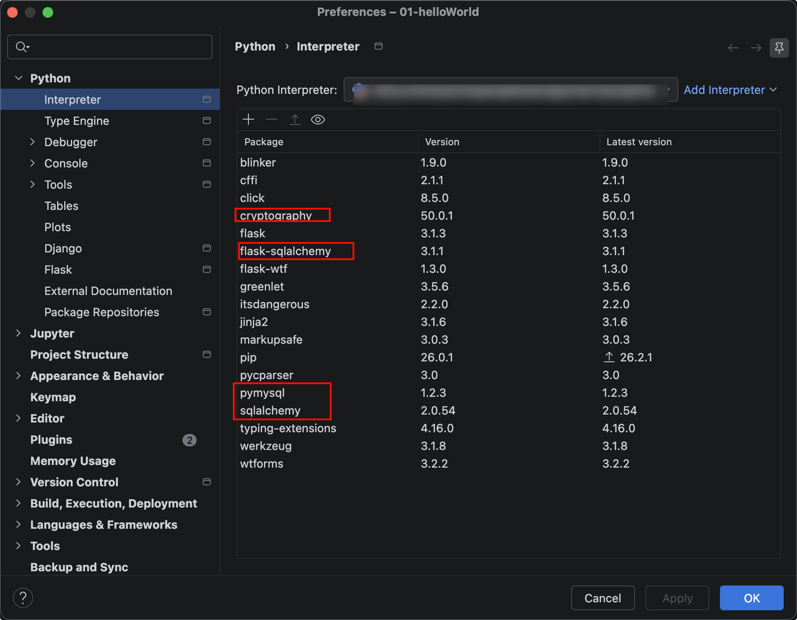

# 简介与安装

## 简介

SQLAlchemy是Python编程语言下的一款开源软件。提供了SQL工具包及对象关系映射(ORM)工具， 使用MIT许可证发行。 

SQLAlchemy采用简单的Python语言，为高效和高性能的数据库访问设计，实现了完整的企业级持久模型。

SQLAlchemy的理念是，SQL数据库的量级和性能重要于对象集合；而对象集合的抽象又重要于表和行。因此，SQLAlchemy采用了类似于Java里Hibernate的数据映射模型，而不是其他ORM框架采用的Active Record模型。不过，Elixir和declarative等可选插件可以让用户使用声明语法。

## 安装

Flask3通过SQLAlchemy来操作Mysql数据库。

首先第一步要安装pymysql，作为连接mysql的驱动，pip安装命令：

`pip install pymysql -i https://pypi.tuna.tsinghua.edu.cn/simple`

然后再安装下sqlalchemy库，pip安装命令：

`pip install flask-sqlalchemy -i https://pypi.tuna.tsinghua.edu.cn/simple`

如果连接的是mysql8版本，MySQL8默认的认证插件是caching_sha2_password，还得安装 cryptography库：

`pip install cryptography -i https://pypi.tuna.tsinghua.edu.cn/simple`

