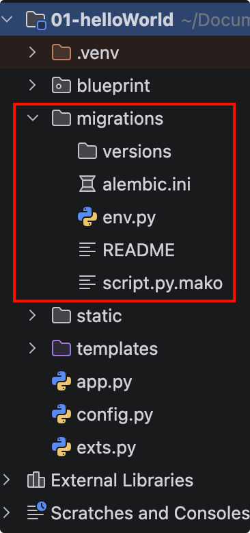
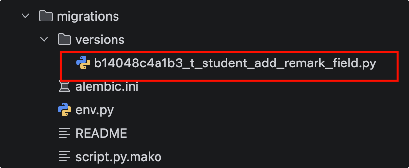
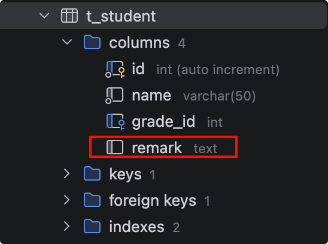

# 数据迁移migrate

## 引入

模型类(表)不是一成不变的，当你添加了新的模型类，或是在模型类中添加了新的字段，甚至是修改了字段的名称或类型，都需要更新表。

如果我们不在乎数据的话，可以删除表，然后重新生成新表。不过在开发时，以删除表再重建的方式更新数据库简单直接，但明显的缺陷是会丢掉数据库中的所有数据。 

在生产环境下，绝对不会想让数据库里的数据都被删除掉，这时你需要使用数据库迁移工具来完成这个工作。

SQLAlchemy的开发者Michael Bayer写了一个数据库迁移工具——Alembic来帮助我们实现数据库的迁移，数据库迁移工具可以在不破坏数据的情况下更新数据库表的结构。

## 安装

我们安装下flask-Migrate库

`pip install flask-Migrate -i https://pypi.tuna.tsinghua.edu.cn/simple`

## 使用

### 实例化Migrate

首先在app.py里面创建migrate对象，要写在db初始化后面

```python {6}
# 创建SQLAlchemy对象
# db = SQLAlchemy(app)
db.init_app(app)

# 实例化Migrate
migrate = Migrate(app, db)
```

### 迁移步骤

1. 第一步就是要创建迁移环境，当前项目终端执行命令

```shell {1}
01-helloWorld ❯ flask db init                                                                         
__name__ app
DEBUG模式：True
2026-09-19 18:38:08,400 INFO sqlalchemy.engine.Engine SELECT DATABASE()
2026-09-19 18:38:08,401 INFO sqlalchemy.engine.Engine [raw sql] {}
2026-09-19 18:38:08,404 INFO sqlalchemy.engine.Engine SELECT @@sql_mode
2026-09-19 18:38:08,404 INFO sqlalchemy.engine.Engine [raw sql] {}
2026-09-19 18:38:08,406 INFO sqlalchemy.engine.Engine SELECT @@lower_case_table_names
2026-09-19 18:38:08,406 INFO sqlalchemy.engine.Engine [raw sql] {}
2026-09-19 18:38:08,410 INFO sqlalchemy.engine.Engine BEGIN (implicit)
2026-09-19 18:38:08,411 INFO sqlalchemy.engine.Engine DESCRIBE `db_flask`.`t_grade`
2026-09-19 18:38:08,411 INFO sqlalchemy.engine.Engine [raw sql] {}
2026-09-19 18:38:08,414 INFO sqlalchemy.engine.Engine DESCRIBE `db_flask`.`t_student`
2026-09-19 18:38:08,414 INFO sqlalchemy.engine.Engine [raw sql] {}
2026-09-19 18:38:08,418 INFO sqlalchemy.engine.Engine COMMIT
  Creating directory 01-helloWorld/migrations ...  done
  Creating directory 01-helloWorld/migrations/versions ...  done
  Generating 01-helloWorld/migrations/script.py.mako ...  done
  Generating 01-helloWorld/migrations/env.py ...  done
  Generating 01-helloWorld/migrations/README ...  done
  Generating 01-helloWorld/migrations/alembic.ini ...  done
  Please edit configuration/connection/logging settings in 01-helloWorld/migrations/alembic.ini
  before proceeding.

```

执行这个命令后，在项目目录生成了一个目录 migrations 及子文件。

{width=200}

2. 接着在student.py里面的StudentModle添加一个remark字段

```python {9}
# 创建学生数据库模型
class StudentModel(db.Model):
    '''
    年级模型
    '''
    __tablename__ = 't_student'
    id = db.Column(db.Integer, primary_key=True, autoincrement=True) # 主键id
    name = db.Column(db.String(50), nullable=False) # 学生姓名
    remark = db.Column(db.Text) # 备注
    grade_id = db.Column(db.Integer, db.ForeignKey('t_grade.id')) # 年级外键id
    grade = db.relationship('GradeModel') # 简历外键关联
```

3. 执行迁移脚本，-m是添加备注信息

```shell {1}
01-helloWorld ❯ flask db migrate -m 't_student add remark  field'                                     
__name__ app
DEBUG模式：True
2026-09-19 18:42:42,543 INFO sqlalchemy.engine.Engine SELECT DATABASE()
2026-09-19 18:42:42,543 INFO sqlalchemy.engine.Engine [raw sql] {}
2026-09-19 18:42:42,546 INFO sqlalchemy.engine.Engine SELECT @@sql_mode
2026-09-19 18:42:42,546 INFO sqlalchemy.engine.Engine [raw sql] {}
2026-09-19 18:42:42,547 INFO sqlalchemy.engine.Engine SELECT @@lower_case_table_names
2026-09-19 18:42:42,547 INFO sqlalchemy.engine.Engine [raw sql] {}
2026-09-19 18:42:42,550 INFO sqlalchemy.engine.Engine BEGIN (implicit)
2026-09-19 18:42:42,550 INFO sqlalchemy.engine.Engine DESCRIBE `db_flask`.`t_grade`
2026-09-19 18:42:42,550 INFO sqlalchemy.engine.Engine [raw sql] {}
2026-09-19 18:42:42,553 INFO sqlalchemy.engine.Engine DESCRIBE `db_flask`.`t_student`
2026-09-19 18:42:42,553 INFO sqlalchemy.engine.Engine [raw sql] {}
2026-09-19 18:42:42,557 INFO sqlalchemy.engine.Engine COMMIT
INFO  [alembic.runtime.migration] Context impl MySQLImpl.
INFO  [alembic.runtime.migration] Will assume non-transactional DDL.
INFO  [sqlalchemy.engine.Engine] BEGIN (implicit)
INFO  [sqlalchemy.engine.Engine] DESCRIBE `db_flask`.`alembic_version`
INFO  [sqlalchemy.engine.Engine] [raw sql] {}
INFO  [sqlalchemy.engine.Engine] DESCRIBE `db_flask`.`alembic_version`
INFO  [sqlalchemy.engine.Engine] [raw sql] {}
INFO  [sqlalchemy.engine.Engine] 
CREATE TABLE alembic_version (
        version_num VARCHAR(32) NOT NULL, 
        CONSTRAINT alembic_version_pkc PRIMARY KEY (version_num)
)


INFO  [sqlalchemy.engine.Engine] [no key 0.00019s] {}
INFO  [alembic.runtime.plugins] setting up autogenerate plugin alembic.autogenerate.schemas
INFO  [alembic.runtime.plugins] setting up autogenerate plugin alembic.autogenerate.tables
INFO  [alembic.runtime.plugins] setting up autogenerate plugin alembic.autogenerate.types
INFO  [alembic.runtime.plugins] setting up autogenerate plugin alembic.autogenerate.constraints
INFO  [alembic.runtime.plugins] setting up autogenerate plugin alembic.autogenerate.defaults
INFO  [alembic.runtime.plugins] setting up autogenerate plugin alembic.autogenerate.comments
INFO  [sqlalchemy.engine.Engine] SHOW FULL TABLES FROM `db_flask`
INFO  [sqlalchemy.engine.Engine] [raw sql] {}
INFO  [sqlalchemy.engine.Engine] SHOW CREATE TABLE `t_grade`
INFO  [sqlalchemy.engine.Engine] [raw sql] {}
INFO  [sqlalchemy.engine.Engine] SHOW CREATE TABLE `t_student`
INFO  [sqlalchemy.engine.Engine] [raw sql] {}
INFO  [sqlalchemy.engine.Engine] SELECT information_schema.columns.table_schema, information_schema.columns.table_name, information_schema.columns.column_name 
FROM information_schema.columns 
WHERE information_schema.columns.table_schema = %(table_schema_1)s AND information_schema.columns.table_name = %(table_name_1)s AND lower(information_schema.columns.column_name) IN (%(lower_1_1)s)
INFO  [sqlalchemy.engine.Engine] [generated in 0.00034s] {'table_schema_1': 'db_flask', 'table_name_1': 't_grade', 'lower_1_1': 'id'}
INFO  [alembic.autogenerate.compare.tables] Detected added column 't_student.remark'
INFO  [sqlalchemy.engine.Engine] ROLLBACK
  Generating 01-helloWorld/migrations/versions/b14048c4a1b3_t_student_add_remark_field.py ...  done

```

versions目录下生成了迁移文件:

{width=400}

```python
"""t_student add remark  field

Revision ID: b14048c4a1b3
Revises: 
Create Date: 2026-09-19 18:42:42.686578

"""
from alembic import op
import sqlalchemy as sa


# revision identifiers, used by Alembic.
revision = 'b14048c4a1b3'
down_revision = None
branch_labels = None
depends_on = None


def upgrade():
    # ### commands auto generated by Alembic - please adjust! ###
    with op.batch_alter_table('t_student', schema=None) as batch_op:
        batch_op.add_column(sa.Column('remark', sa.Text(), nullable=True))

    # ### end Alembic commands ###


def downgrade():
    # ### commands auto generated by Alembic - please adjust! ###
    with op.batch_alter_table('t_student', schema=None) as batch_op:
        batch_op.drop_column('remark')

    # ### end Alembic commands ###

```

4. 最后执行迁移文件，更新数据库，通过upgrade命令：

```shell {1}
01-helloWorld ❯ flask db upgrade                                                                      
__name__ app
DEBUG模式：True
2026-09-19 18:45:33,715 INFO sqlalchemy.engine.Engine SELECT DATABASE()
2026-09-19 18:45:33,715 INFO sqlalchemy.engine.Engine [raw sql] {}
2026-09-19 18:45:33,718 INFO sqlalchemy.engine.Engine SELECT @@sql_mode
2026-09-19 18:45:33,718 INFO sqlalchemy.engine.Engine [raw sql] {}
2026-09-19 18:45:33,719 INFO sqlalchemy.engine.Engine SELECT @@lower_case_table_names
2026-09-19 18:45:33,720 INFO sqlalchemy.engine.Engine [raw sql] {}
2026-09-19 18:45:33,723 INFO sqlalchemy.engine.Engine BEGIN (implicit)
2026-09-19 18:45:33,723 INFO sqlalchemy.engine.Engine DESCRIBE `db_flask`.`t_grade`
2026-09-19 18:45:33,723 INFO sqlalchemy.engine.Engine [raw sql] {}
2026-09-19 18:45:33,727 INFO sqlalchemy.engine.Engine DESCRIBE `db_flask`.`t_student`
2026-09-19 18:45:33,727 INFO sqlalchemy.engine.Engine [raw sql] {}
2026-09-19 18:45:33,731 INFO sqlalchemy.engine.Engine COMMIT
INFO  [alembic.runtime.migration] Context impl MySQLImpl.
INFO  [alembic.runtime.migration] Will assume non-transactional DDL.
INFO  [sqlalchemy.engine.Engine] BEGIN (implicit)
INFO  [sqlalchemy.engine.Engine] DESCRIBE `db_flask`.`alembic_version`
INFO  [sqlalchemy.engine.Engine] [raw sql] {}
INFO  [sqlalchemy.engine.Engine] SELECT alembic_version.version_num 
FROM alembic_version
INFO  [sqlalchemy.engine.Engine] [generated in 0.00019s] {}
INFO  [sqlalchemy.engine.Engine] DESCRIBE `db_flask`.`alembic_version`
INFO  [sqlalchemy.engine.Engine] [raw sql] {}
INFO  [alembic.runtime.migration] Running upgrade  -> b14048c4a1b3, t_student add remark  field
INFO  [sqlalchemy.engine.Engine] ALTER TABLE t_student ADD COLUMN remark TEXT
INFO  [sqlalchemy.engine.Engine] [no key 0.00013s] {}
INFO  [sqlalchemy.engine.Engine] INSERT INTO alembic_version (version_num) VALUES ('b14048c4a1b3')
INFO  [sqlalchemy.engine.Engine] [generated in 0.00031s] {}
INFO  [sqlalchemy.engine.Engine] COMMIT

```

执行完后，t_student表就多了remark字段：

{width=400}