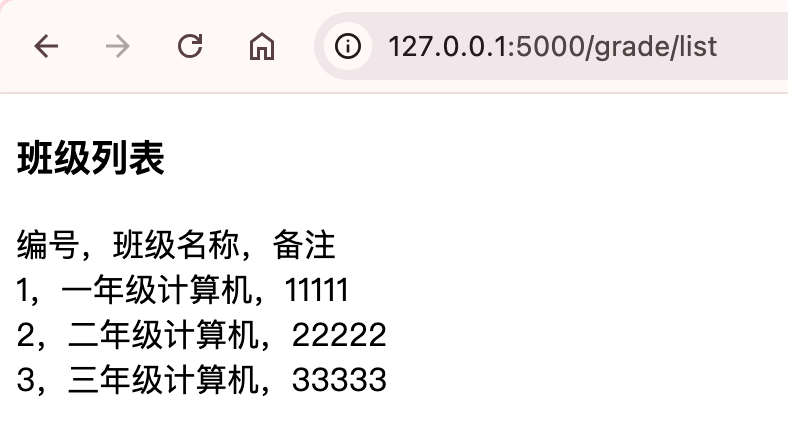
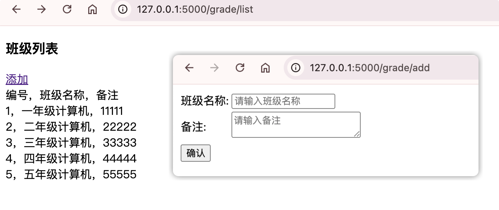
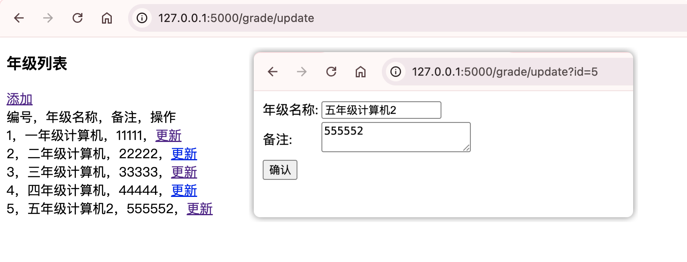
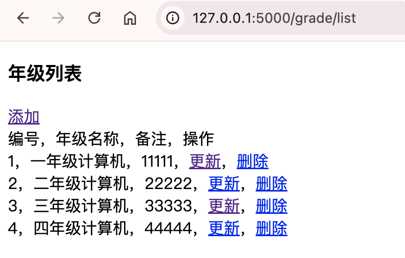

# 单表增删查改数据操作

## 查询所有数据操作

我们来新建一个的蓝图模块-年级模块，后面可以和学生模块，实现一对多的数据库操作。

blueprint下新建grade.py：创建蓝图对象，以及定义年级模型。

```python {22}
from flask import Blueprint, render_template

from exts import db

# 创建蓝图对象
grade_bp = Blueprint('grade', __name__, url_prefix='/grade')

# 创建年级数据库模型
class GradeModel(db.Model):
    '''
    年级模型
    '''
    __tablename__ = 't_grade'
    id = db.Column(db.Integer, primary_key=True, autoincrement=True) # 主键id
    name = db.Column(db.String(50), nullable=False) # 年级名称
    remark = db.Column(db.Text) # 备注

# 定义list视图方法，获取数据，转发到模版页面。
@grade_bp.route('/list')
def list():
    # 根据query对象的all()方法能够查询出所有数据
    gradeList = GradeModel.query.all()
    return render_template('grade/list.html', gradeList=gradeList)
```

app.py里面注册蓝图

```python
app.register_blueprint(grade_bp)
```

templates下新建grade目录，grade目录下新建list.html页面。

```html
<!DOCTYPE html>
<html lang="en">
<head>
    <meta charset="UTF-8">
    <title>年级列表</title>
</head>
<body>
<h3>年级列表</h3>
编号，年级名称，备注 <br />

	{{ grade.id }}，{{ grade.name }}，{{ grade.remark }} <br />

</body>
</html>
```

{width=400}

## 添加数据操作

**SQLAlchemy提供session.add()方法添加model实体数据，以及提供session.commit()提交事务。**

首先list.html加一个添加链接

```html {9}
<!DOCTYPE html>
<html lang="en">
<head>
    <meta charset="UTF-8">
    <title>年级列表</title>
</head>
<body>
<h3>年级列表</h3>
<a href="/grade/add">添加</a> <br />
编号，年级名称，备注 <br />

	{{ grade.id }}，{{ grade.name }}，{{ grade.remark }} <br />

</body>
</html>
```

grade.py里定义下GradeForm表单类，再加一个add()视图函数

```python {21-25,34-47}
from flask import Blueprint, render_template, request
from flask_wtf import FlaskForm
from wtforms import StringField, TextAreaField, SubmitField
from wtforms.validators import DataRequired

from exts import db

# 创建蓝图对象
grade_bp = Blueprint('grade', __name__, url_prefix='/grade')

# 创建年级数据库模型
class GradeModel(db.Model):
    '''
    年级模型
    '''
    __tablename__ = 't_grade'
    id = db.Column(db.Integer, primary_key=True, autoincrement=True) # 主键id
    name = db.Column(db.String(50), nullable=False) # 年级名称
    remark = db.Column(db.Text) # 备注

# 年级表单类
class GradeForm(FlaskForm):
    name = StringField('年级名称', render_kw={'placeholder': '请输入年级名称'}, validators=[DataRequired()])
    remark = TextAreaField('备注', render_kw={'placeholder': '请输入备注'})
    submit = SubmitField('确认')

# 定义list视图方法，获取数据，转发到模版页面。
@grade_bp.route('/list')
def list():
    # 根据query对象的all()方法能够查询出所有数据
    gradeList = GradeModel.query.all()
    return render_template('grade/list.html', gradeList=gradeList)

@grade_bp.route('/add', methods=['GET', 'POST'])
def add():
    gradeForm = GradeForm()
    if request.method == 'GET':
        return render_template('grade/add.html', form=gradeForm)
    else:
        if gradeForm.validate():
            data = gradeForm.data
            print('data:', data)
            print(data['name'])
            gradeModel = GradeModel(name=data['name'], remark=data['remark'])
            db.session.add(gradeModel)
            db.session.commit()
            return list()

#======输出======
data: {'name': '五年级计算机', 'remark': '55555', 'submit': True, 'csrf_token': 'ImRkZmY5OTQ5ZmM1ZGU2YzIxMGIwYjE2ZmJhYWRkMjNiYTEyMTFiODYi.aq40kA.mm2opt_thS2aNfRnIgGdfIvQrMQ'}
五年级计算机
2026-09-19 15:07:04,075 INFO sqlalchemy.engine.Engine BEGIN (implicit)
2026-09-19 15:07:04,082 INFO sqlalchemy.engine.Engine INSERT INTO t_grade (name, remark) VALUES (%(name)s, %(remark)s)
2026-09-19 15:07:04,082 INFO sqlalchemy.engine.Engine [generated in 0.00062s] {'name': '五年级计算机', 'remark': '55555'}
2026-09-19 15:07:04,087 INFO sqlalchemy.engine.Engine COMMIT
2026-09-19 15:07:04,095 INFO sqlalchemy.engine.Engine BEGIN (implicit)
2026-09-19 15:07:04,099 INFO sqlalchemy.engine.Engine SELECT t_grade.id AS t_grade_id, t_grade.name AS t_grade_name, t_grade.remark AS t_grade_remark 
FROM t_grade
2026-09-19 15:07:04,099 INFO sqlalchemy.engine.Engine [generated in 0.00023s] {}
```

grade目录添加下add.html

```html
<!DOCTYPE html>
<html lang="en">
<head>
    <meta charset="UTF-8">
    <title>添加年级</title>
</head>
<body>
<form action="add" method="post">
    <table>
        {{ form.csrf_token }}
        <tr>
            <td>{{ form.name.label }}:</td>
            <td>{{ form.name }}</td>
        </tr>
        <tr>
            <td>{{ form.remark.label }}:</td>
            <td>{{ form.remark }}</td>
        </tr>
        <tr>
            <td>{{ form.submit }}</td>
        </tr>
    </table>
</form>
</body>
</html>
```

{width=400}

## 更新数据操作

list.html页面，加一个更新操作超链接：

```html {12}
<!DOCTYPE html>
<html lang="en">
<head>
    <meta charset="UTF-8">
    <title>年级列表</title>
</head>
<body>
<h3>年级列表</h3>
<a href="/grade/add">添加</a> <br />
编号，年级名称，备注，操作 <br />

	{{ grade.id }}，{{ grade.name }}，{{ grade.remark }}，<a href="/grade/update?id={{ grade.id }}">更新</a> <br />

</body>
</html>
```

新建update.html页面，和add.html页面基本一致，多了个id隐藏字段

```html {21}
<!DOCTYPE html>
<html lang="en">
<head>
    <meta charset="UTF-8">
    <title>年级更新</title>
</head>
<body>
<form action="update" method="post">
    <table>
        {{ form.csrf_token }}
        <tr>
            <td>{{ form.name.label }}:</td>
            <td>{{ form.name }}</td>
        </tr>
        <tr>
            <td>{{ form.remark.label }}:</td>
            <td>{{ form.remark }}</td>
        </tr>
        <tr>
            <td>{{ form.submit }}</td>
            <td>{{ form.id }}</td>
        </tr>
    </table>
</form>
</body>
</html>
```

grade.py里面

1. 首先GradeForm里面加下id字段，HiddenField类型，是隐藏域。

2. 新建一个update()视图：先通过query对象的get方法，根据id获取年级对象，然后修改对象属性，最后commit提交即可。

```python {23,50-69}
from flask import Blueprint, render_template, request
from flask_wtf import FlaskForm
from wtforms import StringField, TextAreaField, SubmitField, HiddenField
from wtforms.validators import DataRequired

from exts import db

# 创建蓝图对象
grade_bp = Blueprint('grade', __name__, url_prefix='/grade')

# 创建年级数据库模型
class GradeModel(db.Model):
    '''
    年级模型
    '''
    __tablename__ = 't_grade'
    id = db.Column(db.Integer, primary_key=True, autoincrement=True) # 主键id
    name = db.Column(db.String(50), nullable=False) # 年级名称
    remark = db.Column(db.Text) # 备注

# 年级表单类
class GradeForm(FlaskForm):
    id = HiddenField()
    name = StringField('年级名称', render_kw={'placeholder': '请输入年级名称'}, validators=[DataRequired()])
    remark = TextAreaField('备注', render_kw={'placeholder': '请输入备注'})
    submit = SubmitField('确认')

# 定义list视图方法，获取数据，转发到模版页面。
@grade_bp.route('/list')
def list():
    # 根据query对象的all()方法能够查询出所有数据
    gradeList = GradeModel.query.all()
    return render_template('grade/list.html', gradeList=gradeList)

@grade_bp.route('/add', methods=['GET', 'POST'])
def add():
    gradeForm = GradeForm()
    if request.method == 'GET':
        return render_template('grade/add.html', form=gradeForm)
    else:
        if gradeForm.validate():
            data = gradeForm.data
            print('data:', data)
            print(data['name'])
            gradeModel = GradeModel(name=data['name'], remark=data['remark'])
            db.session.add(gradeModel)
            db.session.commit()
            return list()

@grade_bp.route('/update', methods=['GET', 'POST'])
def update():
    gradeForm = GradeForm()
    if request.method == 'GET':
        id = request.args.get('id', type=int)
        grade = GradeModel.query.get(id)
        gradeForm.id.data = grade.id
        gradeForm.name.data = grade.name
        gradeForm.remark.data = grade.remark
        return render_template('grade/update.html', form=gradeForm)
    else:
        if gradeForm.validate():
            data = gradeForm.data
            print('data:', data)
            print(data['id'])
            grade = GradeModel.query.get(data['id'])
            grade.name = data['name']
            grade.remark = data['remark']
            db.session.commit()
            return list()

#======输出======
2026-09-19 15:51:57,606 INFO sqlalchemy.engine.Engine BEGIN (implicit)
2026-09-19 15:51:57,616 INFO sqlalchemy.engine.Engine SELECT t_grade.id AS t_grade_id, t_grade.name AS t_grade_name, t_grade.remark AS t_grade_remark 
FROM t_grade 
WHERE t_grade.id = %(pk_1)s
2026-09-19 15:51:57,616 INFO sqlalchemy.engine.Engine [generated in 0.00082s] {'pk_1': 5}
data: {'id': '5', 'name': '五年级计算机2', 'remark': '555552', 'submit': True, 'csrf_token': 'ImRkZmY5OTQ5ZmM1ZGU2YzIxMGIwYjE2ZmJhYWRkMjNiYTEyMTFiODYi.aq4_HQ.VCSgRiaQjCHC9oTap0ZJmYcq4Bw'}
5
2026-09-19 15:52:14,039 INFO sqlalchemy.engine.Engine BEGIN (implicit)
2026-09-19 15:52:14,040 INFO sqlalchemy.engine.Engine SELECT t_grade.id AS t_grade_id, t_grade.name AS t_grade_name, t_grade.remark AS t_grade_remark 
FROM t_grade 
WHERE t_grade.id = %(pk_1)s
2026-09-19 15:52:14,040 INFO sqlalchemy.engine.Engine [cached since 16.43s ago] {'pk_1': '5'}
2026-09-19 15:52:14,050 INFO sqlalchemy.engine.Engine UPDATE t_grade SET name=%(name)s, remark=%(remark)s WHERE t_grade.id = %(t_grade_id)s
2026-09-19 15:52:14,050 INFO sqlalchemy.engine.Engine [generated in 0.00026s] {'name': '五年级计算机2', 'remark': '555552', 't_grade_id': 5}
2026-09-19 15:52:14,057 INFO sqlalchemy.engine.Engine COMMIT
2026-09-19 15:52:14,065 INFO sqlalchemy.engine.Engine BEGIN (implicit)
2026-09-19 15:52:14,066 INFO sqlalchemy.engine.Engine SELECT t_grade.id AS t_grade_id, t_grade.name AS t_grade_name, t_grade.remark AS t_grade_remark 
FROM t_grade
2026-09-19 15:52:14,066 INFO sqlalchemy.engine.Engine [generated in 0.00016s] {}
```

{width=400}

## 删除数据操作

首页list.html里加上删除链接：

```html {12}
<!DOCTYPE html>
<html lang="en">
<head>
    <meta charset="UTF-8">
    <title>年级列表</title>
</head>
<body>
<h3>年级列表</h3>
<a href="/grade/add">添加</a> <br />
编号，年级名称，备注，操作 <br />

	{{ grade.id }}，{{ grade.name }}，{{ grade.remark }}，<a href="/grade/update?id={{ grade.id }}">更新</a>，<a href="/grade/delete/{{ grade.id }}">删除</a> <br />

</body>
</html>
```

grade.py里，接收id参数，根据id获取班级对象，然后调用session对象的delete方法，删除班级，最后 commit提交事务。

```python {71-76}
from flask import Blueprint, render_template, request
from flask_wtf import FlaskForm
from wtforms import StringField, TextAreaField, SubmitField, HiddenField
from wtforms.validators import DataRequired

from exts import db

# 创建蓝图对象
grade_bp = Blueprint('grade', __name__, url_prefix='/grade')

# 创建年级数据库模型
class GradeModel(db.Model):
    '''
    年级模型
    '''
    __tablename__ = 't_grade'
    id = db.Column(db.Integer, primary_key=True, autoincrement=True) # 主键id
    name = db.Column(db.String(50), nullable=False) # 年级名称
    remark = db.Column(db.Text) # 备注

# 年级表单类
class GradeForm(FlaskForm):
    id = HiddenField()
    name = StringField('年级名称', render_kw={'placeholder': '请输入年级名称'}, validators=[DataRequired()])
    remark = TextAreaField('备注', render_kw={'placeholder': '请输入备注'})
    submit = SubmitField('确认')

# 定义list视图方法，获取数据，转发到模版页面。
@grade_bp.route('/list')
def list():
    # 根据query对象的all()方法能够查询出所有数据
    gradeList = GradeModel.query.all()
    return render_template('grade/list.html', gradeList=gradeList)

@grade_bp.route('/add', methods=['GET', 'POST'])
def add():
    gradeForm = GradeForm()
    if request.method == 'GET':
        return render_template('grade/add.html', form=gradeForm)
    else:
        if gradeForm.validate():
            data = gradeForm.data
            print('data:', data)
            print(data['name'])
            gradeModel = GradeModel(name=data['name'], remark=data['remark'])
            db.session.add(gradeModel)
            db.session.commit()
            return list()

@grade_bp.route('/update', methods=['GET', 'POST'])
def update():
    gradeForm = GradeForm()
    if request.method == 'GET':
        id = request.args.get('id', type=int)
        grade = GradeModel.query.get(id)
        gradeForm.id.data = grade.id
        gradeForm.name.data = grade.name
        gradeForm.remark.data = grade.remark
        return render_template('grade/update.html', form=gradeForm)
    else:
        if gradeForm.validate():
            data = gradeForm.data
            print('data:', data)
            print(data['id'])
            grade = GradeModel.query.get(data['id'])
            grade.name = data['name']
            grade.remark = data['remark']
            db.session.commit()
            return list()

@grade_bp.route('/delete/<int:id>')
def delete(id):
    grade = GradeModel.query.get(id)
    db.session.delete(grade)
    db.session.commit()
    return list()

#======输出======
2026-09-19 16:03:50,069 INFO sqlalchemy.engine.Engine BEGIN (implicit)
2026-09-19 16:03:50,072 INFO sqlalchemy.engine.Engine SELECT t_grade.id AS t_grade_id, t_grade.name AS t_grade_name, t_grade.remark AS t_grade_remark 
FROM t_grade 
WHERE t_grade.id = %(pk_1)s
2026-09-19 16:03:50,072 INFO sqlalchemy.engine.Engine [generated in 0.00042s] {'pk_1': 5}
2026-09-19 16:03:50,085 INFO sqlalchemy.engine.Engine DELETE FROM t_grade WHERE t_grade.id = %(id)s
2026-09-19 16:03:50,085 INFO sqlalchemy.engine.Engine [generated in 0.00035s] {'id': 5}
2026-09-19 16:03:50,089 INFO sqlalchemy.engine.Engine COMMIT
2026-09-19 16:03:50,098 INFO sqlalchemy.engine.Engine BEGIN (implicit)
2026-09-19 16:03:50,099 INFO sqlalchemy.engine.Engine SELECT t_grade.id AS t_grade_id, t_grade.name AS t_grade_name, t_grade.remark AS t_grade_remark 
FROM t_grade
2026-09-19 16:03:50,099 INFO sqlalchemy.engine.Engine [cached since 2.395s ago] {}
```

{width=400}