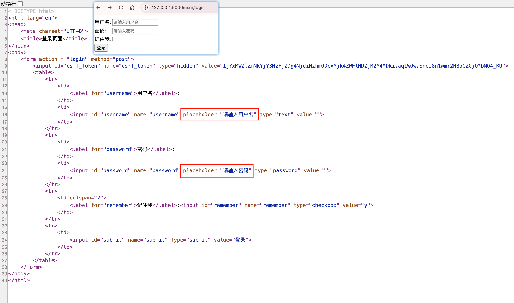
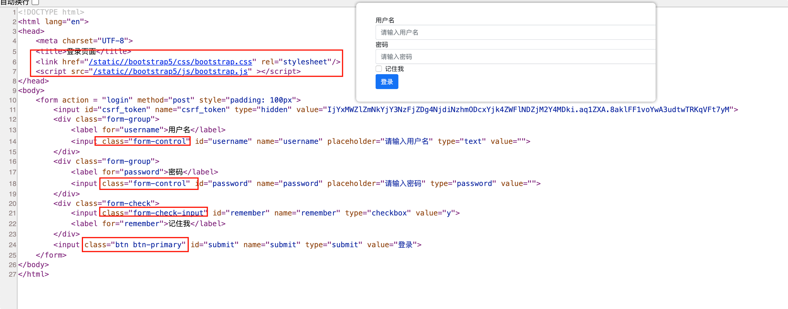

# 表单里添加标签属性和样式

## 添加标签属性

我们可以使用`render_kw`属性在WTForms表单类中添加标签属性。

示例：

```python {5,6}
# 登录类
from flask_wtf import FlaskForm
from wtforms import StringField, PasswordField, BooleanField, SubmitField

class LoginForm(FlaskForm):
    username = StringField('用户名', render_kw={'placeholder': '请输入用户名'})
    password = PasswordField('密码', render_kw={'placeholder': '请输入密码'})
    remember = BooleanField('记住我')
    submit = SubmitField('登录')
```

运行效果：



## 添加样式

我们如果需要给表单加样式，可以直接在模版页面通过class属性实现。

我们这里通过boostrap5框架样式类举例：

```html {6,7,14,18,21,24}
<!DOCTYPE html>
<html lang="en">
<head>
    <meta charset="UTF-8">
    <title>登录页面</title>
    <link href="{{ url_for('static', filename='/bootstrap5/css/bootstrap.css') }}" rel="stylesheet"/>
    <script src="{{ url_for('static', filename='/bootstrap5/js/bootstrap.js') }}" ></script>
</head>
<body>
    <form action = "login" method="post" style="padding: 100px">
        {{ form.csrf_token }}
        <div class="form-group">
            {{ form.username.label }}
            {{ form.username(class='form-control') }}
        </div>
        <div class="form-group">
            {{ form.password.label }}
            {{ form.password(class='form-control') }}
        </div>
        <div class="form-check">
            {{ form.remember(class='form-check-input') }}
            {{ form.remember.label }}
        </div>
        {{ form.submit(class='btn btn-primary') }}
    </form>
</body>
</html>
```

运行效果：

