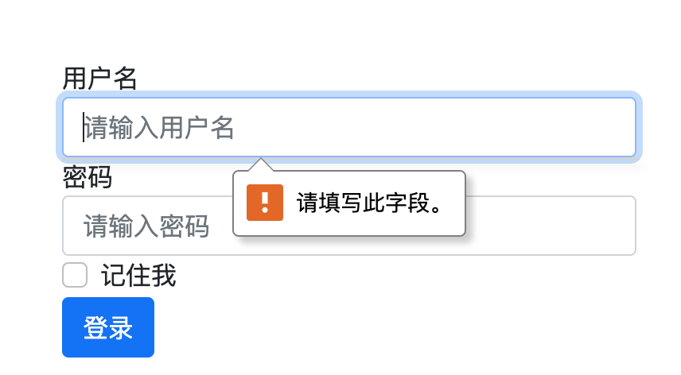
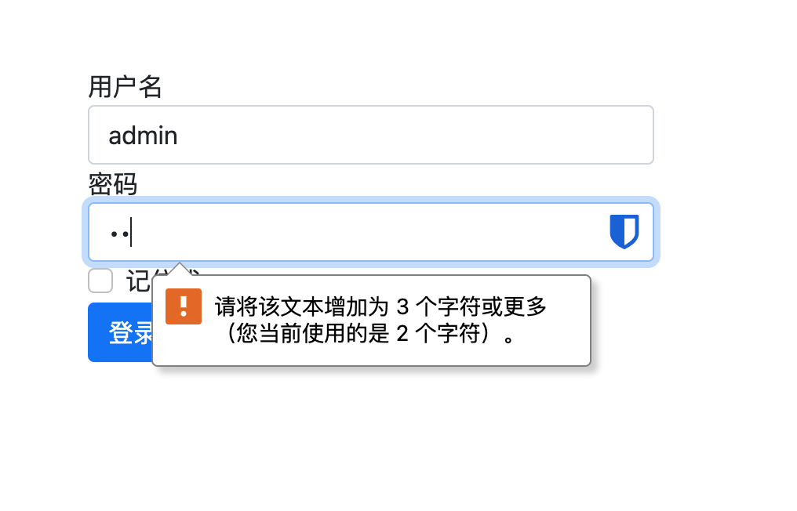

# 表单验证

我们可以通过WTForms表单类属性的`validators`属性来实现表单验证。

 常用的WTForms验证器

| 验证器                                              | 说明                           |
| :-------------------------------------------------- | :----------------------------- |
| DataRequired(message=None)                          | 验证数据是否有效               |
| Email(message=None)                                 | 验证Email地址                  |
| EqualTo(fieldname, message=None)                    | 验证两个字段值是否相同         |
| InputRequired(message=None)                         | 验证是否有数据                 |
| Length(min=-1, max=-1, message=None)                | 验证输入值长度是否在给定范围内 |
| NumberRange(min=None, max=None, message=None)       | 验证输入数字是否在给定范围内   |
| Optional(strip_whitespace=True)                     | 允许输入值为空，并跳过其他验证 |
| Regexp(regex, flags=O, message=None)                | 使用正则表达式验证输入值       |
| URL(require_tld=True, message=None)                 | 验证URL                        |
| AnyOf(values, message=None, values_formatter=None)  | 确保输入值在可选值列表中       |
| NoneOf(values, message=None, values_formatter=None) | 确保输入值不在可选值列表中     |

示例：
改写LoginForm实例：

```python {7,8}
from flask_wtf import FlaskForm
from wtforms import StringField, PasswordField, BooleanField, SubmitField
from wtforms.validators import DataRequired, Length

# 登录类
class LoginForm(FlaskForm):
    username = StringField('用户名', render_kw={'placeholder': '请输入用户名'}, validators=[DataRequired()])
    password = PasswordField('密码', render_kw={'placeholder': '请输入密码'}, validators=[DataRequired(), Length(1, 6)])
    remember = BooleanField('记住我')
    submit = SubmitField('登录')
```

如果验证没通过，点击登录按钮会有提示：

{width=400}

后端视图里通过`validate()`方法来验证：

```python {10}
# 登录页面
@user_bp.route('/login', methods=['GET', 'POST'])
def login():
    loginForm = LoginForm()
    print('标签:', loginForm.username.label)
    print('表单', loginForm.username)
    if request.method == 'GET':
        return render_template('login.html', form=loginForm)
    else:
        if loginForm.validate():
            username = loginForm.username.data
            password = loginForm.password.data
            print(username, password)
        return 'ok'
```

{width=400}