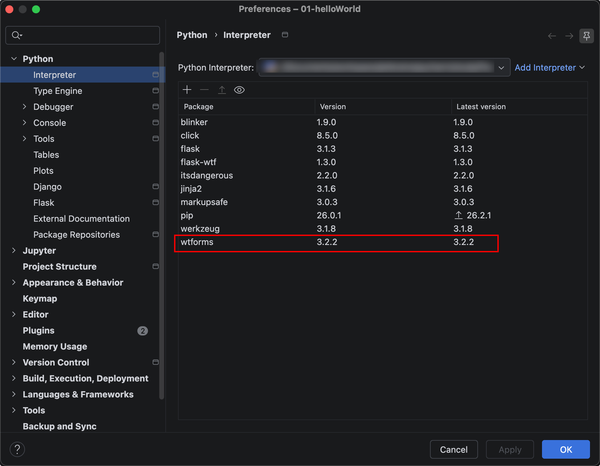

# 概述

## 引入

我们平时开发项目，都会用到表单，编写表单，提交表单，验证表单，如果有错误，还得搞个表单报错提示。

如果我们用Flask3扩展flask-wtf提供的WTForms编写表单，流程很简化很多。

## 安装WTForms

扩展Flask-WTF集成了WTForms，使用它可以在Flask中更方便地使用WTForms。Flask-WTF将表单数 据解析、CSRF保护、文件上传等功能与Flask集成，另外还附加了reCAPTCHA支持。

终端输入:

`pip install flask-wtf -i https://pypi.tuna.tsinghua.edu.cn/simple`

