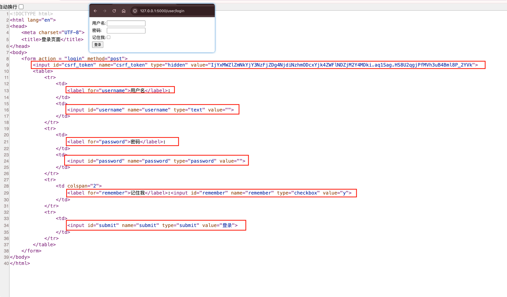

# 渲染表单与获取表单数据

为了能够在模板中渲染表单，我们需要把表单类实例传入模板。

**首先在视图函数里实例化表单类 LoginForm，然后在render_template()函数中使用关键字参数form将表单实例传入模板**

## 渲染表单

示例：

::: code-group

```python [user.py]
from flask_wtf import FlaskForm
from wtforms import StringField, PasswordField, BooleanField, SubmitField
from wtforms.validators import DataRequired, Length

# 登录类
class LoginForm(FlaskForm):
    username = StringField('用户名')
    password = PasswordField('密码')
    remember = BooleanField('记住我')
    submit = SubmitField('登录')

# 登录页面
@user_bp.route('/login')
def login():
    loginForm = LoginForm()
    print('标签:', loginForm.username.label)
    print('表单', loginForm.username)
    return render_template('login.html', form=loginForm)

#======输出======
标签: <label for="username">用户名</label>
表单 <input id="username" name="username" type="text" value="admin">
```

```html [login.html]
<!DOCTYPE html>
<html lang="en">
<head>
    <meta charset="UTF-8">
    <title>登录页面</title>
</head>
<body>
    <form action = "login" method="post">
        {{ form.csrf_token }}
        <table>
            <tr>
                <td>
                    {{ form.username.label }}:
                </td>
                <td>
                    {{ form.username }}
                </td>
            </tr>
            <tr>
                <td>
                    {{ form.password.label }}:
                </td>
                <td>
                    {{ form.password }}
                </td>
            </tr>
            <tr>
                <td colspan="2">
                    {{ form.remember.label }}:{{ form.remember }}
                </td>
            </tr>
            <tr>
                <td>
                    {{ form.submit }}
                </td>
            </tr>
        </table>
    </form>
</body>
</html>
```

:::

运行测试，并打开网页源码：



## 获取数据

后端login()视图函数改下，接收post请求:

```python {10,11}
# 登录页面
@user_bp.route('/login', methods=['GET', 'POST'])
def login():
    loginForm = LoginForm()
    print('标签:', loginForm.username.label)
    print('表单', loginForm.username)
    if request.method == 'GET':
        return render_template('login.html', form=loginForm)
    else:
        username = loginForm.username.data
        password = loginForm.password.data
        print(username, password)
        return 'ok'

#======输出======
admin 111111
```

