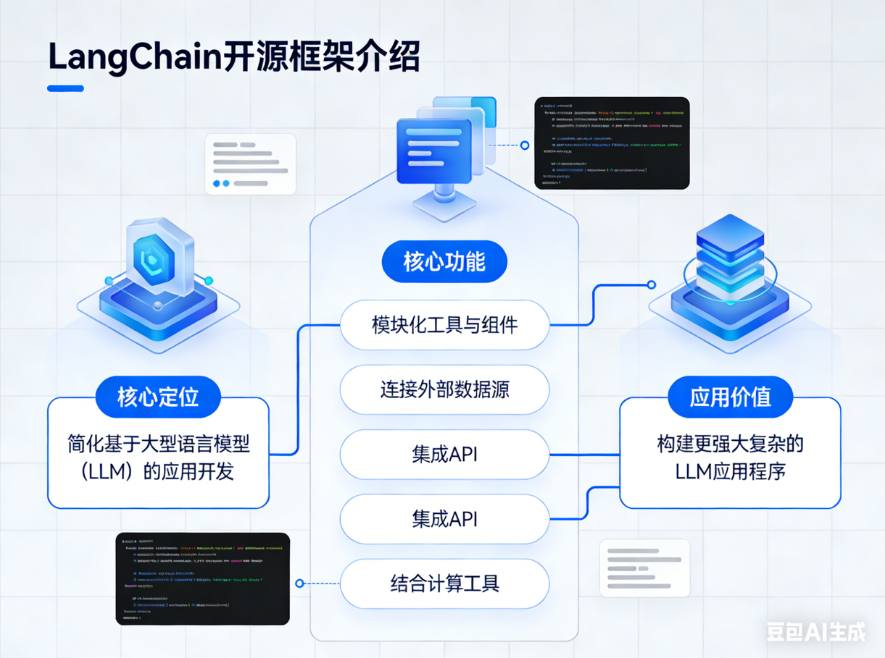
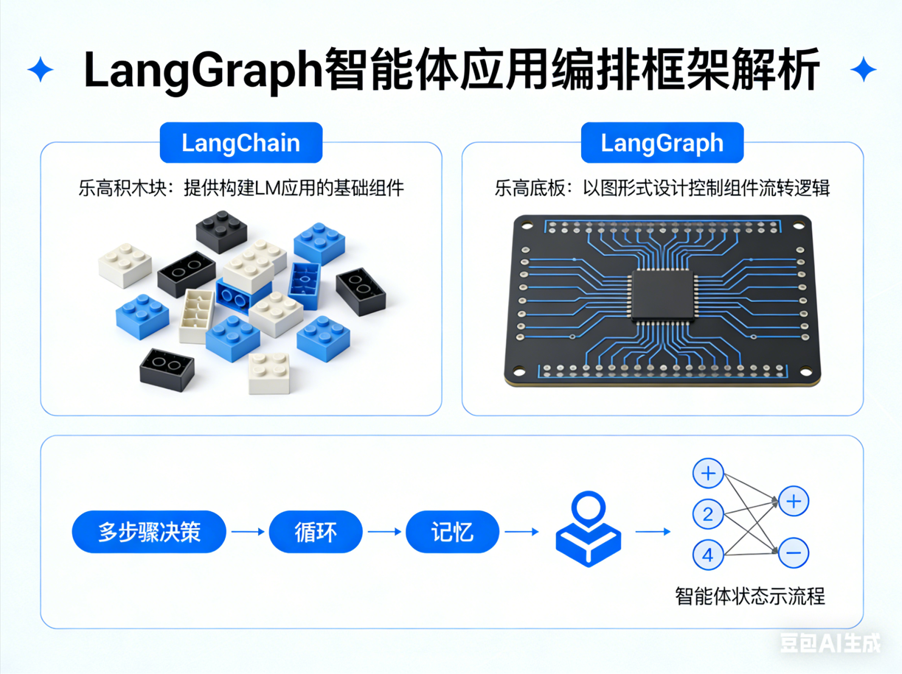

# LangChain简介

LangChain 是一个开源框架，旨在简化基于大型语言模型（LLM）的应用开发。它提供了一套模块化的工具和组件，帮助开发者将LLM与外部数据源、API、计算工具等结合起来，构建更强大、更复杂的应用程序。

LangChain官网：https://www.langchain.com/

LangChain官方文档：https://docs.langchain.com/oss/javascript/langchain/overview

LangGraph 是一个**用于构建复杂、有状态智能体（Agent）应用的编排框架。如果说 LangChain 提供了构建 LLM 应用的各种“乐高积木块”，那么 LangGraph 则提供了一个强大的“乐高底板”，让你能以图（Graph）** 的形式，设计和控制这些积木块之间灵活、复杂的流转逻辑，特别适合构建需要多步骤决策、循环和记忆的 AI 智能体。

## 核心思想

LangChain 的核心思想是**将LLM作为“推理引擎”，并与外部世界连接**，从而实现传统语言模型难以单独完成的任务，例如：

- 访问实时数据
- 执行计算
- 与外部系统交互
- 保持对话记忆

## 主要模块

LangChain 由多个模块组成，每个模块负责特定的功能：

| 模块               | 说明                                                         |
| :----------------- | :----------------------------------------------------------- |
| **Models (模型)**  | 封装了各种LLM提供商（如OpenAI、Hugging Face、Cohere等）的统一接口，方便切换模型。 |
| **Prompts (提示)** | 管理和优化提示词，支持模板化、动态格式化，提升模型输出的可控性。 |
| **Chains (链)**    | 将多个组件（如模型、提示、其他工具）串联成一个工作流，实现复杂任务。 |
| **Agents (代理)**  | 赋予模型“决策能力”，根据任务动态选择使用哪些工具（如搜索引擎、计算器）。 |
| **Memory (记忆)**  | 在对话或任务中保持状态，使模型能记住上下文，适用于聊天机器人等场景。 |
| **Indexes (索引)** | 支持加载、分割和存储外部文档，便于模型进行检索增强生成（RAG）。 |

## 应用场景

LangChain 可广泛应用于：

- **智能问答系统**：基于私有文档进行问答（RAG）
- **聊天机器人**：具备长期记忆和工具调用能力
- **数据分析助手**：用自然语言查询数据库、执行计算
- **自动化工作流**：自动调用API、发送邮件、生成报告
- **代码生成与调试**：辅助编程任务

## 优势

- **模块化设计**：组件可插拔，易于定制和扩展。
- **丰富的集成**：支持众多模型、向量数据库、工具和服务。
- **活跃社区**：快速迭代，大量示例和文档。
- **生产就绪**：提供监控、评估、部署等辅助功能。
