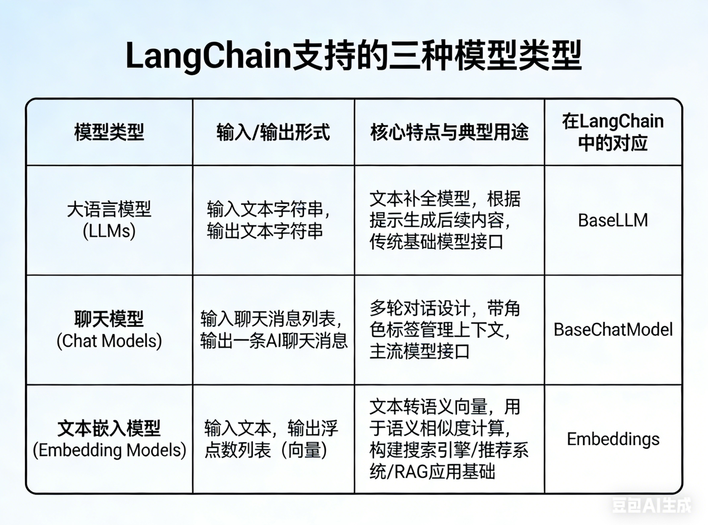

# 基于LangChain开发介绍

**LangChain** 是一个开源库，旨在帮助开发者构建与大型语言模型（LLM）交互的应用。它可以方便地进行自动化任务，支持语言模型的集成、处理和增强，帮助开发者构建复杂的对话型应用、数据分析工具、信息提取、知识库管理等。

LangChain目前支持三种类型的模型：LLMs（大语言模型），Chat Models（聊天模型），Embedding Modes（嵌入模型）

| 模型类型                            | 输入/输出形式                        | 核心特点与典型用途                                           | 在 LangChain 中的对应 |
| :---------------------------------- | :----------------------------------- | :----------------------------------------------------------- | :-------------------- |
| **大语言模型 (LLMs)**               | 输入文本字符串，输出文本字符串       | 也称为**文本补全模型**。适用于根据一段提示（Prompt）生成后续内容的场景，可以看作是更“传统”或基础的模型接口。 | `BaseLLM` 类          |
| **聊天模型 (Chat Models)**          | 输入聊天消息列表，输出一条AI聊天消息 | 专门为**多轮对话**设计，是当前主流模型（如 GPT-4、Qwen 的聊天版本）的接口。消息通常带有角色标签（如系统、用户、AI），能更好地管理对话上下文。 | `BaseChatModel` 类    |
| **文本嵌入模型 (Embedding Models)** | 输入文本，输出浮点数列表（向量）     | 将文本转换为能够表示其语义的**向量**。这个向量不能用于生成对话，而是用于**语义相似度计算**，是构建搜索引擎、推荐系统或 RAG（检索增强生成）应用的基础。 | `Embeddings` 类       |

