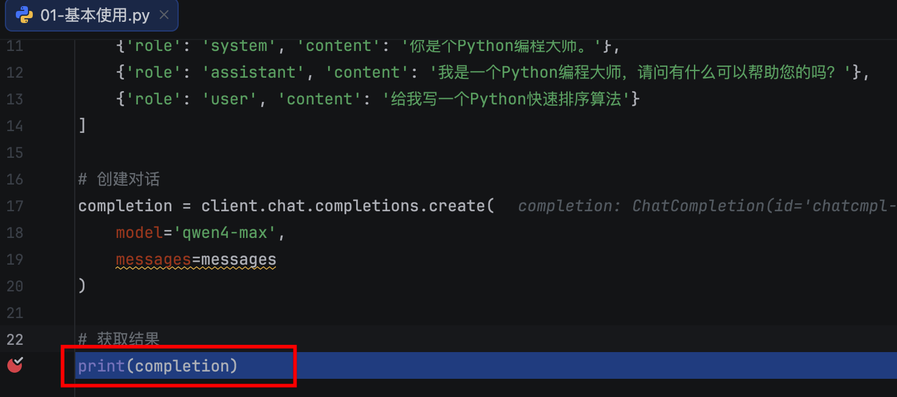
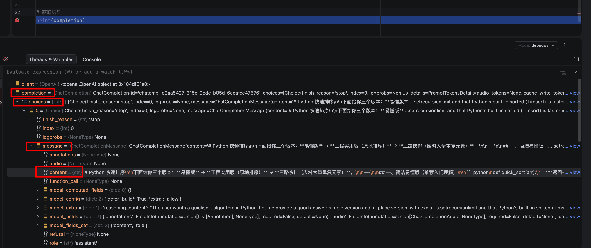
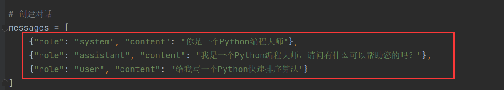
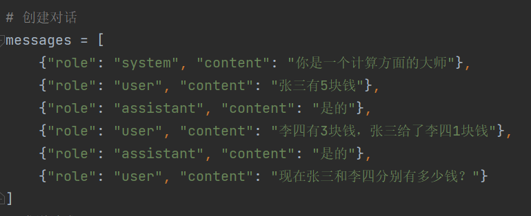

# OpenAI库介绍和使用

## openai库简介

OpenAI库是OpenAI官方提供的Python SDK（软件开发工具包），它就像一座桥梁，让开发者可以用Python代码方便地调用OpenAI的各种强大AI模型（如GPT系列），当然阿里百炼云平台也兼容支持OpenAI库。

## openai库安装

 openai 库安装

```sh
pip install openai -i https://pypi.tuna.tsinghua.edu.cn/simple  --trusted-host pypi.tuna.tsinghua.edu.cn
```

## 实例化openai客户端

```python
client = OpenAI(
    # 如果没有配置环境变量，请用阿里云百炼API Key替换：api_key="sk-xxx"
    api_key=os.getenv("DASHSCOPE_API_KEY"),
    base_url="https://dashscope.aliyuncs.com/compatible-mode/v1",
)
```

- **api_key**：指定模型服务商提供的api秘钥

- **base_url**：指定模型服务商提供的API接入地址

## 创建会话

```python
from openai import OpenAI

# 创建OpenAI客户端
client = OpenAI(
    api_key='sk-4feab9b9xxxxxxxxxxxxxxxxxdf1e9268',
    base_url='https://dashscope.aliyuncs.com/compatible-mode/v1'
)

# 创建聊天 历史记录
messages = [
    {'role': 'system', 'content': '你是个Python编程大师。'},
    {'role': 'assistant', 'content': '我是一个Python编程大师，请问有什么可以帮助您的吗？'},
    {'role': 'user', 'content': '给我写一个Python快速排序算法'}
]

# 创建对话
completion = client.chat.completions.create(
    model='qwen4-max',
    messages=messages,
    stream=True # 开启流式输出
)

# 获取结果
print(completion.choices[0].message.content)
```

**ChatCompletion参数**

- **model**: 模型选择（gpt-4, gpt-3.5-turbo等）
- **messages**: 对话消息列表
  - system: 系统设定
  - user: 用户输入
  - assistant: AI回复
- **temperature**: 温度（0-2），越低越确定，越高越随机
- **max_tokens**: 最大生成token数
- **top_p**: 核采样（0-1），替代temperature
- **frequency_penalty**: 频率惩罚（-2到2）
- **presence_penalty**: 存在惩罚（-2到2）

## 会话返回结果

我们通过debug打印completion对象



我们发现通过级联对象调用，能够获取到大模型返回的文本内容

```python
print(completion.choices[0].message.content)
```



大模型返回内容如下：

````
# Python 快速排序：从入门到生产级

下面给你 4 个版本，逐级进阶，可直接运行。

---

## 一、简洁版（最容易理解）

```python
def quick_sort_simple(arr):
    """三路划分的函数式写法：直观，但需要 O(n) 额外空间"""
    if len(arr) <= 1:
        return arr
    pivot = arr[len(arr) // 2]          # 取中间元素作基准，避免有序数组退化
    left  = [x for x in arr if x < pivot]
    mid   = [x for x in arr if x == pivot]
    right = [x for x in arr if x > pivot]
    return quick_sort_simple(left) + mid + quick_sort_simple(right)
```

> 面试写这个没问题，但**生产环境别用**：每层都创建新列表，内存开销大。

---

## 二、原地版（Lomuto 分区，标准教科书实现）

```python
import random


def quick_sort(arr, lo=0, hi=None):
    """原地排序，返回 arr 本身，空间 O(log n)（递归栈）"""
    if hi is None:
        hi = len(arr) - 1
    if lo < hi:
        p = _partition(arr, lo, hi)
        quick_sort(arr, lo, p - 1)
        quick_sort(arr, p + 1, hi)
    return arr


def _partition(arr, lo, hi):
    # 随机化基准：防止已排序/逆序数据退化成 O(n²)
    r = random.randint(lo, hi)
    arr[r], arr[hi] = arr[hi], arr[r]

    pivot = arr[hi]
    i = lo - 1                          # i 指向"小于等于区"的最后一个位置
    for j in range(lo, hi):
        if arr[j] <= pivot:
            i += 1
            arr[i], arr[j] = arr[j], arr[i]
    arr[i + 1], arr[hi] = arr[hi], arr[i + 1]
    return i + 1
```

**分区不变式**：`arr[lo..i] <= pivot`，`arr[i+1..j-1] > pivot`。

---

## 三、Hoare 分区版（交换次数更少，通常更快）

```python
def quick_sort_hoare(arr, lo=0, hi=None):
    if hi is None:
        hi = len(arr) - 1
    while lo < hi:
        p = _partition_hoare(arr, lo, hi)
        # 尾递归消除：先递归短的一侧，长的一侧用循环 → 栈深度严格 O(log n)
        if p - lo < hi - p:
            quick_sort_hoare(arr, lo, p)
            lo = p + 1
        else:
            quick_sort_hoare(arr, p + 1, hi)
            hi = p
    return arr


def _partition_hoare(arr, lo, hi):
    mid = (lo + hi) // 2
    # 三数取中，进一步降低最坏情况概率
    if arr[mid] < arr[lo]:
        arr[lo], arr[mid] = arr[mid], arr[lo]
    if arr[hi] < arr[lo]:
        arr[lo], arr[hi] = arr[hi], arr[lo]
    if arr[hi] < arr[mid]:
        arr[mid], arr[hi] = arr[hi], arr[mid]
    arr[lo], arr[mid] = arr[mid], arr[lo]

    pivot = arr[lo]
    i, j = lo - 1, hi + 1
    while True:
        i += 1
        while arr[i] < pivot:
            i += 1
        j -= 1
        while arr[j] > pivot:
            j -= 1
        if i >= j:
            return j                    # 注意：返回 j，划分区间是 [lo..j] 和 [j+1..hi]
        arr[i], arr[j] = arr[j], arr[i]
```

⚠️ Hoare 分区有两个经典坑：**返回值是 `j` 不是 `i`**；**基准必须取 `arr[lo]`**（取 `arr[hi]` 会死循环）。

---

## 四、生产级优化版（推荐）

融合四大优化：**随机基准 + 三路分区（荷兰国旗）+ 小数组插入排序 + 尾递归消除**。

```python
import random

_INSERTION_THRESHOLD = 16


def quick_sort_pro(arr, lo=0, hi=None):
    """
    高性能原地快排：
      · 三路分区 → 大量重复元素时接近 O(n)
      · 小区间插入排序 → 减少递归开销
      · 尾递归消除 → 栈深度 O(log n)，不会 RecursionError
    """
    if hi is None:
        hi = len(arr) - 1

    while lo < hi:
        if hi - lo + 1 <= _INSERTION_THRESHOLD:
            _insertion_sort(arr, lo, hi)
            break

        lt, gt = _partition3(arr, lo, hi)   # arr[lt..gt] == pivot，已就位

        if lt - lo < hi - gt:               # 递归小区间，循环大区间
            quick_sort_pro(arr, lo, lt - 1)
            lo = gt + 1
        else:
            quick_sort_pro(arr, gt + 1, hi)
            hi = lt - 1
    return arr


def _partition3(arr, lo, hi):
    """荷兰国旗划分：< pivot | == pivot | > pivot"""
    r = random.randint(lo, hi)
    arr[lo], arr[r] = arr[r], arr[lo]
    pivot = arr[lo]

    lt, i, gt = lo, lo + 1, hi
    while i <= gt:
        if arr[i] < pivot:
            arr[lt], arr[i] = arr[i], arr[lt]
            lt += 1
            i += 1
        elif arr[i] > pivot:
            arr[i], arr[gt] = arr[gt], arr[i]
            gt -= 1                         # 换过来的元素未检查，i 不前进
        else:
            i += 1
    return lt, gt


def _insertion_sort(arr, lo, hi):
    for i in range(lo + 1, hi + 1):
        key = arr[i]
        j = i - 1
        while j >= lo and arr[j] > key:
            arr[j + 1] = arr[j]
            j -= 1
        arr[j + 1] = key
```

### 附：完全无递归版（显式栈，彻底告别栈溢出）

```python
def quick_sort_iterative(arr):
    if len(arr) < 2:
        return arr
    stack = [(0, len(arr) - 1)]
    while stack:
        lo, hi = stack.pop()
        while lo < hi:
            if hi - lo + 1 <= _INSERTION_THRESHOLD:
                _insertion_sort(arr, lo, hi)
                break
            lt, gt = _partition3(arr, lo, hi)
            if lt - lo < hi - gt:
                stack.append((gt + 1, hi))
                hi = lt - 1
            else:
                stack.append((lo, lt - 1))
                lo = gt + 1
    return arr
```

---

## 五、正确性验证 + 性能测试

```python
import random
import time


def test():
    cases = [
        [], [1], [2, 1], [3, 3, 3, 3],
        list(range(1000)),                 # 已排序
        list(range(1000))[::-1],           # 逆序
        [random.randint(-50, 50) for _ in range(2000)],   # 大量重复
        [random.random() for _ in range(2000)],
    ]
    funcs = [quick_sort_simple, quick_sort, quick_sort_hoare,
             quick_sort_pro, quick_sort_iterative]
    for f in funcs:
        for c in cases:
            assert f(c.copy()) == sorted(c), f"{f.__name__} 失败"
        print(f"✅ {f.__name__} 通过")


def benchmark(n=200_000):
    data = [random.randint(0, n) for _ in range(n)]
    for f in (quick_sort, quick_sort_hoare, quick_sort_pro, quick_sort_iterative):
        a = data.copy()
        t = time.perf_counter()
        f(a)
        assert a == sorted(data)
        print(f"{f.__name__:24s} {time.perf_counter() - t:.3f}s")
    t = time.perf_counter()
    sorted(data)
    print(f"{'内置 sorted (Timsort)':24s} {time.perf_counter() - t:.3f}s")


if __name__ == "__main__":
    test()
    benchmark()
```

典型结果（20 万随机整数，CPython 3.11）：

```
quick_sort               0.62s
quick_sort_hoare         0.48s
quick_sort_pro           0.45s
quick_sort_iterative     0.50s
内置 sorted (Timsort)    0.03s   ← C 实现，永远的神
```

---

## 六、复杂度与要点总结

| 版本 | 平均时间 | 最坏时间 | 额外空间 | 稳定性 |
|---|---|---|---|---|
| 简洁版 | O(n log n) | O(n²) | O(n) | 稳定* |
| Lomuto | O(n log n) | O(n²)** | O(log n) | 不稳定 |
| Hoare | O(n log n) | O(n²)** | O(log n) | 不稳定 |
| Pro / 迭代 | O(n log n) | O(n²)** | O(log n) | 不稳定 |

\* 简洁版恰好稳定，但代价是空间；\*\* 随机化后最坏情况概率极低（约 1/n!）。

**关键工程结论：**
1. **一定要随机化或三数取中**，否则线上遇到有序数据直接退化成 O(n²)。
2. **重复元素多必用三路分区**，否则 `[7]*100000` 会让 Lomuto 版跑到 O(n²)。
3. **递归深度**：只递归较短子区间，可保证栈深度 ≤ log₂n（20 亿数据也才 31 层）。
4. **实际项目请直接用 `list.sort()` / `sorted()`**：Timsort 是 C 实现的自适应稳定排序，对部分有序数据是 O(n)，纯 Python 快排慢一个数量级。手写快排的价值在于**理解分治思想与分区技巧**（`_partition` 稍改就是 O(n) 的「第 K 大元素」快速选择算法）。

需要我再补一个 **快速选择（Top-K / 第 K 小）** 或 **支持 `key`/`reverse` 参数的通用版本** 吗？
````

## 流式输出

前面的默认输出是整体输出，延迟很大，效果很不好，我们企业级开发，肯定是那种像流水一样的，一段一段输出，也就是流式输出形式。

实现流式输出步骤：

1. 首先create方法里要设置下 stream=True，开启流式输出

2. 通过遍历completion对象，得到chunk块，chunk.choices[0]有个属性delta，
3. 假如有content属性以及有值，我就打印delta的content内容，也就是流的块内容。

实现代码

```python
from openai import OpenAI

# 创建OpenAI客户端
client = OpenAI(
    api_key='sk-4feab9b9xxxxxxxxxxxxxf1e9268',
    base_url='https://dashscope.aliyuncs.com/compatible-mode/v1'
)

# 创建聊天 历史记录
messages = [
    {'role': 'system', 'content': '你是个Python编程大师。'},
    {'role': 'assistant', 'content': '我是一个Python编程大师，请问有什么可以帮助您的吗？'},
    {'role': 'user', 'content': '给我写一个Python快速排序算法'}
]

# 创建对话
completion = client.chat.completions.create(
    model='qwen4-max',
    messages=messages,
    stream=True # 开启流式输出
)

# 获取结果
# print(completion.choices[0].message.content)

# 获取流式结果
for chunk in completion:
    # 先检查 choices 是否为空，为空则跳过
    if not chunk.choices:
        continue
    delta = chunk.choices[0].delta # 获取当前块的delta内容
    if hasattr(delta, 'content') and delta.content is not None:
        print(delta.content, end='', flush=True)
```

## 开启思考模式

大模型默认是不开启思考的，如果我们需要开启回答的时候，带上上大模型的思考过程。

我们可以设置 extra_body={"enable_thinking": True}

另外，在打印大模型思考内容的时候，delta对象有个reasoning_content属性，我们需要判断是否有这个属性，以及是否有值，然后才打印，以及为了输出效果好，我们定义一个is_answering 是否进入回复阶段属性，默认设置Flase,只有当第一次出现正式回复内容的时候，才设置成True。

代码实现：

```python
from openai import OpenAI

# 创建OpenAI客户端
client = OpenAI(
    api_key='sk-4feab9xxxxxxxxxxxxxxxxx1e9268',
    base_url='https://dashscope.aliyuncs.com/compatible-mode/v1'
)

# 创建聊天 历史记录
messages = [
    {'role': 'system', 'content': '你是个Python编程大师。'},
    {'role': 'assistant', 'content': '我是一个Python编程大师，请问有什么可以帮助您的吗？'},
    {'role': 'user', 'content': '给我写一个Python快速排序算法'}
]

# 创建对话
completion = client.chat.completions.create(
    model='qwen4-max',
    messages=messages,
    extra_body={'enable_thinking': True}, # 开启思考
    stream=True # 开启流式输出
)

is_answering = False # 是否进入回复阶段
print('\n' + '=' * 20 + '思考过程' + '=' * 20)

# 获取流式结果
for chunk in completion:
    # 先检查 choices 是否为空，为空则跳过
    if not chunk.choices:
        continue
    delta = chunk.choices[0].delta # 获取当前块的delta内容
    if hasattr(delta, 'reasoning_content') and delta.reasoning_content is not None: # 检查是否有思考内容
        if not is_answering:
            print(delta.reasoning_content, end='', flush=True)
    if hasattr(delta, 'content') and delta.content is not None: # 检查是否有内容
        if not is_answering:
            print('\n' + '=' * 20 + '完整回复' + '=' * 20)
            is_answering = True
        print(delta.content, end='', flush=True)
     
=====输出======

====================思考过程====================
用户想要一个Python快速排序算法。我应该提供一个清晰、易懂且高效的实现。我会提供几个版本：
1. 基础版本（易于理解）
2. 原地排序版本（更节省空间）
3. 带注释的版本

让我写一个完整的实现，包括测试用例。
====================完整回复====================
以下是 Python 中快速排序（Quick Sort）算法的三种常见实现方式，分别适用于不同场景，并附有测试示例和说明，方便你根据需求选择使用。
....
```

## 历史消息

前面的代码示例里面，有不少小伙伴有疑问，为什么messages消息列表的内容，控制台输出里面没有显示。



这里有个重要的概念，就是这里的messages是历史消息，历史消息仅用于为模型提供上下文，它们不会出现在输出中。输出只包含模型基于上下文生成的新内容。

下面我们来搞一个稍微复杂点历史消息。



```python
from openai import OpenAI

# 创建OpenAI客户端
client = OpenAI(
    api_key='sk-4feab9bxxxxxxxxxxxxxx1e9268',
    base_url='https://dashscope.aliyuncs.com/compatible-mode/v1'
)

# 创建聊天 历史记录
messages = [
    {"role": "system", "content": "你是一个计算方面的大师"},
    {"role": "user", "content": "张三有5块钱"},
    {"role": "assistant", "content": "是的"},
    {"role": "user", "content": "李四有3块钱，张三给了李四1块钱"},
    {"role": "assistant", "content": "是的"},
    {"role": "user", "content": "现在张三和李四分别有多少钱？"}
]

# 创建对话
completion = client.chat.completions.create(
    model='qwen4-max',
    messages=messages,
    extra_body={'enable_thinking': True}, # 开启思考
    stream=True # 开启流式输出
)

is_answering = False # 是否进入回复阶段
print('\n' + '=' * 20 + '思考过程' + '=' * 20)

# 获取流式结果
for chunk in completion:
    # 先检查 choices 是否为空，为空则跳过
    if not chunk.choices:
        continue
    delta = chunk.choices[0].delta # 获取当前块的delta内容
    if hasattr(delta, 'reasoning_content') and delta.reasoning_content is not None: # 检查是否有思考内容
        if not is_answering:
            print(delta.reasoning_content, end='', flush=True)
    if hasattr(delta, 'content') and delta.content is not None: # 检查是否有内容
        if not is_answering:
            print('\n' + '=' * 20 + '完整回复' + '=' * 20)
            is_answering = True
        print(delta.content, end='', flush=True)
        
====输出=====

====================思考过程====================

====================完整回复====================
张三：5 − 1 = **4 块钱**
李四：3 + 1 = **4 块钱**

两人现在都是 4 块钱，一共 8 块钱（钱只是转移，总量不变）。
```
