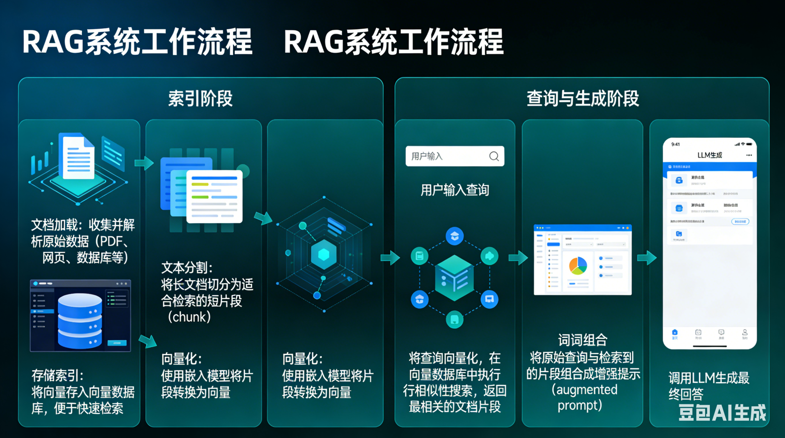

# RAG简介

**RAG（Retrieval-Augmented Generation，检索增强生成）** 是一种结合信息检索与大型语言模型（LLM）的架构。它通过在生成答案前先从外部知识库检索相关文档片段，为生成模型提供事实依据，从而提升回答的准确性、时效性并减少幻觉。

## 核心工作流程

RAG系统通常包含两个阶段：

- **索引阶段**
  - 文档加载：收集并解析原始数据（PDF、网页、数据库等）。
  - 文本分割：将长文档切分为适合检索的短片段（chunk）。
  - 向量化：使用嵌入模型将片段转换为向量。
  - 存储索引：将向量存入向量数据库，便于快速检索。
- **查询与生成阶段**
  - 用户输入查询。
  - 将查询向量化，在向量数据库中执行相似性搜索，返回最相关的文档片段。
  - 将原始查询与检索到的片段组合成增强提示（augmented prompt）。
  - 调用LLM生成最终回答。

## 关键组件

| 组件               | 作用                         | 常见选项                                         |
| :----------------- | :--------------------------- | :----------------------------------------------- |
| **文档加载与处理** | 提取文本，清洗数据，切分块   | LangChain文档加载器，Unstructured，自定义解析    |
| **嵌入模型**       | 将文本转为向量，语义表示     | OpenAI embeddings，Sentence Transformers，Cohere |
| **向量数据库**     | 存储向量，高效近似最近邻检索 | Chroma，FAISS，Pinecone，Weaviate，Qdrant        |
| **大语言模型**     | 基于增强提示生成自然语言回答 | GPT系列，Claude，Llama，ChatGLM                  |
| **提示工程**       | 设计包含上下文的提示格式     | 定制模板，Chain-of-Thought                       |

## 开发步骤

1. **需求与数据准备**：确定应用场景，收集并清洗知识库文档。
2. **构建索引**：选择合适的块大小、重叠策略，使用嵌入模型生成向量并存入向量库。
3. **实现检索逻辑**：根据查询召回Top-K相关片段，可结合重排序（rerank）提升精度。
4. **集成生成模型**：将检索结果与查询组装成提示，调用LLM接口。
5. **评估与优化**：测试回答质量，调整检索参数、块大小、提示模板或引入反馈机制。

## 常用框架与工具

- **LangChain**：提供模块化组件，快速搭建RAG流水线。
- **LlamaIndex**：专为数据索引和检索设计，支持多种数据源和高级检索策略。
- **向量数据库**：如Chroma（轻量级）、FAISS（高效）、Pinecone（托管服务）。
- **Embedding服务**：HuggingFace Sentence Transformers，OpenAI Embeddings。
- **LLM部署**：可通过API调用（OpenAI，Anthropic）或本地部署（vLLM，ollama）。

## 典型应用场景

- **企业智能客服**：结合产品文档，精准回答用户问题。
- **知识库问答**：对内部文档、研究报告进行自然语言查询。
- **内容创作辅助**：基于最新资料生成报告或摘要。
- **教育辅导**：根据教材内容提供个性化解答。

## 优势与挑战

**优势**

- 减少模型幻觉，回答基于实际文档。
- 知识易于更新：只需更新索引库，无需重新训练模型。
- 可解释性：可追溯回答来源。
- 降低计算成本：小模型+检索可能优于大模型闭卷回答。

**挑战**

- 检索质量直接影响生成效果。
- 延迟：涉及两次网络调用（向量检索+LLM生成）。
- 上下文窗口限制：需考虑片段数量与长度。
- 评估复杂：需要同时衡量检索和生成质量。

## 未来趋势

- 多模态RAG：支持图像、表格、视频的检索与生成。
- 自适应检索：根据问题复杂度动态调整检索策略。
- 混合检索：结合关键词与向量搜索，提升精度。
- 缓存与优化：减少延迟和API成本。

RAG已成为构建企业级LLM应用的主流模式，它将外部知识无缝融入生成流程，让AI回答更可靠、更具业务价值。