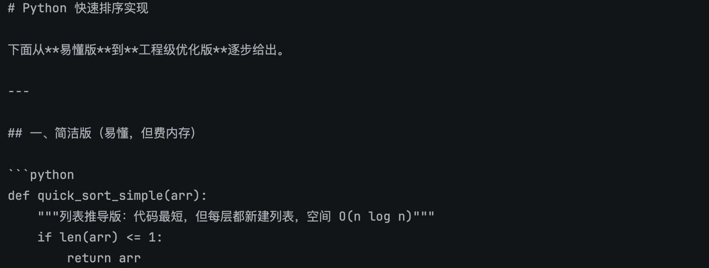
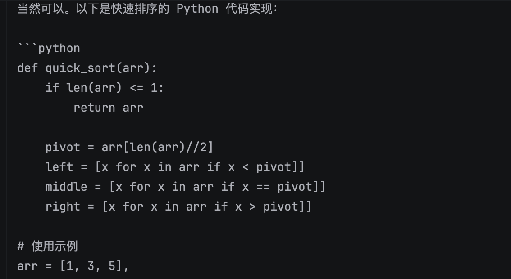
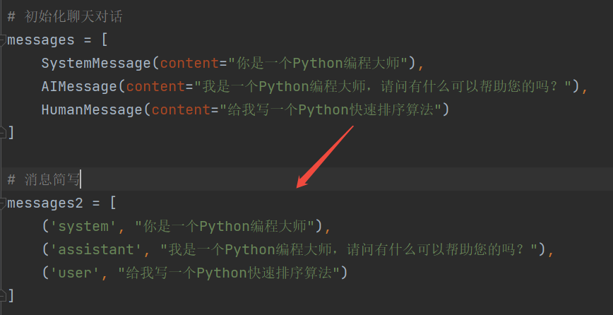

# LangChain调用聊天大模型

再之前学习openai库的时候，对话消息有三种角色。

**messages**: 对话消息列表

- system: 系统设定
- user: 用户输入
- assistant: AI回复

我们现在使用LangChain框架，也有三个角色，

- system对应SystemMessage，系统设定消息
- user对应HumanMessage，用户输入消息
- assistant对应AIMessage，AI回复消息

## 调用ChatOpenAI

接下来，我们看一个示例：

```python
from langchain_openai import ChatOpenAI
from langchain_core.messages import SystemMessage, AIMessage, HumanMessage

# 创建模型
model = ChatOpenAI(
    model="qwen4-max",
    api_key="sk-ws-xxxxxxxxxxxxo", # type: ignore[arg-type]
    base_url='https://dashscope.aliyuncs.com/compatible-mode/v1'
)
# 初始化聊天对话
messages = [
    SystemMessage(content="你是一个Python编程大师"),
    AIMessage(content="我是一个Python编程大师，请问有什么可以帮助您的吗？"),
    HumanMessage(content="给我写一个Python快速排序算法")
]

# 调用模型
result = model.stream(input=messages)

for chunk in result:
    print(chunk.content, end="", flush=True)
```

运行输出：



### 使用DashScope

除了可以通过ChatOpenAI调用通义千问外，阿里还可以通过自己的DashScope调用。

`DashScope`（模型服务灵积）是阿里云推出的一个模型服务平台。它就像阿里云版的“OpenAI API 平台”，旨在通过标准化的API接口，为开发者提供丰富、易用的AI模型服务 。

需要使用到`langchain-community（已废弃）`库。当然内部还需要`dashscope`库的支持，也需要安装下。

> inter mac 无法直接安装cryptography，需要编译安装
>
> ```sh
> python -m pip install cryptography --only-binary=:all: -i https://pypi.tuna.tsinghua.edu.cn/simple
> ```

```sh
pip install langchain-community dashscope -i https://pypi.tuna.tsinghua.edu.cn/simple  --trusted-host pypi.tuna.tsinghua.edu.cn
```

下面是LangChain调用通义千问大语言模型的参考代码：

```python
from langchain_community.chat_models.tongyi import ChatTongyi
from langchain_core.messages import SystemMessage, AIMessage, HumanMessage

# 创建模型
model = ChatTongyi(
    model="qwen4-max",
    api_key="sk-ws-H.xxxxxxxxxbexQno" # type: ignore[arg-type]
)

# 初始化聊天对话
messages = [
    SystemMessage(content="你是一个Python编程大师"),
    AIMessage(content="我是一个Python编程大师，请问有什么可以帮助您的吗？"),
    HumanMessage(content="给我写一个Python快速排序算法")
]

# 调用模型
result = model.stream(input = messages)

for chunk in result:
    print(chunk.content, end="", flush=True)
```


## 调用ChatOllama

我们也换成调用本地ollama大模型：

```python
from langchain_ollama import ChatOllama
from langchain_core.messages import SystemMessage, AIMessage, HumanMessage

# 创建模型
model = ChatOllama(model="qwen:0.5b")

# 初始化聊天对话
messages = [
    SystemMessage(content="你是一个Python编程大师"),
    AIMessage(content="我是一个Python编程大师，请问有什么可以帮助您的吗？"),
    HumanMessage(content="给我写一个Python快速排序算法")
]

# 调用模型
result = model.stream(input=messages)

for chunk in result:
    print(chunk.content, end="", flush=True)
```

运行输出：



## 消息简写

前面我们调用大模型的会话消息使用的是对象，SystemMessage，AIMessage，HumanMesssage，但是写起来麻烦，而且不灵活。我们以后开发都用下面的简写形式，列表里面是元组，元组第一个元素是角色(system,assistant,user)，第二个元素是内容。



### openai

完整测试代码：

```python
from langchain_openai import ChatOpenAI
from langchain_core.messages import SystemMessage, AIMessage, HumanMessage

# 创建模型
model = ChatOpenAI(
    model="qwen4-max",
    api_key="sk-ws-HxxxxxxxxbexQno", # type: ignore[arg-type]
    base_url='https://dashscope.aliyuncs.com/compatible-mode/v1'
)
# 初始化聊天对话
messages = [
    SystemMessage(content="你是一个Python编程大师"),
    AIMessage(content="我是一个Python编程大师，请问有什么可以帮助您的吗？"),
    HumanMessage(content="给我写一个Python快速排序算法")
]

# 消息简写
messages2 = [
    ('system', '你是一个Python编程大师'),
    ('assistant', '我是一个Python编程大师，请问有什么可以帮助您的吗？'),
    ('user', '给我写一个Python快速排序算法')
]

# 调用模型
result = model.stream(input = messages2)

for chunk in result:
    print(chunk.content, end="", flush=True)
```

### ollama

调用本地Ollama大模型的示例代码我们也改下吧：

```python
from langchain_ollama import ChatOllama
from langchain_core.messages import SystemMessage, AIMessage, HumanMessage

# 创建模型
model = ChatOllama(model="qwen:0.5b")

# 初始化聊天对话
messages = [
    SystemMessage(content="你是一个Python编程大师"),
    AIMessage(content="我是一个Python编程大师，请问有什么可以帮助您的吗？"),
    HumanMessage(content="给我写一个Python快速排序算法")
]

# 消息简写
messages2 = [
    ('system', '你是一个Python编程大师'),
    ('assistant', '我是一个Python编程大师，请问有什么可以帮助您的吗？'),
    ('user', '给我写一个Python快速排序算法')
]

# 调用模型
result = model.stream(input=messages2)

for chunk in result:
    print(chunk.content, end="", flush=True)
```

