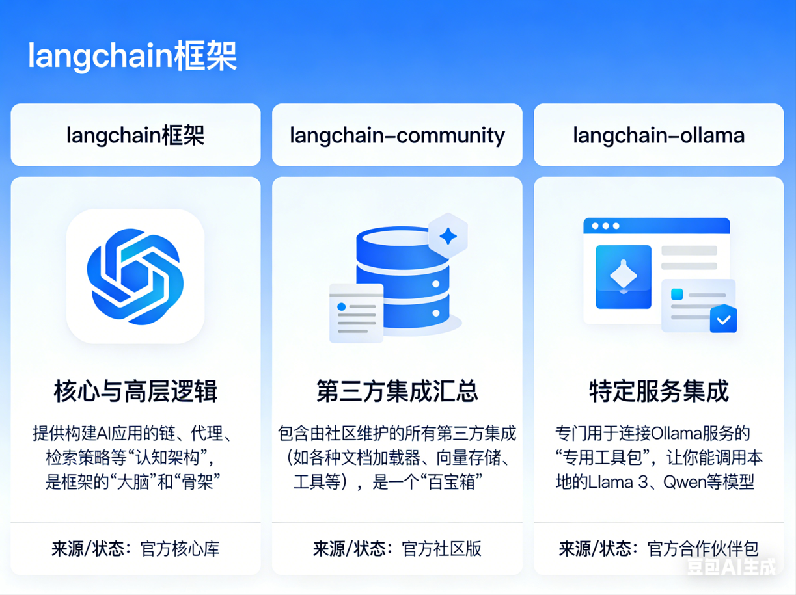
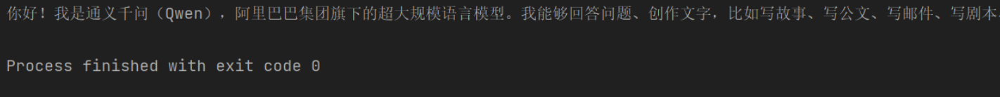
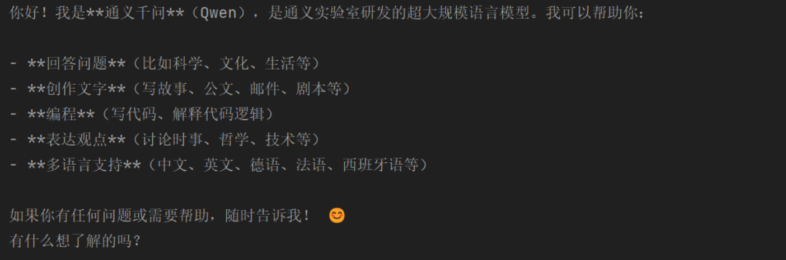

# 使用LangChain调用大语言模型

## 安装库

我们首先来安装下LangChain库

```sh
pip install langchain langchain-community langchain-ollama -i https://pypi.tuna.tsinghua.edu.cn/simple  --trusted-host pypi.tuna.tsinghua.edu.cn
```

| 库名                    | 核心定位           | 主要职责                                                     | 来源 / 状态    |
| :---------------------- | :----------------- | :----------------------------------------------------------- | :------------- |
| **langchain**           | 框架核心与高层逻辑 | 提供构建AI应用的**链、代理、检索策略**等“认知架构”，是框架的“大脑”和“骨架。 | 官方核心库     |
| **langchain-community** | 第三方集成汇总     | 包含由社区维护的**所有第三方集成**（如各种文档加载器、向量存储、工具等），是一个“百宝箱”。 | 官方社区版     |
| **langchain-ollama**    | 特定服务集成       | 专门用于连接**Ollama服务**的“专用工具包”，让你能调用本地的Llama 3、Qwen等模型。 | 官方合作伙伴包 |



## 调用通义千问

比如我们现在要调用的通义千问大模型，就需要使用到langchain-community社区库。当然内部还需要dashscope库的支持，也需要安装下。

> inter mac 无法直接安装cryptography，需要编译安装
>
> ```sh
> python -m pip install cryptography --only-binary=:all: -i https://pypi.tuna.tsinghua.edu.cn/simple
> ```

```sh
pip install dashscope -i https://pypi.tuna.tsinghua.edu.cn/simple  --trusted-host pypi.tuna.tsinghua.edu.cn
```

`DashScope`（模型服务灵积）是阿里云推出的一个模型服务平台。它就像阿里云版的“OpenAI API 平台”，旨在通过标准化的API接口，为开发者提供丰富、易用的AI模型服务 。

下面是LangChain调用通义千问大语言模型的参考代码：

```python
from langchain_community.llms.tongyi import Tongyi

# 创建模型
model = Tongyi(model="qwen4-max", api_key="sk-4feabxxxxxxxxxxxx268")

# 调用模型
result = model.invoke(input("你是谁？"))
print(result)
```

运行输出：



## 调用Ollama

我们使用LangChain来调用Ollama本地大模型

```python
from langchain_ollama import OllamaLLM

# 创建模型
model = OllamaLLM(model="qwen:0.5b")

# 调用模型
result = model.invoke(input("你是谁？"))
print(result)
```

运行输出：



## 设置流式输出

前面我们使用invoke是完整输出形式，当返回数据量大的时候，会有延迟，显示效果也不好，我们企业级开发，肯定是一段一段的像流水一样的输出形式。

在LangChain中，我们使用stream()方法，来实现流式输出。

实现代码：

```python
from langchain_community.llms.tongyi import Tongyi

# 创建模型
model = Tongyi(model="qwen4-max", api_key="sk-4feabxxxxxxxxxxxx268")

# 调用模型
result = model.invoke(input("你是谁？"))

for chunk in result:
    print(chunk, end="", flush=True)
```

运行返回的就是一段一段的流式输出了。

同样，如果我们使用本地ollama里的大模型，代码也改下：

```python
from langchain_ollama import OllamaLLM

# 创建模型
model = OllamaLLM(model="qwen:0.5b")

# 调用模型
result = model.stream(input("你是谁？"))

for chunk in result:
    print(chunk, end="", flush=True)

```

运行也是流式效果

