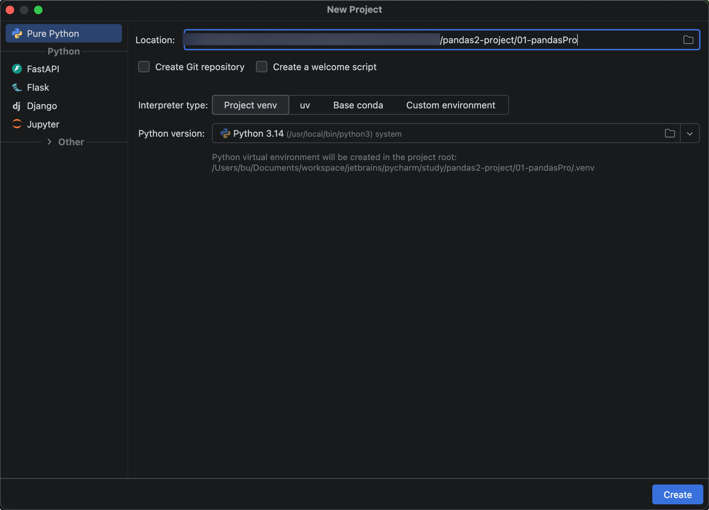
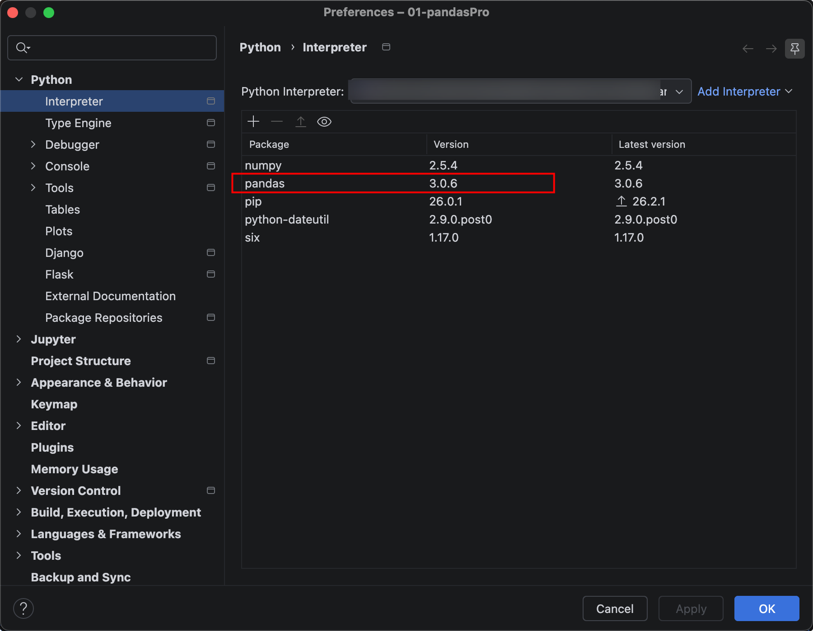
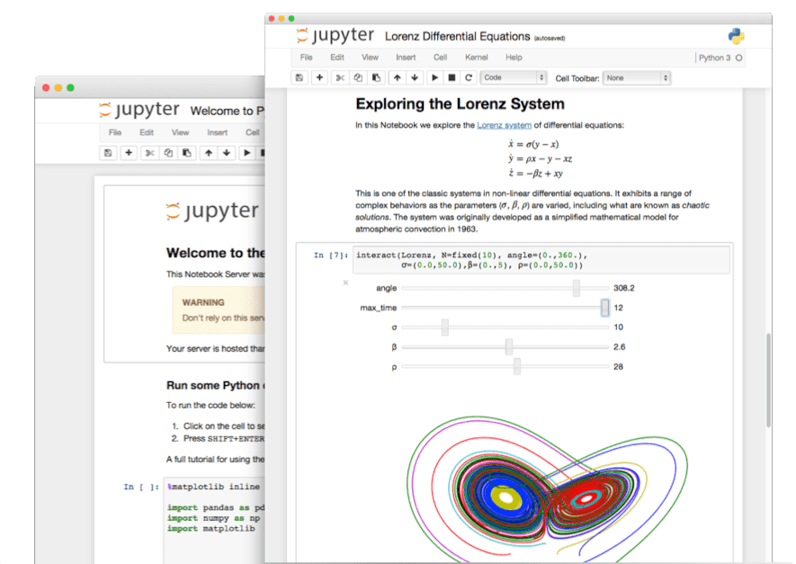
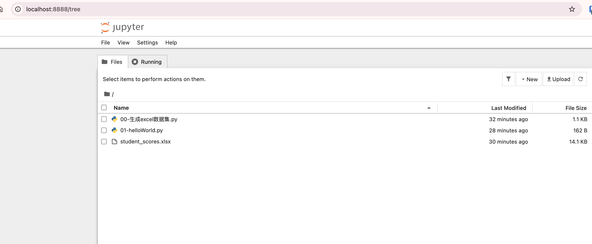
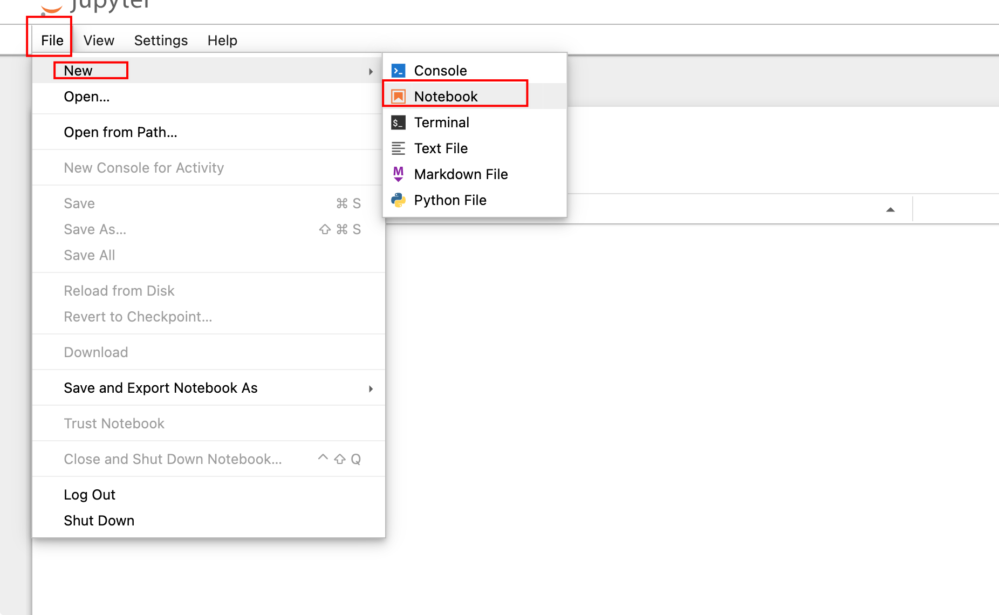
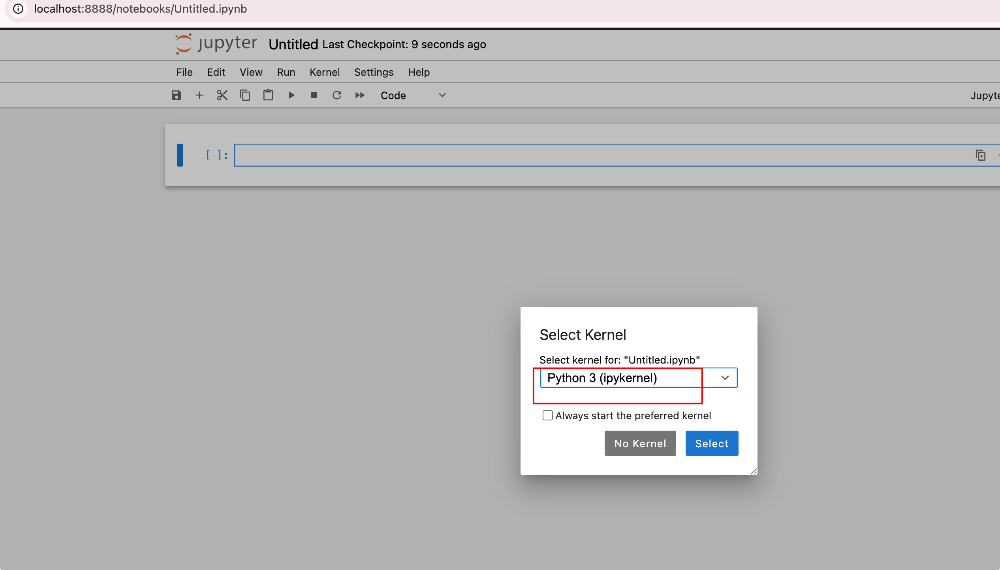
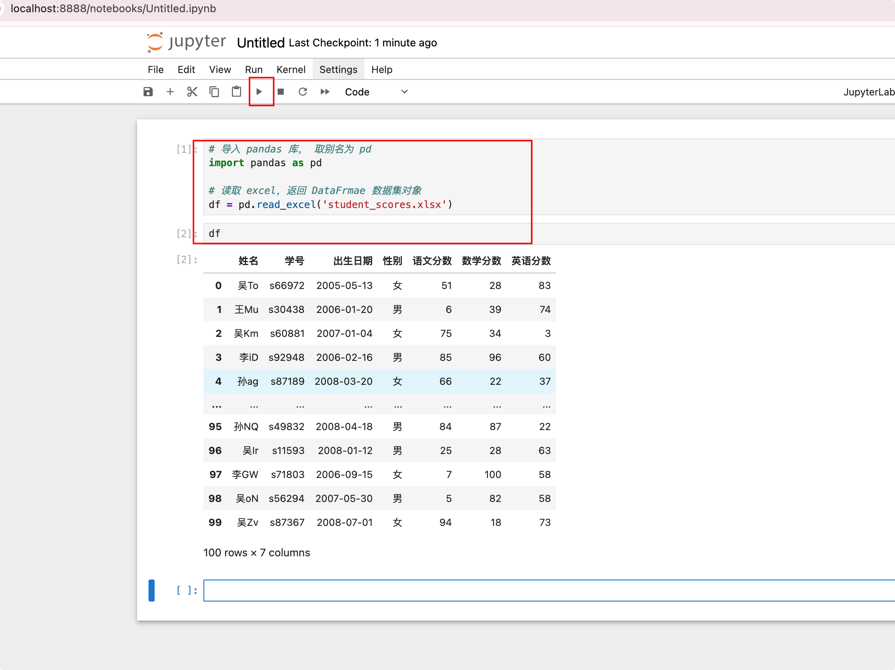
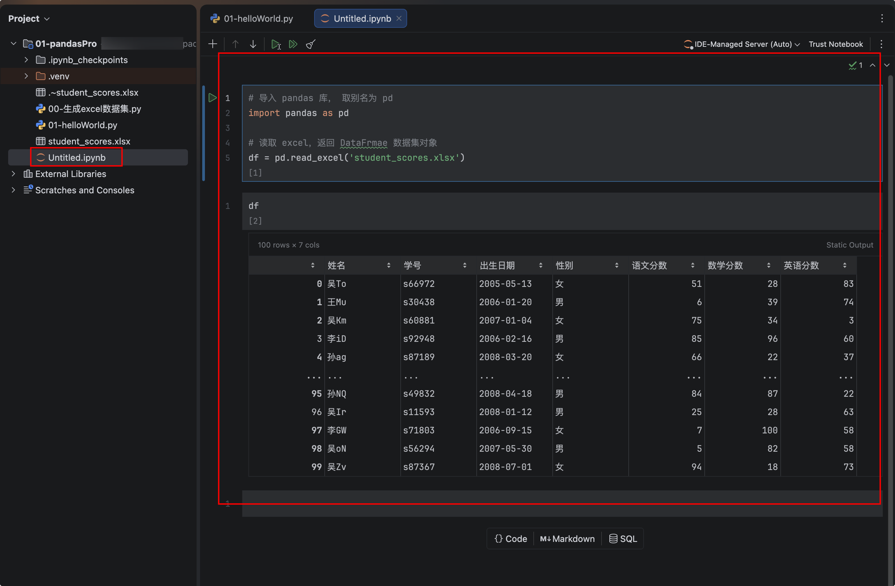
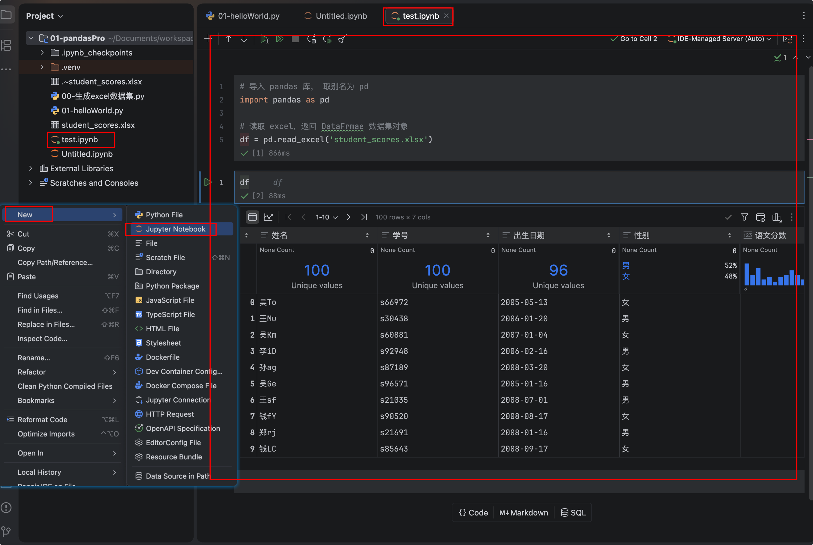

# 初识Pandas2

## Pandas2简介

Pandas 是python的一个数据分析包，用于数据分析，数据处理，数据可视化。最初由AQR Capital Management于2008年4月开发，并于2009年底开源出来，当时由专注于Python数据包开发的PyData 开发团队继续开发和维护，属于PyData项目的一部分。Pandas最初被作为金融数据分析工具而开发出 来，因此，pandas为时间序列分析提供了很好的支持。 Pandas的名称来自于面板数据(panel data) 和python数据分析(data analysis)。

pandas最新版本:3.0.6

 pandas官网地址:https://pandas.pydata.org/


## 安装Pandas库

新建一个python普通项目(Pure Python)，我们选择虚拟环境。



用pip命令安装pandas

`pip install pandas -i https://mirrors.aliyun.com/pypi/simple`



## 编写Pandas2 HelloWord项目

我们首先准备一个excel文件，用来演示pandas操作数据集(数据的集合)。

excel文件属于数据集的一 种，其他的csv，网页，sql，剪贴板也算数据集。

我们通过pandas生成 student_scores.xlsx 文件。一共100条数据。包含姓名，学号，出生日期，性别，语文分数，数学分数，英语分数列信息。先给下代码，等后面学到数据输出再细讲代码，暂时不要求掌握。( 需要额外安装openpyxl库 )

`pip install openpyxl -i https://mirrors.aliyun.com/pypi/simple`

```python
import pandas as pd
import random
import string
from datetime import datetime, timedelta


def random_name():
    first_names = ['赵', '钱', '孙', '李', '周', '吴', '郑', '王']
    last_names = [''.join(random.choices(string.ascii_letters, k=2))]

    return random.choice(first_names) + random.choice(last_names)


def random_date():
    start_date = datetime.strptime('2005-01-01', '%Y-%m-%d')
    end_date = datetime.strptime('2008-12-31', '%Y-%m-%d')
    random_days = random.randint(0, (end_date - start_date).days)
    return (start_date + timedelta(days=random_days)).strftime('%Y-%m-%d')


data = {
    '姓名': [random_name() for _ in range(100)],
    '学号': [f's{random.randint(10000, 99999)}' for _ in range(100)],
    '出生日期': [random_date() for _ in range(100)],
    '性别': [random.choice(['男', '女']) for _ in range(100)],
    '语文分数': [random.randint(0, 100) for _ in range(100)],
    '数学分数': [random.randint(0, 100) for _ in range(100)],
    '英语分数': [random.randint(0, 100) for _ in range(100)]
}

df = pd.DataFrame(data)
df.to_excel('student_scores.xlsx', index=False)
```

新建helloWorld.py来读取这个Excel数据集

```python
# 导入 pandas 库， 取别名为 pd
import pandas as pd

# 读取 excel，返回 DataFrmae 数据集对象
df = pd.read_excel('student_scores.xlsx')

print(df)

#======输出======
     姓名      学号        出生日期 性别  语文分数  数学分数  英语分数
0   吴To  s66972  2005-05-13  女    51    28    83
1   王Mu  s30438  2006-01-20  男     6    39    74
2   吴Km  s60881  2007-01-04  女    75    34     3
3   李iD  s92948  2006-02-16  男    85    96    60
4   孙ag  s87189  2008-03-20  女    66    22    37
..  ...     ...         ... ..   ...   ...   ...
95  孙NQ  s49832  2008-04-18  男    84    87    22
96  吴Ir  s11593  2008-01-12  男    25    28    63
97  李GW  s71803  2006-09-15  女     7   100    58
98  吴oN  s56294  2007-05-30  男     5    82    58
99  吴Zv  s87367  2008-07-01  女    94    18    73

[100 rows x 7 columns]
```

格式不太好看，用Jupyter，返回效果会好看很多。

## Jupyter Notebook安装

### 介绍

Jupyter (https://jupyter.org)项目是一个非营利性开源项目，于2014年由IPython项目中诞生，它能支持所有编程语言的交互式数据科学和科学计算。它的特点是能够在网页上直接执行编写的代码，同时支持动态交互，在做数据可视化时尤其方便。

目前Jupyter有两个版本，Jupyter Lab和Jupyter Notebook，都是基于Web的交互式开发环境，其中 Jupyter Lab为最新一代的产品。




### 安装

安装命令:

`pip install jupyter -i https://mirrors.aliyun.com/pypi/simple`

安装好后 启动jupyter 在终端输入命令:

`jupyter notebook`

启动后，自动打开了浏览器或者输入 http://localhost:8888/tree



### 使用

可以选择File -> New -> Notebook 新建一个文件





输入代码后，点击运行，输出对象不需要print，直接输入对象，然后按运行按钮，下方即可输出可视化 效果很好的数据结果集。



点击保存后，同时项目目录下也对应生成一个ipynb文件



我们直接新建一个ipynb后缀的文件，然后pycharm里直接来进行Jupyter操作



pycharm里面的结果集功能更加强大，比如可以排序，分页等。