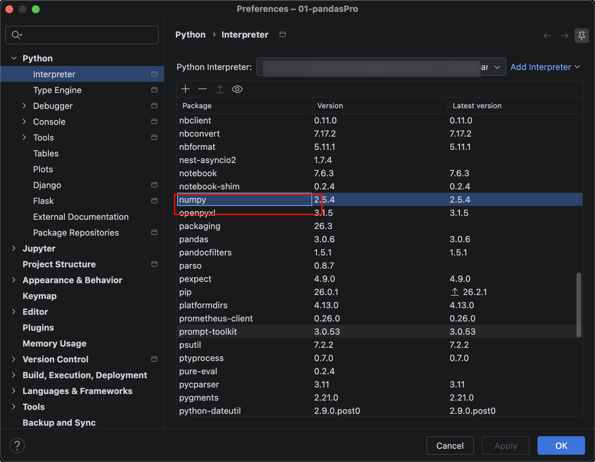
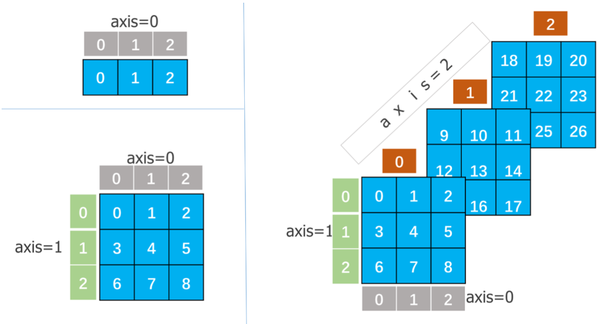

# NumPy数据结构基础

Pandas是基于强大的NumPy库开发的，它继承了NumPy中的一些数据结构，也继承了NumPy的高效计算特性。


## 简介

官方网站：https://numpy.org

NumPy(Numerical Python)是Python的一种开源的数值计算扩展。这种工具可用来存储和处理大型矩阵，比Python自身的嵌套列表(nested list structure)结构要高效得多(该结构也可以用来表示矩阵(matrix))，支持大量的维度数组与矩阵运算，此外也针对数组运算提供大量的数学函数库。

NumPy是Python的一个高性能矩阵运算的科学计算库。它的主要用途是以数组的形式进行数据操作和数学运算，数据分析、机器学习大都是进行数学计算。Pandas依赖NumPy，在安装它时会自动安装 NumPy。Pandas的数据结构和运算的底层工作都交由NumPy来完成。



NumPy的ndarray提供了一维到三维的数据结构。



ndarray对数据向量化，利用隐式逐元素方式的广播机制进行算术运算、逻辑运算、位运算、函数调用等，可以快速、批量地处理数据。

## 数组创建

### 手动创建

NumPy数组创建最常用的方式是直接创建， numpy 可以直接创建或者将 python的其他元素转为 array 对象。

```python
import numpy as np

# 创建一维数组
a1 = np.array([1, 2, 3])
print(a1, type(a1))

# 创建二维数组
a2 = np.array([[1, 2, 3], [4, 5, 6], [7, 8, 9]])
print(a2, type(a2))

# 创建三维数组
a3 = np.array([[[1, 2, 3], [4, 5, 6], [7, 8, 9]], [[10, 11, 12], [13, 14, 15], [16, 17, 18]], [[19, 20, 21], [22, 23, 24], [25, 26, 27]]])
print(a3, type(a3))

#======输出======
[1 2 3] <class 'numpy.ndarray'>
[[1 2 3]
 [4 5 6]
 [7 8 9]] <class 'numpy.ndarray'>
[[[ 1  2  3]
  [ 4  5  6]
  [ 7  8  9]]

 [[10 11 12]
  [13 14 15]
  [16 17 18]]

 [[19 20 21]
  [22 23 24]
  [25 26 27]]] <class 'numpy.ndarray'>
```


### 用函数创建

除了直接创建多维数组，也可以采用常见的函数进行创建

```python
# 生成10个浮点型0
n1 = np.zeros(10)
print(n1)

# 生成8个浮点型1
n2 = np.ones(8)
print(n2)

# 生成9个随机值，很夸张的随机值
n3 = np.empty(9)
print(n3)

# 生成10个，不包括10，步长为1，默认从0开始
n4 = np.arange(10)
print(n4)

# 生成与n4结构一样的1值
n5 = np.ones_like(n4)
print(n5)

# 生成与n4结构一样的0值
n6 = np.zeros_like(n4)
print(n6)

# 生成与n4结构一样的随机值
n7 = np.empty_like(n4)
print(n7)

# 高级用法
print("----------------")
# 从2开始，步长0.5，不超过10
print(np.arange(2, 10, 0.5))

# 从3到6，生成均匀的5个值，包括最终值6
print(np.linspace(3, 6, num=5, endpoint=True))

# 返回一个3行4列的随机数组，浮点型
print(np.random.randn(3, 4))

# 返回一个3行4列的随机数组，整型，随机值，范围0到9
print(np.random.randint(0, 10, size=(3, 4)))

# 返回一个3维数组 整型，随机值范围0到9
print(np.random.randint(0, 10, size=(3, 3, 3)))


#======输出======
[0. 0. 0. 0. 0. 0. 0. 0. 0. 0.]
[1. 1. 1. 1. 1. 1. 1. 1.]
[ 1.14285714 -2.28571429  0.57142857 -2.28571429  4.97142857 -1.54285714
  0.57142857 -1.54285714  0.88571429]
[0 1 2 3 4 5 6 7 8 9]
[1 1 1 1 1 1 1 1 1 1]
[0 0 0 0 0 0 0 0 0 0]
[0 0 0 0 0 0 0 0 0 0]
----------------
[2.  2.5 3.  3.5 4.  4.5 5.  5.5 6.  6.5 7.  7.5 8.  8.5 9.  9.5]
[3.   3.75 4.5  5.25 6.  ]
[[-2.35331562  0.39519647  0.12857563  0.12611055]
 [ 1.14387251  0.3540404  -0.76225205 -0.24322978]
 [ 1.17307833 -0.18229276 -0.0609978   0.86721485]]
[[8 8 2 1]
 [5 1 9 0]
 [0 0 2 3]]
[[[5 4 3]
  [7 2 9]
  [7 5 1]]

 [[0 0 8]
  [4 1 5]
  [3 8 0]]

 [[2 6 2]
  [6 2 1]
  [7 0 1]]]
```

## 数据类型

NumPy 提供了丰富的数据类型(dtypes)，主要用于高效数值计算。

NumPy 的数据类型比 Python 原生类型更精细，适合科学计算。

选择合适的数据类型可以:

- 节省内存(如用 int8 代替 int64 ) 
- 提高计算效率(如 float32 比 float64 更快) 
- 确保精度(如避免整数溢出)。

以下是 NumPy 的主要数据类型分类及说明:

### 1. 数值类型 (Numeric Types)

**(1) 整数类型 (Integer)**

| 类型     | 说明           | 范围（有符号）  | 范围（无符号） |
| :------- | :------------- | :-------------- | :------------- |
| `int8`   | 8位整数        | -128 到 127     | -              |
| `int16`  | 16位整数       | -32768 到 32767 | -              |
| `int32`  | 32位整数       | -2³¹ 到 2³¹-1   | -              |
| `int64`  | 64位整数       | -2⁶³ 到 2⁶³-1   | -              |
| `uint8`  | 8位无符号整数  | -               | 0 到 255       |
| `uint16` | 16位无符号整数 | -               | 0 到 65535     |
| `uint32` | 32位无符号整数 | -               | 0 到 2³²-1     |
| `uint64` | 64位无符号整数 | -               | 0 到 2⁶⁴-1     |

示例：

```python
import numpy as np

a = np.array([1, 2, 3], dtype=np.int32)  # 32位整数
b = np.array([255, 0], dtype=np.uint8)   # 8位无符号整数
```

**(2) 浮点类型 (Float)**

| 类型       | 说明                     | 精度（位数）             |
| :--------- | :----------------------- | :----------------------- |
| `float16`  | 半精度浮点（16位）       | 5位指数 + 10位尾数       |
| `float32`  | 单精度浮点（32位）       | 8位指数 + 23位尾数       |
| `float64`  | 双精度浮点（64位，默认） | 11位指数 + 52位尾数      |
| `float128` | 扩展精度浮点（128位）    | 更高精度（部分系统支持） |

示例：

```python
c = np.array([1.0, 2.5], dtype=np.float32)  # 单精度浮点
d = np.array([3.1415926535], dtype=np.float64)  # 双精度浮点
```

**(3) 复数类型 (Complex)**

| 类型         | 说明                             |
| :----------- | :------------------------------- |
| `complex64`  | 实部和虚部均为 `float32`         |
| `complex128` | 实部和虚部均为 `float64`（默认） |
| `complex256` | 更高精度的复数（部分系统支持）   |

示例：

```python
e = np.array([1 + 2j, 3 + 4j], dtype=np.complex64)
```

### 2. 其他类型

**(1) 布尔类型 (Boolean)**

| 类型    | 说明                 |
| :------ | :------------------- |
| `bool_` | 布尔值（True/False） |

示例：

```python
f = np.array([True, False], dtype=np.bool_)
```

**(2) 字符串类型 (String)**

| 类型     | 说明                   |
| :------- | :--------------------- |
| `str_`   | Unicode 字符串（默认） |
| `bytes_` | 字节字符串（ASCII）    |

示例：

```python
g = np.array(["hello", "numpy"], dtype=np.str_)   # unicode
h = np.array([b"abc", b"123"], dtype=np.bytes_)   # 字节字符串
```

**(3) 日期时间类型 (Datetime)**

| 类型          | 说明                         |
| :------------ | :--------------------------- |
| `datetime64`  | 日期时间（年、月、日、秒等） |
| `timedelta64` | 时间间隔（差值）             |

示例：

```python
i = np.array(["2023-01-01", "2024-12-31"], dtype="datetime64[D]")  # 天精度
j = np.array([1, 7], dtype="timedelta64[D]")  # 时间差（天）
```

### 3. 结构化数据类型 (Structured Arrays)

用于存储类似表格的数据（多个字段）：

```python
dt = np.dtype([("name", "U10"), ("age", "i4"), ("height", "f4")])
people = np.array([("Alice", 25, 1.65), ("Bob", 30, 1.80)], dtype=dt)
print(people["age"])  # 访问字段
```

完整代码:

```python
"""
    NumPy数据类型
"""

import numpy as np

a = np.array([1, 2, 3], dtype=np.int32) # 32位整数
b = np.array([255, 0], dtype=np.uint8) # 8位无符号整数
print(a, b)

c = np.array([1.0, 2.5], dtype=np.float32) # 单精度浮点
d = np.array([3.1415926535], dtype=np.float64) # 双精度浮点
print(c, d)

e = np.array([1 + 2j, 3 + 4j], dtype=np.complex64) # 复数类型
print(e)

f = np.array([True, False], dtype=np.bool_) # 布尔类型
print(f)

g = np.array(["hello", "numpy"], dtype=np.str_) # Unicode 字符串
h = np.array([b"abc", b"123"], dtype=np.bytes_) # 字节字符串
print(g, h)

i = np.array(["2023-01-01", "2024-12-31"], dtype="datetime64[D]") # 天精度
j = np.array([1, 7], dtype="timedelta64[D]") # 时间差(天)
print(i, j)

dt = np.dtype([("name", "U10"), ("age", "i4"), ("height", "f4")])
people = np.array([("Alice", 25, 1.65), ("Bob", 30, 1.80)], dtype=dt)
print(people)
print(people["age"]) # 访问字段

#======输出======
[1 2 3] [255   0]
[1.  2.5] [3.14159265]
[1.+2.j 3.+4.j]
[ True False]
['hello' 'numpy'] [b'abc' b'123']
['2023-01-01' '2024-12-31'] [1 7]
[('Alice', 25, 1.65) ('Bob', 30, 1.8 )]
[25 30]
```

## 数组属性

下面是数组的一些常见属性。

| 属性名   | 含义                                             |
| :------- | :----------------------------------------------- |
| dtype    | 数组中元素的类型                                 |
| ndim     | 数组的维度                                       |
| size     | 所有数据的长度，比如mn维的二维数组，其size就是mn |
| itemsize | 表示一个元素所占的字节的多少                     |
| shape    | 数组的形状                                       |

示例：

```python
"""
    NumPy数组属性
"""

import numpy as np

a3 = np.array([[[1, 2, 3], [4, 5, 6], [7, 8, 9]], [[10, 11, 12], [13, 14, 15], [16, 17, 18]], [[19, 20, 21], [22, 23, 24], [25, 26, 27]]])
print(a3)

print('数组的维度:', a3.ndim)
print('数组的形状:', a3.shape)
print('数据的长度:', a3.size)
print('数组中的元素的类型:', a3.dtype)
print('数组中的每个元素所占的字节:', a3.itemsize)

#======输出======
[[[ 1  2  3]
  [ 4  5  6]
  [ 7  8  9]]

 [[10 11 12]
  [13 14 15]
  [16 17 18]]

 [[19 20 21]
  [22 23 24]
  [25 26 27]]]
数组的维度: 3
数组的形状: (3, 3, 3)
数据的长度: 27
数组中的元素的类型: int64
数组中的每个元素所占的字节: 8

```

## 数组重建

### 尺寸修改reshape方法

数组在创建的时候就已经有了，但是在后续过程中也可以进行重建，使用 `reshape` 函数可以对数组进行尺寸上的修改。

在这里需要说明的是 **reshape 中的参数就是重建后的尺寸，但是对于一些时候，不知道所有轴的尺寸就 可以使用-1来进行自动调整。**

```python
"""
    NumPy数组重建
"""
import numpy as np

# 尺寸修改reshape方法
a = np.arange(24)
print(a)
print(a.reshape(3, 2, -1))

#======输出======
[ 0  1  2  3  4  5  6  7  8  9 10 11 12 13 14 15 16 17 18 19 20 21 22 23]
[[[ 0  1  2  3]
  [ 4  5  6  7]]

 [[ 8  9 10 11]
  [12 13 14 15]]

 [[16 17 18 19]
  [20 21 22 23]]]
```

**对于一个三维的数组，可以发现其第三个轴有 4个数，但这个数是自动算出来的(24除以3再除以2)。**

### 合并与拆分

对于多个数组也可以进行合并与拆分操作

#### 普通合并

这里是简单的一个水平合并和竖直合并，一个隐形的条件就是竖直合并时，需要保证两个数组第二 个轴的大小一致，并且保持不变，而水平合并时需要保证两个数组的第一个轴的大小一致。

```python
"""
    NumPy数组重建
"""
import numpy as np

# 合并与拆分
a4 = np.arange(12).reshape(3, 4)
b4 = np.arange(12, 24).reshape(3, 4)
print("a4", a4)
print("b4", b4)
print("垂直合并", np.vstack((a4, b4)))
print("水平合并", np.hstack((a4, b4)))

#======输出======
a4 [[ 0  1  2  3]
 [ 4  5  6  7]
 [ 8  9 10 11]]
b4 [[12 13 14 15]
 [16 17 18 19]
 [20 21 22 23]]
垂直合并 [[ 0  1  2  3]
 [ 4  5  6  7]
 [ 8  9 10 11]
 [12 13 14 15]
 [16 17 18 19]
 [20 21 22 23]]
水平合并 [[ 0  1  2  3 12 13 14 15]
 [ 4  5  6  7 16 17 18 19]
 [ 8  9 10 11 20 21 22 23]]
```

#### concatenate合并

也可以使用`concatenate([a,b],axis=)`，把两个数组按照一定的轴合并，在哪个轴合并就是哪个轴的尺寸发生变化。

```python
"""
    NumPy数组重建
"""
import numpy as np

# concatenate合并
a5 = np.arange(12).reshape(3, 4)
b6 = np.arange(12, 24).reshape(3, 4)
print("a5", a5)
print("b6", b6)
print("第一轴合并：", np.concatenate((a5, b6), axis=0))
print("第二轴合并：", np.concatenate((a5, b6), axis=1))

#======输出======
a5 [[ 0  1  2  3]
 [ 4  5  6  7]
 [ 8  9 10 11]]
b6 [[12 13 14 15]
 [16 17 18 19]
 [20 21 22 23]]
第一轴合并： [[ 0  1  2  3]
 [ 4  5  6  7]
 [ 8  9 10 11]
 [12 13 14 15]
 [16 17 18 19]
 [20 21 22 23]]
第二轴合并： [[ 0  1  2  3 12 13 14 15]
 [ 4  5  6  7 16 17 18 19]
 [ 8  9 10 11 20 21 22 23]]
```

#### split拆分

对于两个数组可以进行合并，那么一个数组也可以拆成两个数组，使用`split(array,[],axis=)`进行拆分:

```python
"""
    NumPy数组重建
"""
import numpy as np

# 拆分
a7 = np.arange(36).reshape(2, 2, 9)
print("a7", a7)
# split的参数有 要拆分的数组，在哪个位置进行拆分，[3，6]表示在3，4之间，6，7 之间进行拆分， axis=2 表示对第三个轴进行拆分。
b7, c7, d7 = np.split(a7, [3, 6], axis=2)
print("b7", b7)
print("c7", c7)
print("d7", d7)

#======输出======
a7 [[[ 0  1  2  3  4  5  6  7  8]
  [ 9 10 11 12 13 14 15 16 17]]

 [[18 19 20 21 22 23 24 25 26]
  [27 28 29 30 31 32 33 34 35]]]
b7 [[[ 0  1  2]
  [ 9 10 11]]

 [[18 19 20]
  [27 28 29]]]
c7 [[[ 3  4  5]
  [12 13 14]]

 [[21 22 23]
  [30 31 32]]]
d7 [[[ 6  7  8]
  [15 16 17]]

 [[24 25 26]
  [33 34 35]]]
```

