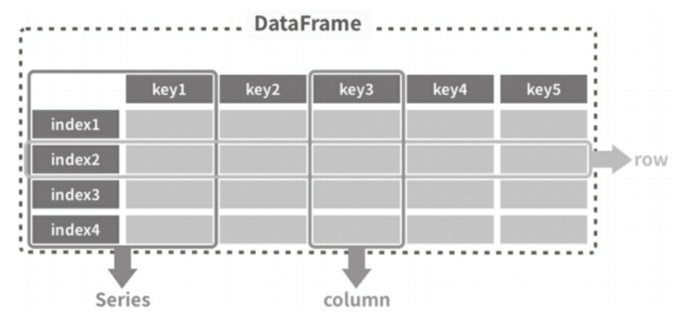
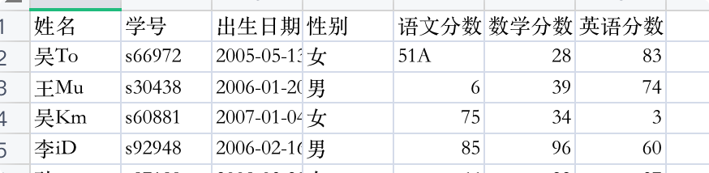

# Pandas2数据结构

## 介绍

Pandas提供Series和DataFrame作为数组数据的存储框架。

Series(系列、数列、序列)是一个带有标签的一维数组，这一系列连续的数据代表了一定的业务意义。

DataFrame意为数据框，它就像一个存放数据的架子，有多行多列，每个数据在一个格子里，每个格子 有自己的编号。



## 一维数据结构-Series

Series是一种类似于一维数组的对象，它由一组数据(不同数据类型)以及一组与之相关的数据标签(即索引)组成。

**创建语法**

`s = pd.Series(data, index=index)`

data可以是python对象，NumPy的ndarray，固定值也行。index是指定索引，是一个列表。

**创建Series对象**

示例：

```python
"""
    一维数据结构-Series
"""
import pandas as pd

# 创建Series对象
s1 = pd.Series([2, 'b', 3.4, 6])
print(s1) # 打印Series
print("*****")
print(type(s1)) # 打印类型
print("*****")
print(s1.index) # 打印索引
print("*****")
print(s1.values) # 打印值

#======输出======
0      2
1      b
2    3.4
3      6
dtype: object
*****
<class 'pandas.Series'>
*****
RangeIndex(start=0, stop=4, step=1)
*****
[2 'b' 3.4 6]
```


**创建指定标签索引的Series**

示例：

```python
"""
    一维数据结构-Series
"""
import pandas as pd

s2 = pd.Series([2, 'b', 3.4, 6], index=['a', 'b', 'c', 'd'])
print(s2) # 打印Series
print("*****")
print(type(s2))
print("*****")
print(s2.index) # 打印索引
print("*****")
print(s2.values) # 打印值

#======输出======
a      2
b      b
c    3.4
d      6
dtype: object
*****
<class 'pandas.Series'>
*****
Index(['a', 'b', 'c', 'd'], dtype='str')
*****
[2 'b' 3.4 6]
```


**使用字典创建Series**

示例：

```python
"""
    一维数据结构-Series
"""
import pandas as pd

# 使用字典创建Series
s3 = pd.Series({'语文': 90, '数学': 100, '英语': 66})
print(s3) # 打印Series
print("*****")
print(type(s3))
print("*****")
print(s3.index) # 打印索引
print("*****")
print(s3.values) # 打印值

#======输出======
语文     90
数学    100
英语     66
dtype: int64
*****
<class 'pandas.Series'>
*****
Index(['语文', '数学', '英语'], dtype='str')
*****
[ 90 100  66]
```


**根据标签索引查询Series数据**

示例：

```python
"""
    一维数据结构-Series
"""
import pandas as pd

s2 = pd.Series([2, 'b', 3.4, 6], index=['a', 'b', 'c', 'd'])
print(s2)
print("*****")
# 根据标签索引查询Series数据
print(s2['c']) # 查询单个值
print("*****")
print(type(s2['c']))
print("*****")
print(s2[['a', 'b', 'd']]) # 查询多个值，返回的还是一个Series对象
print("*****")
print(type(s2[['a', 'b', 'd']]))

#======输出======
a      2
b      b
c    3.4
d      6
dtype: object
*****
3.4
*****
<class 'float'>
*****
a    2
b    b
d    6
dtype: object
*****
<class 'pandas.Series'>
```

支持查询多个值，返回的还是一个Series对象。

## 二维数据结构-DataFrame

DataFrame是一个二维表格型数据结构。每列可以是不同的值类型，既有行索引index，也有列索引 columns，可以看成是由Series组成的字典。

**创建语法**

`df = pd.DataFrame(data=None, index=None, columns=None)`

参数说明：

- `data`：具体数据，结构化或同构的ndarray、可迭代对象、字典或DataFrame。
- `index`：行索引，类似数组的对象，支持解包，如果没有指定，会自动生成RangeIndex (0, 1, 2, ..., n)。
- `colums`：列索引、表头，如果没有指定，会自动生成 RangeIndex (0, 1, 2, ..., n)。

**使用字典方式定义DataFrame**

示例：

```python
"""
    Pandas2二维数据结构-DataFrame
"""
import pandas as pd

# 使用字典方式定义DataFrame
d = {
    '学号': [1, 2, 3],
    '姓名': ['张三', '李四', '王五'],
    '语文': [99, 88, 77],
    '数学': [43, 54, 66],
    '英语': [88, 54, 23]}
df = pd.DataFrame(d)
print(df)
print("*****")
print(type(df))
print("*****")
print(df.dtypes)
print("*****")
print(df.index)
print("*****")
print(df.columns)
print("*****")
print(df.values)

#======输出======

   学号  姓名  语文  数学  英语
0   1  张三  99  43  88
1   2  李四  88  54  54
2   3  王五  77  66  23
*****
<class 'pandas.DataFrame'>
*****
学号    int64
姓名      str
语文    int64
数学    int64
英语    int64
dtype: object
*****
RangeIndex(start=0, stop=3, step=1)
*****
Index(['学号', '姓名', '语文', '数学', '英语'], dtype='str')
*****
[[1 '张三' 99 43 88]
 [2 '李四' 88 54 54]
 [3 '王五' 77 66 23]]
```


**从DataFrame中查询Series**

如果只查询一行或者一列，返回的就是Series对象，如果查询的是多行，多列，返回的还是DataFrame。

示例：

```python
"""
    Pandas2二维数据结构-DataFrame
"""
import pandas as pd

# 使用字典方式定义DataFrame
d = {
    '学号': [1, 2, 3],
    '姓名': ['张三', '李四', '王五'],
    '语文': [99, 88, 77],
    '数学': [43, 54, 66],
    '英语': [88, 54, 23]}
df = pd.DataFrame(d)
print(df)
print("*****")

# 从DataFrame中查询Series
# 查询一列，返回Series
print(df['姓名'])
print("*****")
print(type(df['姓名']))
print("*****")
print(df['姓名'][1])

print("*****")
# 查询多列，返回DataFrame
print(df[['姓名', '语文']])
print("*****")
print(type(df[['姓名', '语文']]))
print("*****")
print(df[['姓名', '语文'][0]])
print("*****")
print(df[['姓名', '语文'][0]][2])
print("*****")

# 查询一行，返回Series
print(df.loc[1])
print("*****")
print(type(df.loc[1]))
print("*****")
print(df.loc[1]['姓名'], df.loc[1]['语文'])
print("*****")
# 查询多行，返回DataFrame
print(df.loc[[0, 2]])
print("*****")
print(type(df.loc[[0, 2]]))
print("*****")
print(df.loc[[0, 2]]['姓名'])
print("*****")
print(df.loc[[0, 2]]['姓名'][2])

#======输出======

   学号  姓名  语文  数学  英语
0   1  张三  99  43  88
1   2  李四  88  54  54
2   3  王五  77  66  23
*****
0    张三
1    李四
2    王五
Name: 姓名, dtype: str
*****
<class 'pandas.Series'>
*****
李四
*****
   姓名  语文
0  张三  99
1  李四  88
2  王五  77
*****
<class 'pandas.DataFrame'>
*****
0    张三
1    李四
2    王五
Name: 姓名, dtype: str
*****
王五
*****
学号     2
姓名    李四
语文    88
数学    54
英语    54
Name: 1, dtype: object
*****
<class 'pandas.Series'>
*****
李四 88
*****
   学号  姓名  语文  数学  英语
0   1  张三  99  43  88
2   3  王五  77  66  23
*****
<class 'pandas.DataFrame'>
*****
0    张三
2    王五
Name: 姓名, dtype: str
*****
王五
```

## 数据类型

在 pandas 中，数据类型（dtypes）主要分为以下几类，涵盖了数值、文本、时间、类别等多种数据形式：

1. **数值类型**

* **`int` 类型（整数）：**
    * `int8`, `int16`, `int32`, `int64`（带符号整数）
    * `uint8`, `uint16`, `uint32`, `uint64`（无符号整数）
* **`float` 类型（浮点数）：**
    * `float16`, `float32`, `float64`（半精度、单精度、双精度）
* **`bool` 类型（布尔值）：**
    * `bool`（`True` / `False`）

2. **文本类型**

* **`object`：**
    * 默认的字符串类型（实际存储为 Python `str` 对象）。
    * 也可存储混合类型（非纯字符串时）。
* **`string`（Pandas 1.0+）：**
    * 专为字符串设计的新类型（需显式指定 `dtype='string'`）。
    * 避免与 `object` 混用时的潜在问题。

3. **时间类型**

* **`datetime64[ns]`：**
    * 日期时间（纳秒精度），通过 `pd.to_datetime()` 转换。
* **`timedelta64[ns]`：**
    * 时间差（如 `pd.Timedelta('1D')`）。
* **`period`：**
    * 时间段（如 `pd.Period('2023-01')`）。

4. **类别类型**

* **`category`：**
    * 有限离散值的分类数据（如性别、等级）。
    * 内存高效，支持排序和自定义顺序。

5. **其他特殊类型**

* **`interval`：**
    * 区间类型（如 `pd.Interval(0, 5)`）。
* **`sparse`：**
    * 稀疏数据（适用于大部分值为缺失或重复的情况）。

**基本使用**

`DataFrame` 二维结构用 `dtypes` 属性查看每列的数据类型。`Series` 一维结构用 `dtype` 属性查看指定字段数据类型。

示例一：

```python
import pandas as pd

df = pd.read_excel('student_scores.xlsx')  # 读取excel，返回DataFrame数据集对象
print(df)
print(df.dtypes)  # 查看每列的数据类型

#======输出======
     姓名      学号        出生日期 性别  语文分数  数学分数  英语分数
0   吴To  s66972  2005-05-13  女    51    28    83
1   王Mu  s30438  2006-01-20  男     6    39    74
2   吴Km  s60881  2007-01-04  女    75    34     3
3   李iD  s92948  2006-02-16  男    85    96    60
4   孙ag  s87189  2008-03-20  女    66    22    37
..  ...     ...         ... ..   ...   ...   ...
95  孙NQ  s49832  2008-04-18  男    84    87    22
96  吴Ir  s11593  2008-01-12  男    25    28    63
97  李GW  s71803  2006-09-15  女     7   100    58
98  吴oN  s56294  2007-05-30  男     5    82    58
99  吴Zv  s87367  2008-07-01  女    94    18    73

[100 rows x 7 columns]
*****
姓名        str
学号        str
出生日期      str
性别        str
语文分数    int64
数学分数    int64
英语分数    int64
dtype: object
```

示例二：

我们在取一列，得到的是一个Series对象。我用dtype属性查看指定字段的数据类型。

```python
import pandas as pd

df = pd.read_excel('student_scores.xlsx')  # 读取excel，返回DataFrame数据集对象

print(df['姓名']) # 获取姓名列，以及类型
print("*****")
print(type(df['姓名']))
print("*****")
print(df['姓名'].dtype) # 查询姓名数据类型
print("*****")
print(df['语文分数'].dtype) # 查询语文分数类型

#======输出======
0     吴To
1     王Mu
2     吴Km
3     李iD
4     孙ag
     ... 
95    孙NQ
96    吴Ir
97    李GW
98    吴oN
99    吴Zv
Name: 姓名, Length: 100, dtype: str
*****
<class 'pandas.Series'>
*****
str
*****
int64
```

示例三：

Pandas数据类型是指某一列里所有数据的共性，如果全是数字，那么就是数字型;如果其中有一个不是数字，那么就不是数字型了。
比如我们把某个人的语文分数改成非数字。

{width=400}

```python
import pandas as pd

df = pd.read_excel('student_scores.xlsx')  # 读取excel，返回DataFrame数据集对象
print(df.dtypes) 

#======输出======

*****
姓名         str
学号         str
出生日期       str
性别         str
语文分数    object
数学分数     int64
英语分数     int64
dtype: object
```

示例四：

pandas还提供了一些api来判断Series对象类型，返回布尔类型:

```python
pd.api.types.is_bool_dtype(s)
pd.api.types.is_categorical_dtype(s)
pd.api.types.is_datetime64_any_dtype(s)
pd.api.types.is_datetime64_ns_dtype(s)
pd.api.types.is_datetime64_dtype(s)
pd.api.types.is_float_dtype(s)
pd.api.types.is_int64_dtype(s)
pd.api.types.is_numeric_dtype(s)
pd.api.types.is_object_dtype(s)
pd.api.types.is_string_dtype(s)
pd.api.types.is_timedelta64_dtype(s)
```


```python
import pandas as pd

df = pd.read_excel('student_scores.xlsx')  # 读取excel，返回DataFrame数据集对象

print(df['语文分数'].dtype == np.int64)
print(df['数学分数'].dtype == np.int64)
print(pd.api.types.is_bool_dtype(df['语文分数']))
print(pd.api.types.is_object_dtype(df['语文分数']))
print(pd.api.types.is_object_dtype(df['数学分数']))

#======输出======
False
True
False
True
False
```

