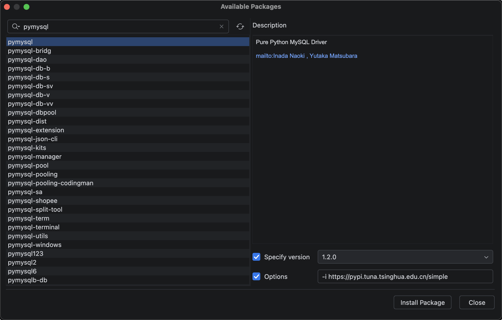

# 简介以及安装

## 简介

python操作mysql数据库有好几个第三方模块，比较出名是`pymysql`和`mysql-connector-python`，用法差不多。

mysql-connector-python，这个是mysql官方提供的驱动模块。 

我们以pymysql模块为例，操作mysql8;

## 安装

命令行安装：

`pip install pymysql -i https://pypi.tuna.tsinghua.edu.cn/simple`

或者直接用pycharm安装

