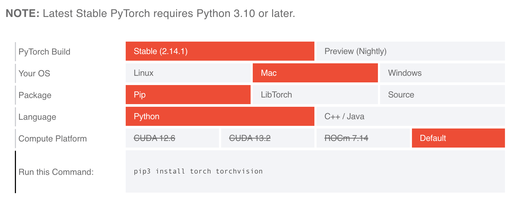
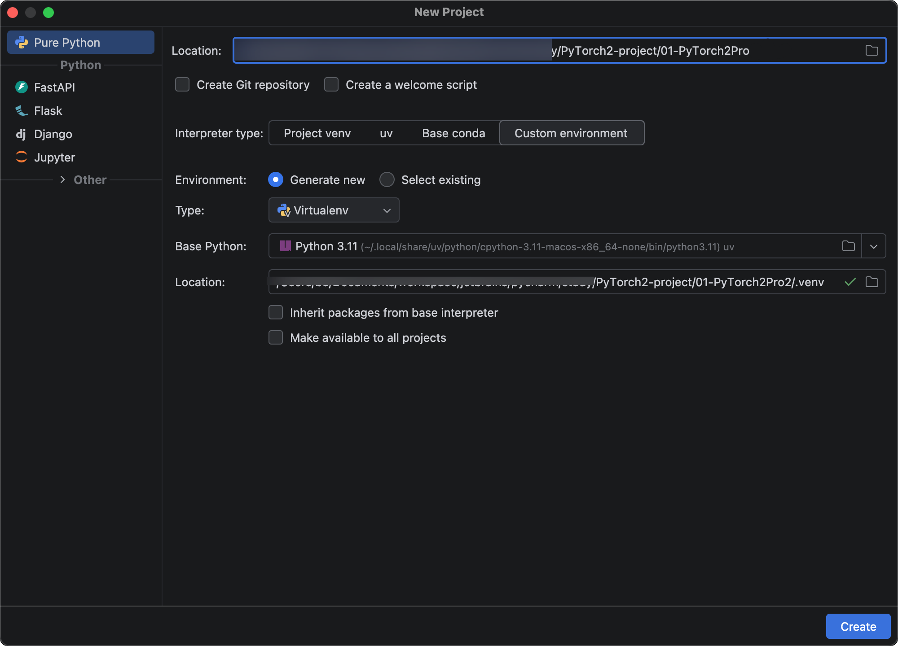

# PyTorch2安装与环境配置

PyTorch2安装环境适用于 Windows、Linux、macOS，PyTorch2和Tensorflow2一样，模型都可以跑CPU和GPU。



我们安装以MacOS操作系统和跑CPU为例讲解。首先新建项目，Python版本用3.11，以及使用虚拟环境创建。

 

安装命令:

`pip install torch torchvision -i https://pypi.tuna.tsinghua.edu.cn/simple`

- `pytorch` :主框架;
- `torchvision` :用于计算机视觉任务;

> 但是老macos系统只能安装2.2.2版本
>
> ```sh
> pip install "numpy<2" -i https://mirrors.aliyun.com/pypi/simple
> pip install torch==2.2.2 torchvision==0.17.2 -i https://pypi.tuna.tsinghua.edu.cn/simple
> ```

验证下是否安装成功:

```python
import torch

print('PyTorch版本:', torch.__version__)
print('是否可用CPU:', torch.cpu.is_available())
print('设备类型:', torch.device('cpu'))

#======输出======
PyTorch版本: 2.2.2
是否可用CPU: True
设备类型: cpu
```

