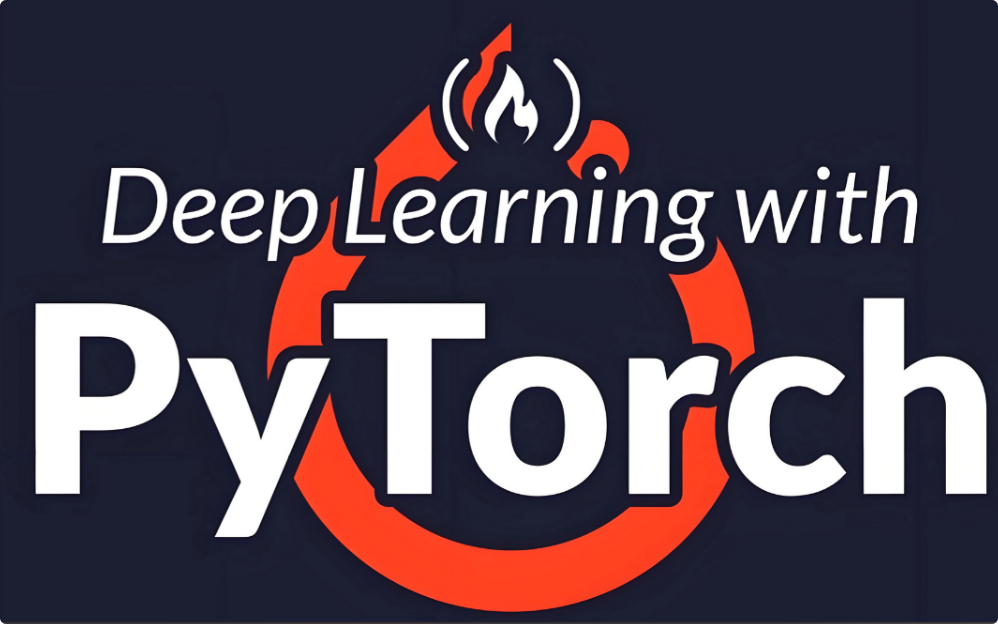

# PyTorch2简介



**PyTorch 2** 是由 Meta（原 Facebook）AI 团队于 2023 年正式推出的深度学习框架新版本，是经典 PyTorch 的重大升级。它在保持易用性和灵活性的基础上，通过引入一系列新的编译和优化技术，实现了**高性能计算、自动加速与高效部署**的统一。PyTorch 2 代表了从传统动态图框架向 **动态图 + 编译优化混合架构**的进化。PyTorch最新版本2.14.1。

pytorch官网：`https://pytorch.org/`

学习指南：
`https://docs.pytorch.org/tutorials/beginner/basics/quickstart_tutorial.html`
API文档：
`https://docs.pytorch.org/docs/stable/pytorch-api.html`

## PyTorch 2 的核心理念

PyTorch 一直以“Pythonic、灵活、易调试”著称，深受研究者和开发者欢迎。而 PyTorch 2 的目标是：
> “让你的模型在不修改一行代码的情况下，跑得更快、更高效。”

为此，PyTorch 2 引入了新的 **编译栈（TorchDynamo、AOTAutograd、TorchInductor）**，实现对 Python 代码的 **图捕获、自动优化与硬件级编译**。

## 主要创新特性

**1. TorchDynamo：动态图编译核心**

* TorchDynamo 是一个动态跟踪器，能在运行时捕获 Python 模型的执行图，并将其转化为可优化的中间表示（IR）。
* 它的最大优势在于：**用户无需修改原始 PyTorch 代码**，通过简单调用 `torch.compile()` 即可触发编译。
* 示例：
    ```python
    pythonmodel1 = torch.compile(model1)
    output = model1(input)
    ```
    这样模型会自动使用 TorchInductor 编译执行，速度通常可提升30%~200%。

**2. AOTAutograd (Ahead-of-Time Autograd)**
* 对自动微分机制进行了重构，使得反向传播过程也能被提前捕获并优化。
* 减少了重复计算和冗余内存开销，大幅提升训练效率。

**3. TorchInductor：新一代深度编译器**
* TorchInductor 将高层计算图编译成底层高效的内核代码，支持 **CPU、GPU（CUDA）** 等多种硬件。
* GPU 端基于 **Triton 内核语言**，可生成比手写 CUDA 更高效的代码。

**4. 更好的多设备与分布式支持**
* PyTorch 2 优化了 **DistributedDataParallel (DDP)、FSDP (Fully Sharded Data Parallel)** 等分布式训练接口。
* 支持更高效的多 GPU、跨节点大模型训练。

**5. TorchExport 与 TorchDynamo 配合部署**
* PyTorch 2 进一步简化了模型从训练到部署的路径，结合 **TorchScript / TorchServe / ONNX Runtime**，可实现灵活部署到云端或边缘设备。

## PyTorch 2 的体系架构

PyTorch 2 的核心架构分为三层：

**1. 前端 (Frontend)**
用户级 API，包括 `torch`, `torch.nn`, `torch.optim`, `torch.utils.data` 等。
* 提供模型定义、损失函数、优化器与数据加载接口。

**2. 中间层 (Compiler Stack)**
* **TorchDynamo**：动态图捕获。
* **AOTAutograd**：提前自动微分。
* **TorchInductor**：底层代码生成。
这一层负责将 Python 模型自动转化为高效可执行图。

**3. 后端 (Backend)**
* 包括 CPU (x86/ARM) 、GPU (CUDA、ROCm) 、XLA、TPU 等多种硬件执行环境。
* 由 **Triton 内核**与 **LLVM 编译器** 提供底层优化支持。

## 性能与兼容性

| 特性       | PyTorch 1.x        | PyTorch 2                     |
| :--------- | :----------------- | :---------------------------- |
| 执行方式   | 动态解释执行       | 动态 + 编译优化               |
| 编译器     | TorchScript (静态) | TorchDynamo + Inductor (动态) |
| 训练速度   | 较慢               | 提升 30%~2倍                  |
| 调试难度   | 低                 | 保持一致                      |
| 分布式支持 | 较成熟             | 更高性能                      |
| 混合精度   | 支持               | 优化更好                      |

## 典型应用领域

* **计算机视觉 (CV)**：图像分类、目标检测、生成模型 (如 Stable Diffusion) 。
* **自然语言处理 (NLP)**：Transformer、LLM (如 GPT、BERT 等) 。
* **强化学习 (RL)**：与 Gym、RLlib 等结合实现智能体训练。
* **科学计算与量子机器学习**：通过 TorchQuantum 等库扩展。
