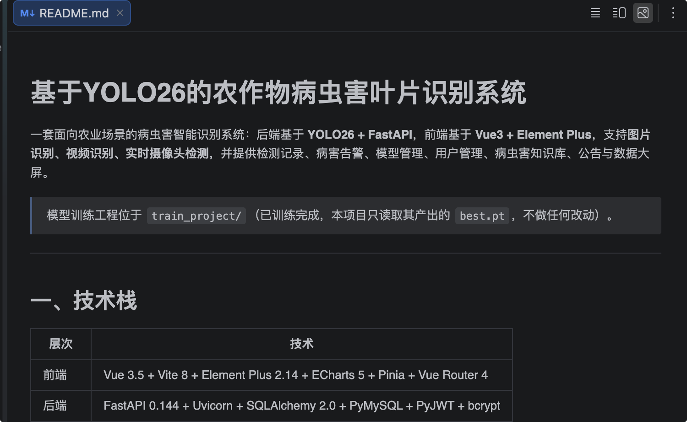
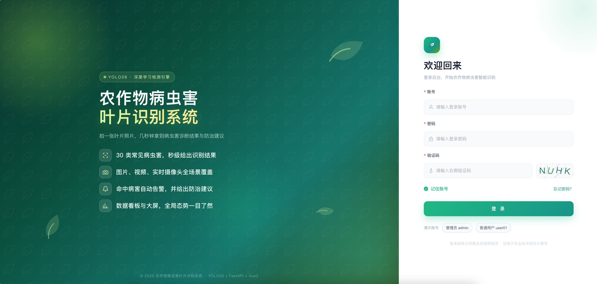
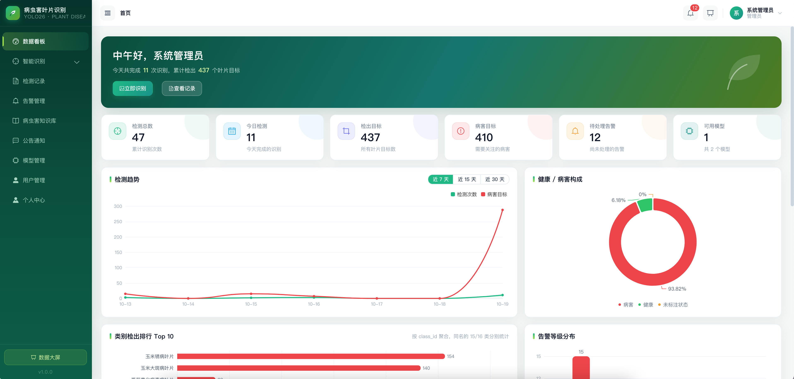

# AI编程生成项目代码

## Plan沟通项目方案

提示词：

```txt
生成一个基于YOLO26的农作物病虫害叶片识别系统
要求
1，指定项目名称是 基于YOLO26的农作物病虫害叶片识别系统
2，后端FastAPI，在server目录，前端用Vue3+element plus，在client目录。train_project是模型训练项目，已经开发好，不需要改动。
......
```

让AI基于上面的需要写plan方案



## 基于计划生成代码

最终效果




