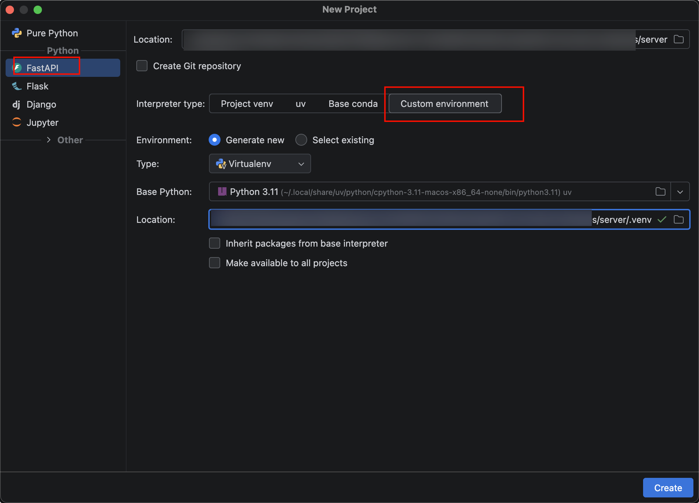
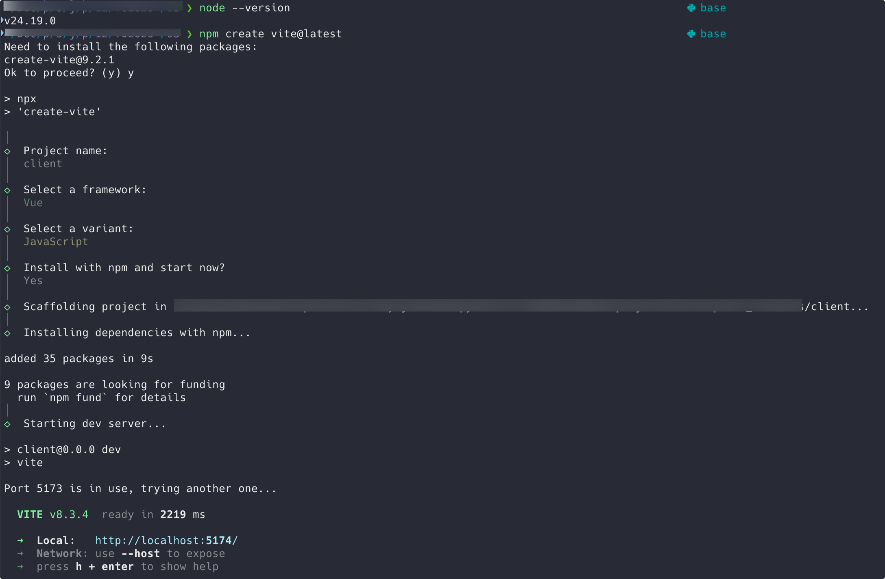
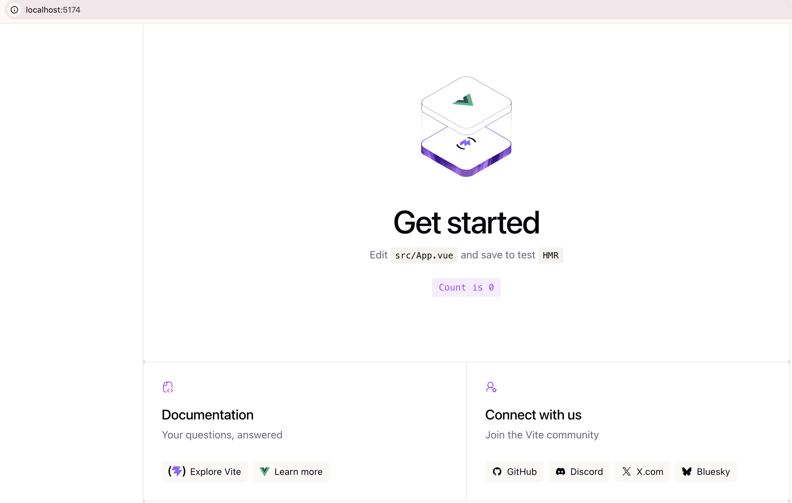

# 创建后端和前端项目

## 新建后端Python项目

打开pycharm，新建项目，选择fastapi，项目名称设置成server。

## 新建前端Vue项目

nodejs版本24。

接下来创建前端vue项目，用vite构建

进入命令行工具：输入 `npm create vite@latest `指定项目名称`client`，选择`Vue`框架，指定语言`JavaScript`

建完，我们点下链接测试

出现这个界面说明我们新建成功了。

