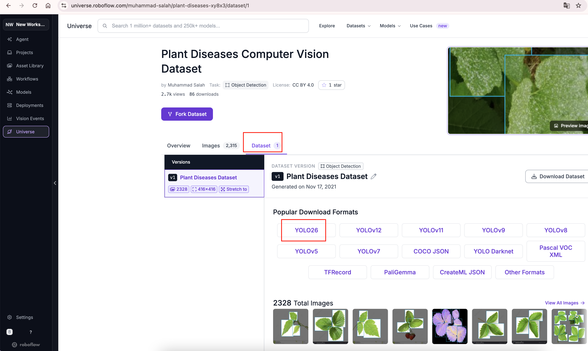
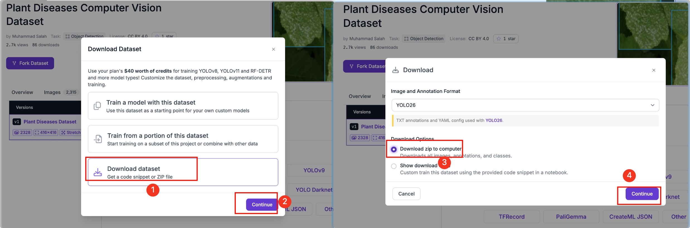
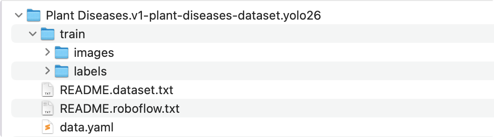
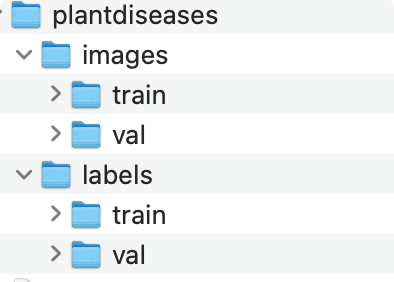
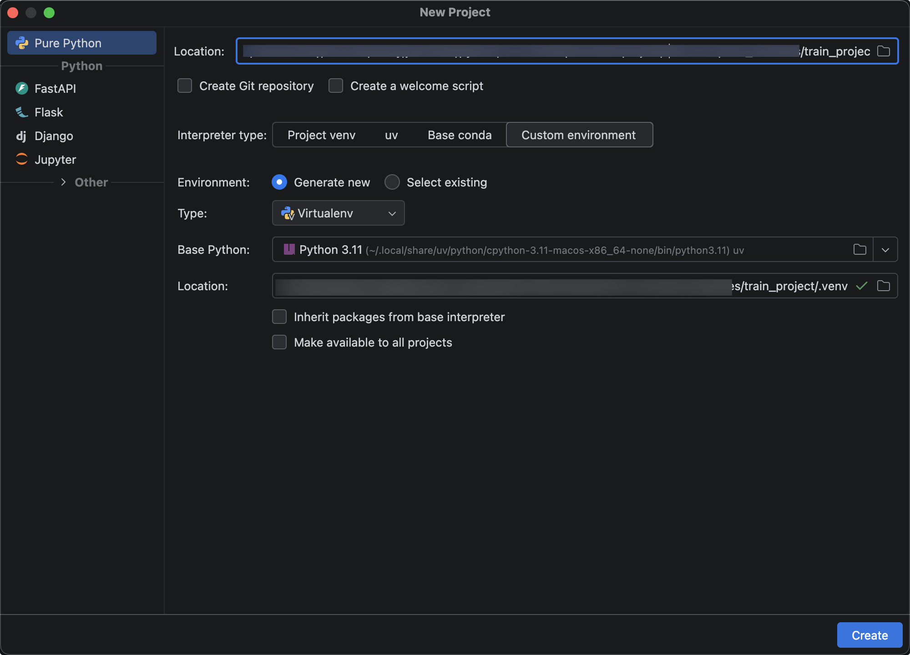
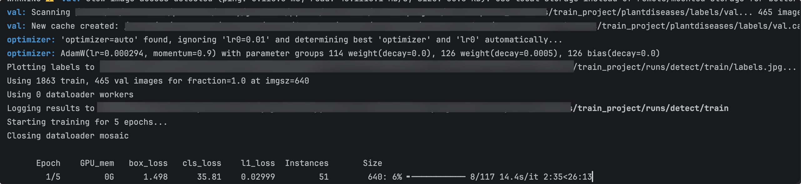
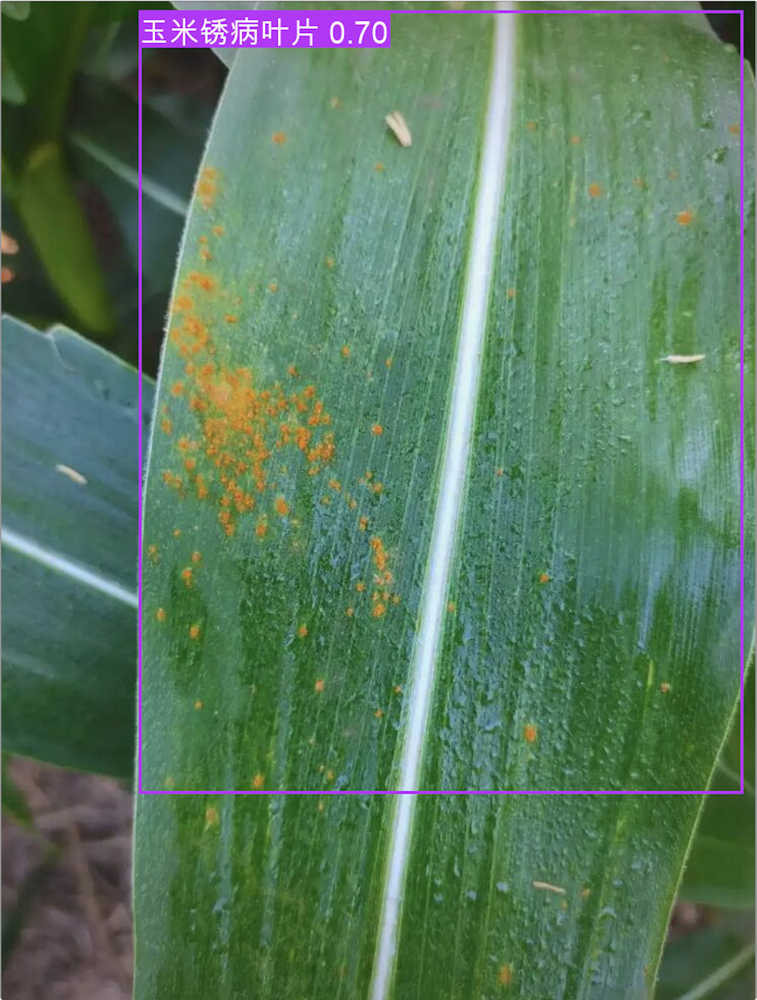

# 训练数据集

## 数据集下载

农作物病虫害叶片 数据集:https://universe.roboflow.com/muhammad-salah/plant-diseases-xy8x3

注册网站即可下载





下载解压后，给的数据集只有训练集图片和标注文件。

{width=400}

data.yaml内容

```yaml
train: ../train/images
val: ../valid/images
test: ../test/images

nc: 30
names: ['Apple Scab Leaf', 'Apple leaf', 'Apple rust leaf', 'Bell_pepper leaf', 'Bell_pepper leaf spot', 'Blueberry leaf', 'Cherry leaf', 'Corn Gray leaf spot', 'Corn leaf blight', 'Corn rust leaf', 'Peach leaf', 'Potato leaf', 'Potato leaf early blight', 'Potato leaf late blight', 'Raspberry leaf', 'Soyabean leaf', 'Soybean leaf', 'Squash Powdery mildew leaf', 'Strawberry leaf', 'Tomato Early blight leaf', 'Tomato Septoria leaf spot', 'Tomato leaf', 'Tomato leaf bacterial spot', 'Tomato leaf late blight', 'Tomato leaf mosaic virus', 'Tomato leaf yellow virus', 'Tomato mold leaf', 'Tomato two spotted spider mites leaf', 'grape leaf', 'grape leaf black rot']

roboflow:
  workspace: muhammad-salah
  project: plant-diseases-xy8x3
  version: 1
  license: CC BY 4.0
  url: https://universe.roboflow.com/muhammad-salah/plant-diseases-xy8x3/dataset/1
```

## 训练集与验证集划分

**数据集 2328个训练图片，30个类别。划分训练集图片：1863 验证集图片：465。大约是8:2比例；**

| 英文类别名                           | 中文说明                           |
| :----------------------------------- | :--------------------------------- |
| Apple Scab Leaf                      | 苹果黑星病叶片                     |
| Apple leaf                           | 苹果健康叶片                       |
| Apple rust leaf                      | 苹果锈病叶片                       |
| Bell_pepper leaf                     | 甜椒健康叶片                       |
| Bell_pepper leaf spot                | 甜椒叶斑病叶片                     |
| Blueberry leaf                       | 蓝莓叶片                           |
| Cherry leaf                          | 樱桃叶片                           |
| Corn Gray leaf spot                  | 玉米灰斑病叶片                     |
| Corn leaf blight                     | 玉米大斑病叶片                     |
| Corn rust leaf                       | 玉米锈病叶片                       |
| Peach leaf                           | 桃子叶片                           |
| Potato leaf                          | 马铃薯健康叶片                     |
| Potato leaf early blight             | 马铃薯早疫病叶片                   |
| Potato leaf late blight              | 马铃薯晚疫病叶片                   |
| Raspberry leaf                       | 树莓叶片                           |
| Soyabean leaf                        | 大豆叶片                           |
| Soybean leaf                         | 大豆叶片                           |
| Squash Powdery mildew leaf           | 南瓜白粉病叶片                     |
| Strawberry leaf                      | 草莓叶片                           |
| Tomato Early blight leaf             | 番茄早疫病叶片                     |
| Tomato Septoria leaf spot            | 番茄壳针孢叶斑病（番茄褐斑病）叶片 |
| Tomato leaf                          | 番茄健康叶片                       |
| Tomato leaf bacterial spot           | 番茄细菌性斑点病叶片               |
| Tomato leaf late blight              | 番茄晚疫病叶片                     |
| Tomato leaf mosaic virus             | 番茄花叶病毒病叶片                 |
| Tomato leaf yellow virus             | 番茄黄化病毒病叶片                 |
| Tomato mold leaf                     | 番茄霉病叶片                       |
| Tomato two spotted spider mites leaf | 番茄二斑叶螨危害叶片               |
| grape leaf                           | 葡萄叶片                           |
| grape leaf black rot                 | 葡萄黑腐病叶片                     |

我们需要根据YOLO26官方规范，来新建目录重新划分下训练集，验证集图片，以及标注文件，最后创建数据集的配置plantdiseases.yaml文件

{width=400}

```yaml [plantdiseases.yaml]
path: plantdiseases # dataset root dir
train: images/train # train images (relative to 'path') 4 images
val: images/val # val images (relative to 'path') 4 images
test: # test images (optional)

# Classes
names:
  0: 苹果黑星病叶片
  1: 苹果健康叶片
  2: 苹果锈病叶片
  3: 甜椒健康叶片
  4: 甜椒叶斑病叶片
  5: 蓝莓叶片
  6: 樱桃叶片
  7: 玉米灰斑病叶片
  8: 玉米大斑病叶片
  9: 玉米锈病叶片
  10: 桃子叶片
  11: 马铃薯健康叶片
  12: 马铃薯早疫病叶片
  13: 马铃薯晚疫病叶片
  14: 树莓叶片
  15: 大豆叶片
  16: 大豆叶片
  17: 南瓜白粉病叶片
  18: 草莓叶片
  19: 番茄早疫病叶片
  20: 番茄壳针孢叶斑病（番茄褐斑病）叶片
  21: 番茄健康叶片
  22: 番茄细菌性斑点病叶片
  23: 番茄晚疫病叶片
  24: 番茄花叶病毒病叶片
  25: 番茄黄化病毒病叶片
  26: 番茄霉病叶片
  27: 番茄二斑叶螨危害叶片
  28: 葡萄叶片
  29: 葡萄黑腐病叶片
```

## 基于YOLO26的模型训练

我们首先新建模型训练项目train_project



接下来安装 YOLO26库

```bash
conda install -c conda-forge opencv
pip install opencv-python==4.9.0.80 -i https://pypi.tuna.tsinghua.edu.cn/simple 
pip install ultralytics -i https://pypi.tuna.tsinghua.edu.cn/simple
pip install "numpy<2" -i https://pypi.tuna.tsinghua.edu.cn/simple
```

新建模型训练 plantdiseases_train.py。

```python
from ultralytics import YOLO

model = YOLO("yolo26n.pt") # 加载预训练权重
results = model.train(data="plantdiseases.yaml", epochs=5, imgsz=640)
```

运行项目，首先会自动下载字体库，因为我们分类用了中文



我们拿到训练好的最佳模型best.pt，接下来进行预测，新建plantdiseases_predict.py

```python [plantdiseases_predict.py]

from pathlib import Path
import sys
from typing import Any

from ultralytics import YOLO

sys.path.append(str(Path(__file__).resolve().parents[1]))

# 脚本所在目录，避免工作目录不对时找不到权重和图片
HERE = Path(__file__).resolve().parent
WEIGHTS = HERE / "best.pt"
IMAGE = HERE / "test.jpg"


def ensure_dir(path: str | Path) -> Path:
    """确保目录存在并返回 Path。"""
    p = Path(path)
    p.mkdir(parents=True, exist_ok=True)
    return p


def print_detections(result: Any, names: dict) -> None:
    """
    打印单张图的检测结果。

    Args:
        result: Ultralytics Results 对象（单张）
        names: 类别 id -> 名称 映射
    """
    if result.boxes is None or len(result.boxes) == 0: # 如果检测结果为空，则打印未检测到目标
        print("  （未检测到目标）")
        return

    for i, box in enumerate(result.boxes): # 遍历检测结果 Boxes，可以理解为「这一张图里所有检测到的目标框」。
        cls_id = int(box.cls[0]) # 类别id
        conf = float(box.conf[0]) # 置信度
        xyxy = box.xyxy[0].tolist() # 边界框坐标
        name = names.get(cls_id, str(cls_id)) # 类别名称
        print(
            f"  [{i}] {name:16s} conf={conf:.3f} " # 打印检测结果
            f"xyxy=[{xyxy[0]:.1f}, {xyxy[1]:.1f}, {xyxy[2]:.1f}, {xyxy[3]:.1f}]" # 打印边界框坐标
        )


def main() -> None:
    """加载自定义权重并对单张图片推理、打印并保存结果。"""
    if not WEIGHTS.exists():
        raise FileNotFoundError(f"未找到模型权重: {WEIGHTS}")
    if not IMAGE.exists():
        raise FileNotFoundError(f"未找到待推理图片: {IMAGE}")

    model = YOLO(str(WEIGHTS))  # 加载自己训练的安全帽模型
    out_dir = ensure_dir(HERE / "runs")  # 推理结果保存目录

    results = model.predict(
        source=str(IMAGE),
        conf=0.1,  # 置信度阈值，低于该值的框会被丢掉
        imgsz=960,  # 比训练默认 640 更大，适配高分辨率原图
        save=True,  # 保存带检测框的图片
        project=str(out_dir),
        name="plantdiseases_predict",
        exist_ok=True,
    )

    print(f"类别: {model.names}")
    print_detections(results[0], model.names)
    print(f"结果已保存到: {out_dir / 'test_predict'}")

    results[0].show()  # 弹窗显示检测结果


if __name__ == "__main__":
    main()
```

运行下:

{width=200}