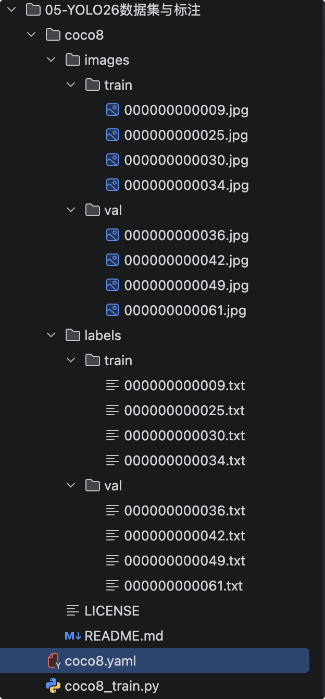
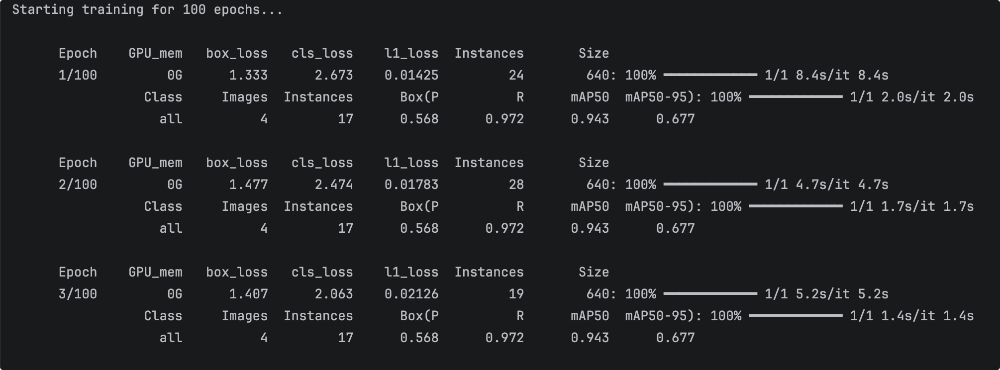
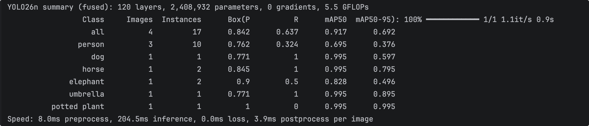

# YOLO26数据集与标注

## 引入

真实业务场景中，**COCO的80个类别几乎不可能覆盖你的需求**。你可能是检测工业缺陷、农作物病虫害、交通标志、仓库货架……这些类别在COCO里根本不存在。模型再强，没见过就是没见过。训练不是一条直线，而是“数据→分配→损失→评估→回查数据”的闭环。

所以，要学会制作和管理自己的数据集。

## YOLO数据格式

YOLO的数据集遵循一套严格的目录和文件规范。

### 目录结构

```text
my_dataset/
├── images/
│   ├── train/          # 训练集图片
│   │   ├── 000001.jpg
│   │   ├── 000002.jpg
│   │   └── ...
│   └── val/            # 验证集图片
│       ├── 000101.jpg
│       └── ...
└── labels/
    ├── train/          # 训练集标签（与images/train/中的图片一一对应）
    │   ├── 000001.txt
    │   ├── 000002.txt
    │   └── ...
    └── val/            # 验证集标签（与images/val/中的图片一一对应）
        ├── 000101.txt
        └── ...
```


核心规则：**每张图片对应一个同名的.txt标签文件**，放在对应的labels/子目录下。如果一张图里没有目标，通常不需要单独写标签文件。

### 标签格式

每个`.txt`文件中，**每一行代表一个目标**，格式为：

`<class_id> <x_center> <y_center> <width> <height>`


五个字段的含义：

| 字段       | 含义          | 说明                               |
| :--------- | :------------ | :--------------------------------- |
| `class_id` | 类别ID        | 从0开始的整数（0, 1, 2, ...）      |
| `x_center` | 框中心点x坐标 | 归一化到[0,1]，= 原始x / 图片宽度  |
| `y_center` | 框中心点y坐标 | 归一化到[0,1]，= 原始y / 图片高度  |
| `width`    | 框宽度        | 归一化到[0,1]，= 原始宽 / 图片宽度 |
| `height`   | 框高度        | 归一化到[0,1]，= 原始高 / 图片高度 |

> **所有坐标值必须是归一化到[0,1]区间的浮点数**。坐标未归一化或xyxy/xywh混用，都会导致训练异常。

### 标签示例与对应原图

假设有一张`000001.jpg`（分辨率1920×1080），图中有一个“人”（class_id=0）和一个“车”（class_id=1）：

- 人的真实框：中心(960, 540)，宽240，高540
- 车的真实框：中心(1500, 720)，宽400，高300

归一化计算：

- 人：cx=960/1920=0.500，cy=540/1080=0.500，w=240/1920=0.125，h=540/1080=0.500
- 车：cx=1500/1920=0.781，cy=720/1080=0.667，w=400/1920=0.208，h=300/1080=0.278

对应的`labels/train/000001.txt`内容为：

```text
0 0.500 0.500 0.125 0.500
1 0.781 0.667 0.208 0.278
```

## data.yaml 结构

`data.yaml` 是连接数据集与YOLO训练流程的**唯一配置文件**。结构非常简单，通常不超过20行：

```yaml
# 数据集根目录（绝对或相对路径）
path: /home/user/my_dataset

# 图像文件夹（相对于path）
train: images/train
val: images/val

# 可选：测试集
# test: images/test

# 类别数量
nc: 2

# 类别名称（索引 → 名称，必须与标签文件中的class_id一致）
names:
  0: person
  1: car
```


各字段含义：

| 字段    | 说明                         |
| :------ | :--------------------------- |
| `path`  | 数据集根目录                 |
| `train` | 训练集图像目录（相对于path） |
| `val`   | 验证集图像目录（相对于path） |
| `nc`    | 类别总数                     |
| `names` | 类别索引到名称的映射字典     |

> **关键原则**：`names` 是类别索引的唯一真相来源。标签文件中的 `class_id` 必须与 `names` 的索引严格对应。一旦标注完成，**不要重新排列names的顺序**——新增类别只能加在末尾。

## 训练测试demo

### 准备训练集

**COCO8** 是Ultralytics官方提供的一个微型数据集——只取了COCO训练集的前8张图片。

https://github.com/ultralytics/ultralytics/blob/main/ultralytics/cfg/datasets/coco8.yaml

### 开始训练

现在用官方提供的coco8来学习训练流程

1. 下载训练资源，到项目中

https://github.com/ultralytics/assets/releases/download/v0.0.0/coco8.zip

{width=400}

2. 新增`coco8.yaml`与测试代码`coco8_train.py`

::: code-group

```yaml [coco8.yaml]
# Ultralytics 🚀 AGPL-3.0 License - https://ultralytics.com/license

# COCO8 dataset (first 8 images from COCO train2017) by Ultralytics
# Documentation: https://docs.ultralytics.com/datasets/detect/coco8
# Example usage: yolo train data=coco8.yaml
# parent
# ├── ultralytics
# └── datasets
#     └── coco8 ← downloads here (1 MB)

# Train/val/test sets as 1) dir: path/to/imgs, 2) file: path/to/imgs.txt, or 3) list: [path/to/imgs1, path/to/imgs2, ..]
path: coco8 # dataset root dir
train: images/train # train images (relative to 'path') 4 images
val: images/val # val images (relative to 'path') 4 images
test: # test images (optional)

# Classes
names:
  0: person
  1: bicycle
  2: car
  3: motorcycle
  4: airplane
  5: bus
  6: train
  7: truck
  8: boat
  9: traffic light
  10: fire hydrant
  11: stop sign
  12: parking meter
  13: bench
  14: bird
  15: cat
  16: dog
  17: horse
  18: sheep
  19: cow
  20: elephant
  21: bear
  22: zebra
  23: giraffe
  24: backpack
  25: umbrella
  26: handbag
  27: tie
  28: suitcase
  29: frisbee
  30: skis
  31: snowboard
  32: sports ball
  33: kite
  34: baseball bat
  35: baseball glove
  36: skateboard
  37: surfboard
  38: tennis racket
  39: bottle
  40: wine glass
  41: cup
  42: fork
  43: knife
  44: spoon
  45: bowl
  46: banana
  47: apple
  48: sandwich
  49: orange
  50: broccoli
  51: carrot
  52: hot dog
  53: pizza
  54: donut
  55: cake
  56: chair
  57: couch
  58: potted plant
  59: bed
  60: dining table
  61: toilet
  62: tv
  63: laptop
  64: mouse
  65: remote
  66: keyboard
  67: cell phone
  68: microwave
  69: oven
  70: toaster
  71: sink
  72: refrigerator
  73: book
  74: clock
  75: vase
  76: scissors
  77: teddy bear
  78: hair drier
  79: toothbrush
```

```python [coco8_train.py]
from ultralytics import YOLO

model = YOLO("yolo26n.pt") # 加载预训练权重
results = model.train(data="coco8.yaml", epochs=100, imgsz=640) # epochs训练100次
```

:::

### 运行过程



#### 训练轮次信息

第一部分：训练轮次信息（Epoch 1/100）

这一行显示的是**第 1 个训练周期**（共 100 个周期）结束时的损失状态：

| 字段          | 数值          | 含义解读                                                     |
| :------------ | :------------ | :----------------------------------------------------------- |
| **Epoch**     | 1/100         | 当前训练进度，总共要跑 100 轮，这是第 1轮。                  |
| **GPU_mem**   | 0G            | 当前占用的显存大小（显示 0G 可能是因为这轮是在验证集上跑的，没有加载梯度；或者显存占用极小，不足 1G 被四舍五入）。 |
| **box_loss**  | 1.333         | **边界框回归损失**。衡量预测框位置（xywh）与真实框的差距，数值越小说明框得越准。 |
| **cls_loss**  | 2.673         | **分类损失**。衡量预测的物体类别（如是猫还是狗）与真实类别的差距。 |
| **l1_loss**   | 0.01425       | **L1 损失**（平均绝对误差）。在标准 YOLO 检测中通常是 `dfl_loss`（分布焦点损失），这里显示 `l1_loss`，说明你的模型可能用于**关键点检测**（如人体姿态估计）或特定坐标点回归，数值极小表示坐标点的偏差很小。 |
| **Instances** | 24            | 指**当前这一批次（Batch）** 的图像中，总共包含 24 个待检测的目标实例（物体/关键点）。 |
| **Size**      | 640           | 输入神经网络的图像分辨率被统一缩放为 640x640 像素。          |
| 速度          | 8.4s/it, 8.4s | 验证集推理速度为每秒8.4 张图，本次验证耗时 8.4 秒。          |

#### 验证集评估指标

第二部分：验证集评估指标（Class all）

这一行是对**整个验证集（4 张图片）** 进行推理后的最终性能评估，这是衡量模型好坏的核心指标：

| 字段          | 数值  | 含义解读                                                     |
| :------------ | :---- | :----------------------------------------------------------- |
| **Class**     | all   | 对所有类别取平均（你的验证集中可能只有一个类别，或者计算了所有类别的均值）。 |
| **Images**    | 4     | 验证集总共包含 **4 张图片**。                                |
| **Instances** | 17    | 这 4 张图片里总共标注了 **17 个真实目标**（平均每张图约 4.25 个目标）。 |
| **Box(P)**    | 0.568 | **精确率（Precision）** = 56.8%。模型预测出的所有目标框中，有 56.8% 是预测正确的。 |
| **R**         | 0.972 | **召回率（Recall）** = 97.2%。在 17 个真实目标中，模型成功找出了约 97.2%（约 16 个），漏检率较低。 |
| **mAP50**     | 0.943 | **IoU=0.5 时的平均精度** = 94.3%。这是最常用的目标检测硬指标，表示预测框与真实框重合度超过 50% 就算正确时的平均准确率。 |
| **mAP50-95**  | 0.677 | **严格模式下的平均精度** = 67.7%。计算 IoU 阈值从 0.5 到 0.95（步长 0.05）下的平均 mAP，值通常比 mAP50 低很多，能更全面地反映框的精细度。 |

#### 最终监测结果

最终检测结果，做了下总类和每个类别的参数汇总。



## 自己训练步骤

1. 准备自己的数据集（按上述目录结构组织）
2. 编写自己的 `data.yaml`
3. 将 `data="coco8.yaml"` 替换为 `data="my_data.yaml"`

### 标注工具

市面上的标注工具比较多，推荐Label Studio（其他标注工具基本使用方法都差不多的，但是有一个LabelImg不推荐，好几年不更新了，已经更不上Python版本了）

Label Studio 是一款开源的数据标注平台，旨在为AI和机器学习项目提供高质量的训练数据。它解决了传统标注工具分散、格式不统一的问题，通过统一的界面和流程，大幅提升数据准备效率。

**核心功能**方面，Label Studio 支持**多模态数据**，包括图像、文本、音频、视频和时间序列，并提供50多种内置标注模板，可灵活定制以适应各类任务。其最大亮点是与机器学习模型的**深度集成**：支持“预标注”（模型先预测，人工修正）和“主动学习”（智能筛选高价值样本），显著降低人工成本。标注结果可一键导出为COCO、YOLO等主流格式，无缝对接模型训练。

**技术与部署**上，它基于Python和React构建，提供API、SDK和Webhooks，便于融入MLOps流水线。开源版可免费本地部署或云端运行，也提供企业版以支持SSO、RBAC等高级安全需求。

总之，Label Studio 不仅是标注工具，更是连接数据与模型的桥梁，帮助团队更快、更准地构建AI应用。

### 质量原则

数据质量直接决定模型性能的上限。以下是几个核心原则：

#### 5.1 类平衡（Class Balance）

各类别的样本数量应尽量均衡。如果一类有几千个样本，另一类只有几十个，模型会偏向多数类。

- **检查方法**：训练前绘制类别分布直方图
- **补救措施**：对少数类进行过采样（oversampling）+ 激进的数据增强

#### 5.2 难例挖掘（Hard Examples）

不要只挑“好认”的图片。遮挡、低光照、小尺寸、复杂背景的样本，恰恰是提升模型鲁棒性的关键。对遮挡超过50%的物体建议标记为 `difficult`。

#### 5.3 小目标要多拍

小目标检测本身就是难点。如果业务场景涉及小目标（如遥感影像中的车辆、无人机航拍中的人），**训练集中必须包含足够多的小目标样本**。

#### 5.4 Train/Val 划分

经典划分比例约为 **8:2**（训练集:验证集）。

- 如果数据集较小，可适当提高训练集比例
- **必须采用分层采样（Stratified Sampling）** ——确保每个类别在训练集和验证集中的分布是均匀的，避免某个类别只出现在训练集而验证集完全没有

### 总结速查表

| 要点      | 核心内容                                      |
| :-------- | :-------------------------------------------- |
| 目录结构  | `images/train|val` + `labels/train|val`       |
| 标签格式  | 每行：`class_id cx cy w h`，全部归一化到[0,1] |
| data.yaml | `path`、`train`、`val`、`nc`、`names`         |
| 标注工具  | 入门用LabelImg，团队用Roboflow/CVAT           |
| 质量原则  | 类平衡、难例、小目标、分层采样8:2划分         |
| 快速起步  | 先用 `coco8.yaml` 跑通，再换自己的数据        |

YOLO26（及所有主流YOLO版本）的官方预训练权重，都是基于 **MS COCO（微软通用物体检测数据集）** 的 **80个类别** 训练的。这80类涵盖了日常生活最常见的物体。

按索引顺序（0~79），完整列表如下：

| 0~19 区间                           | 20~39 区间                         | 40~59 区间                       | 60~79 区间                   |
| :---------------------------------- | :--------------------------------- | :------------------------------- | :--------------------------- |
| **0**: person（人）                 | **20**: elephant（大象）           | **40**: wine glass（酒杯）       | **60**: dining table（餐桌） |
| **1**: bicycle（自行车）            | **21**: bear（熊）                 | **41**: cup（杯子）              | **61**: toilet（马桶）       |
| **2**: car（汽车）                  | **22**: zebra（斑马）              | **42**: fork（叉子）             | **62**: tv（电视）           |
| **3**: motorcycle（摩托车）         | **23**: giraffe（长颈鹿）          | **43**: knife（刀子）            | **63**: laptop（笔记本电脑） |
| **4**: airplane（飞机）             | **24**: backpack（背包）           | **44**: spoon（勺子）            | **64**: mouse（鼠标）        |
| **5**: bus（公交车）                | **25**: umbrella（雨伞）           | **45**: bowl（碗）               | **65**: remote（遥控器）     |
| **6**: train（火车）                | **26**: handbag（手提包）          | **46**: banana（香蕉）           | **66**: keyboard（键盘）     |
| **7**: truck（卡车）                | **27**: tie（领带）                | **47**: apple（苹果）            | **67**: cell phone（手机）   |
| **8**: boat（船）                   | **28**: suitcase（行李箱）         | **48**: sandwich（三明治）       | **68**: microwave（微波炉）  |
| **9**: traffic light（交通信号灯）  | **29**: frisbee（飞盘）            | **49**: orange（橙子）           | **69**: oven（烤箱）         |
| **10**: fire hydrant（消防栓）      | **30**: skis（滑雪板・双板）       | **50**: broccoli（西兰花）       | **70**: toaster（烤面包机）  |
| **11**: stop sign（停止标志）       | **31**: snowboard（单板滑雪板）    | **51**: carrot（胡萝卜）         | **71**: sink（水槽）         |
| **12**: parking meter（停车计时器） | **32**: sports ball（球类）        | **52**: hot dog（热狗）          | **72**: refrigerator（冰箱） |
| **13**: bench（长凳）               | **33**: kite（风筝）               | **53**: pizza（披萨）            | **73**: book（书）           |
| **14**: bird（鸟）                  | **34**: baseball bat（棒球棒）     | **54**: donut（甜甜圈）          | **74**: clock（钟）          |
| **15**: cat（猫）                   | **35**: baseball glove（棒球手套） | **55**: cake（蛋糕）             | **75**: vase（花瓶）         |
| **16**: dog（狗）                   | **36**: skateboard（滑板）         | **56**: chair（椅子）            | **76**: scissors（剪刀）     |
| **17**: horse（马）                 | **37**: surfboard（冲浪板）        | **57**: couch（沙发）            | **77**: teddy bear（泰迪熊） |
| **18**: sheep（羊）                 | **38**: tennis racket（网球拍）    | **58**: potted plant（盆栽植物） | **78**: hair drier（吹风机） |
| **19**: cow（牛）                   | **39**: bottle（瓶子）             | **59**: bed（床）                | **79**: toothbrush（牙刷）   |
