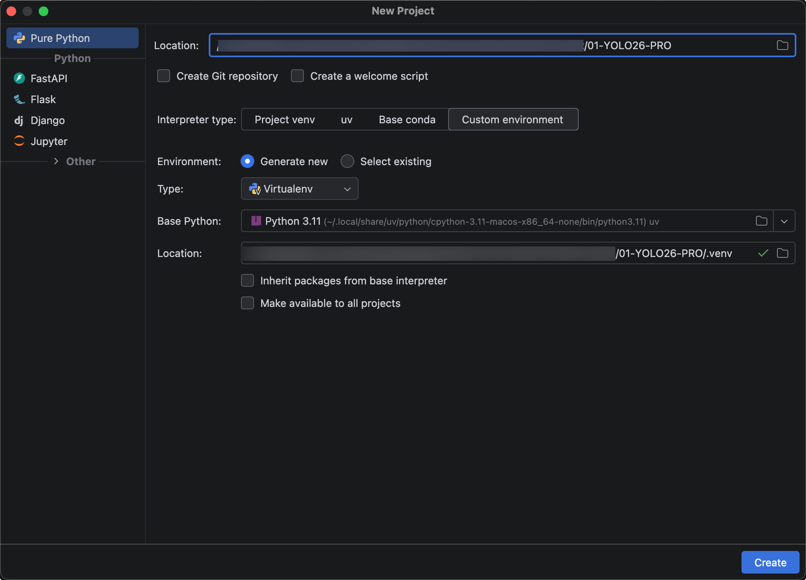
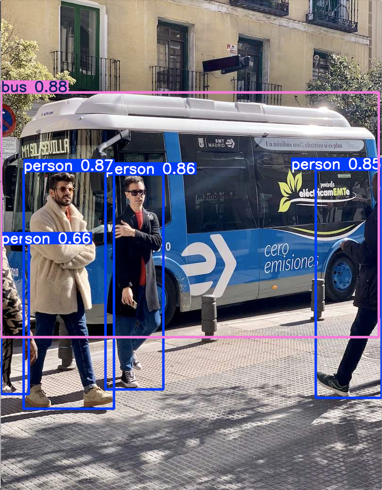

# YOLO26 Hello World项目搭建

首先新建项目，Python版本用3.11，以及使用虚拟环境创建。



## 安装YOLO26库

接下来安装 YOLO26库

`pip install ultralytics -i https://mirrors.aliyun.com/pypi/simple`

> 1. 老MacOS系统只能用python 3.11，因为旧MacOS系统只支持PyTorch2.2.2库
>
> 2. 旧MacOS编译安装时会卡死在opencv，所以用Conda安装别人编译后的
>
>    ```sh
>    curl -O https://repo.anaconda.com/miniconda/Miniconda3-latest-MacOSX-x86_64.sh
>    bash Miniconda3-latest-MacOSX-x86_64.sh
>    # 打开新窗口
>    conda --version
>    conda install -c conda-forge opencv
>    pip install opencv-python==4.9.0.80 -i https://pypi.tuna.tsinghua.edu.cn/simple
>    pip install ultralytics -i https://pypi.tuna.tsinghua.edu.cn/simple
>    ```

先写一个简单测试代码test.py，看下YOLO26库是否安装成功：

```python
import torch
import ultralytics

print(f"PyTorch版本：{torch.__version__}")
print(f"Ultralytics版本：{ultralytics.__version__}")

# 检查可用的计算设备
if torch.cuda.is_available():
    print("CUDA GPU 可用")
elif torch.backends.mps.is_available():
    print("MPS (Apple GPU) 可用")
else:
    print("只能用 CPU 运行")

#======输出======
PyTorch版本：2.2.2
Ultralytics版本：8.4.178
MPS (Apple GPU) 可用
```

## 基本使用

### 代码示例

新建一个helloWorld.py程序，体验下YOLO16

```python
from ultralytics import YOLO

# 加载预训练模型（会自动下载）
model = YOLO("yolo26n.pt")
# model = YOLO("yolo26s.pt")

# 对一张图片进行推理
result = model("https://ultralytics.com/images/bus.jpg")

# 显示带有检测框的结果
result[0].show()

#======输出======
Downloading https://github.com/ultralytics/assets/releases/download/v8.4.0/yolo26n.pt to 'yolo26n.pt': 100% ━━━━━━━━━━━━ 5.3MB 7.8MB/s 0.7s

Downloading https://ultralytics.com/images/bus.jpg to 'bus.jpg': 100% ━━━━━━━━━━━━ 134.2KB 575.7KB/s 0.2s
image 1/1 /01-YOLO26-PRO/bus.jpg: 640x480 4 persons, 1 bus, 274.6ms
Speed: 16.4ms preprocess, 274.6ms inference, 12.0ms postprocess per image at shape (1, 3, 640, 480)
```

### 输出解释

运行项目，控制台输出，第一次会先自动下载预训练模型;

第18行的输出是 YOLO26 在推理一张图片时打印的性能日志，它告诉你了模型处理这张图片**总共花了多少时间**，以及**每个环节分别用了多久**。我们把它拆开来看：

#### 三个时间阶段

1. **Preprocess (预处理) — 1.7ms**
   - 这是模型“读懂”图片前的准备工作。YOLO 需要把输入的原始图片（可能是任意尺寸、格式）**统一缩放、归一化、转为模型能识别的张量格式**。
   - 这里的 **1.7ms** 表示这个转换过程只花了 1.7 毫秒，非常快。
2. **Inference (推理) — 41.2ms**
   - 这是最核心的计算阶段。模型把预处理后的图片“喂”给神经网络，进行**前向传播**，得到原始检测结果（比如数百个候选框和分类分数）。
   - **41.2ms** 是模型“思考”并输出原始结果所用的时间。这个时间主要取决于模型的大小（如 yolo26n 最快，yolo26x 最慢）和硬件（CPU/GPU）性能。对于一般的边缘设备（如 CPU），这个速度已经相当不错了。
3. **Postprocess (后处理) — 0.3ms**
   - 这是对推理原始结果进行“精加工”的步骤。传统 YOLO 需要在这里执行**非极大值抑制（NMS）**来去除重复框，这一步往往耗时且不稳定。
   - 但 **YOLO26 的一大革新就是“端到端无 NMS”**，所以它的后处理极其轻量，只需要做简单的阈值过滤和格式整理。**0.3ms** 正体现了这一优势，几乎可以忽略不计。

#### 关于输入尺寸

 `(1, 3, 640, 480)`

这四维数字表示模型实际接收的图片张量维度：

- `1`：**批次大小**，即一次只处理了一张图片。
- `3`：**颜色通道数**，RGB 三通道。
- `640`：**图片高度**（像素）。
- `480`：**图片宽度**（像素）。

也就是说，你的原始图片被缩放/填充到了 **640×480** 分辨率进行推理。这个尺寸通常由你在训练或预测时设置的 `imgsz` 参数决定。

#### 总耗时与性能评价

- **总计耗时** ≈ 1.7 + 41.2 + 0.3 = **43.2ms**，意味着每秒大约可以处理 **23 张图片**（1000ms / 43.2ms ≈ 23 FPS）。
- 这个速度对于大多数实时应用（如视频监控、无人机巡检）**完全够用**。如果是在 GPU（如 NVIDIA T4）上，这个数值会更低（可能小于 10ms）；在 CPU 上，41.2ms 推理时间说明 YOLO26 的优化非常出色。
- 特别留意 **后处理只有 0.3ms**，这直接证明了 YOLO26 “无 NMS”设计带来的效率提升——传统模型的后处理往往需要 5~10ms，甚至更多。

#### 显示预测结果



这些数字（如 `0.87`、`0.66`）在目标检测中叫作**置信度分数（Confidence Score）**。

你可以把它直接理解为**模型对自己判断的“把握程度”**，或者**“蒙对的概率”**。它是一个介于 **0 和 1 之间**的数值。

### 总结

 YOLO26默认可以识别的物体种类和单张图像最多检测出的物体数量，是两个不同的概念。

- 可识别的物体类别：默认是 80 种。这些类别来自COCO数据集，覆盖了常见的人、车、动物等日常物体。

- 单张图像最多检测数量：默认是 300 个。这得益于其默认的“一对一头”架构，能直接输出最多300个筛选后的检测结果，无需额外的后处理步骤。  