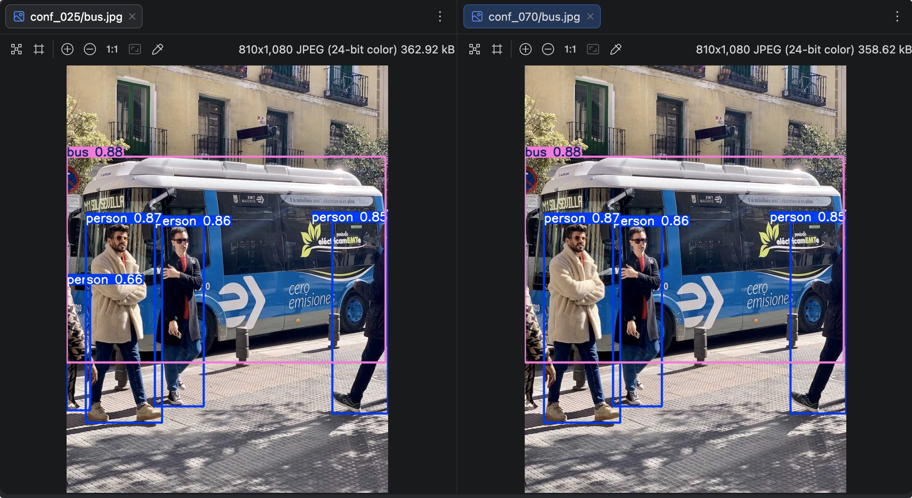
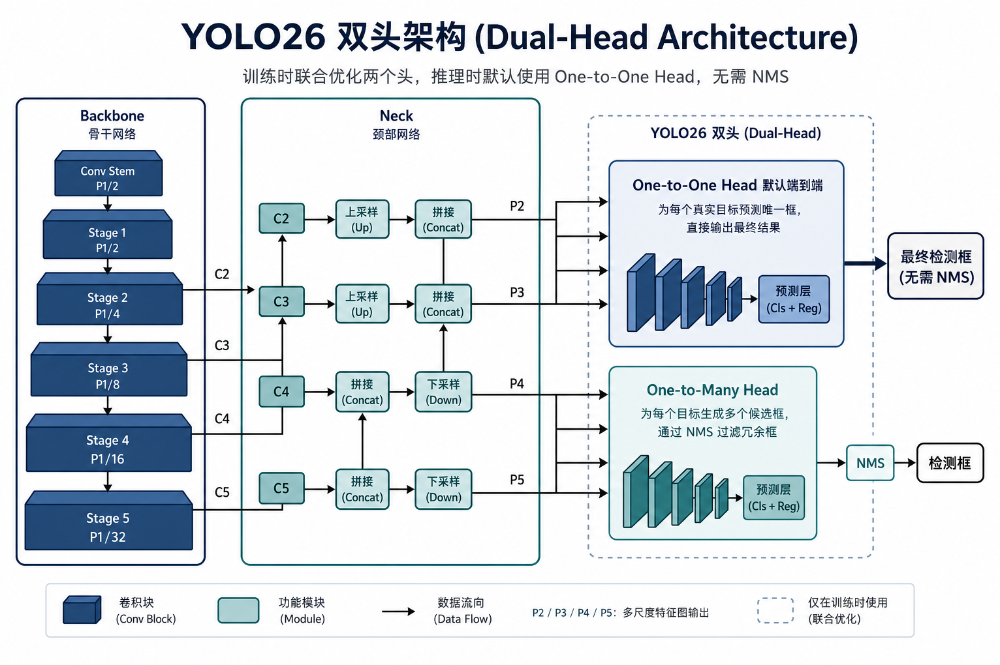
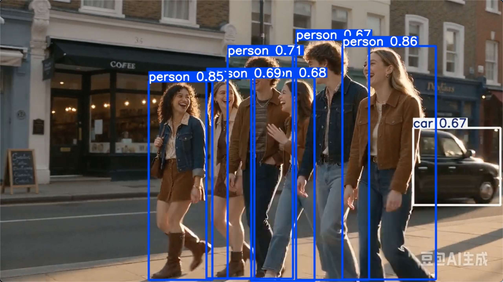
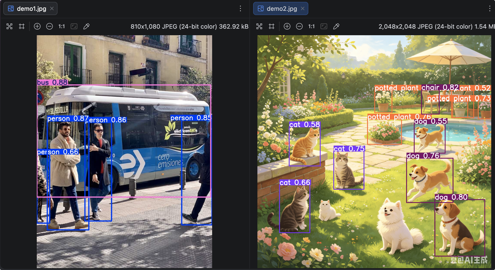

# YOLO26图片与视频推理

predict 常用参数

| 参数            | 含义                    | 入门建议  |
| --------------- | ----------------------- | --------- |
| `source`        | 图片/文件夹/视频/摄像头 | 先单图    |
| `conf`          | 置信度阈值              | 0.25~0.5  |
| `iou`           | NMS IoU（传统头更相关） | 默认即可  |
| `imgsz`         | 推理边长                | 640       |
| `device`        | `0` / `cpu` / `0,1`     | 有卡用 0  |
| `save` / `show` | 保存 / 弹窗             | 调试用    |
| `end2end`       | 是否端到端头            | 默认 True |

示例：

```python
# -*- coding: utf-8 -*-
"""
图片 / 视频 / 批量推理
"""
import sys
from pathlib import Path

from ultralytics import YOLO
from utils.common import ensure_dir, print_detections

sys.path.append(str(Path(__file__).resolve().parents[1]))

def predict_one_image(model: YOLO, image: str, conf: float, tag: str) -> None:
    """
    对单张图推理并打印结果
    :param model: YOLO模型
    :param image: 图片路径
    :param conf: 置信度
    :param tag: 标签
    :return:
    """
    # 保存路径
    out_dir = ensure_dir(Path(__file__).parent / "runs")
    results = model.predict(
        source=image, # 图片路径
        conf=conf, # 置信度, 只保留 置信度>conf 的监测框，低于阈值的会被丢弃 默认0.25
        imgsz=640, # 图像大小 默认640
        save=True, # 保存结果
        project=str(out_dir), # 保存路径
        name=f"conf_{tag}", # 保存名称
        exist_ok=True # 是否覆盖保存
    )
    print(f"\n=== conf={conf} ({tag}) ===")
    print_detections(results[0], model.names)


def compare_end2end(model: YOLO, image: str, conf: float) -> None:
    """
    对比 端到端 one-to-one（默认，无需NMS）与传统 one-to-many 头。
    入门默认使用 nms=False(旧版参数end2end=True，即将废弃)即可。
    :param model: YOLO模型
    :param image: 图片路径
    :param conf: 置信度
    :return:
    """
    print("\n=== 默认端到端（nms=False）===")
    r1 = model.predict(
        source=image,
        conf=conf,
        nms=False, # 启动端到端
        verbose=False # 控制是否在终端打印推理过程的日志信息。
    )
    print_detections(r1[0], model.names)

    print("\n=== 传统头（nms=True, 需 NMS）===")
    r2 = model.predict(
        source=image,
        conf=conf,
        nms=True, # 启动端到端
        verbose=False # 控制是否在终端打印推理过程的日志信息。
    )
    print_detections(r2[0], model.names)


def predict_video(model: YOLO, video: str, conf: float, tag: str) -> None:
    """

    :param model: YOLO模型
    :param video: 视频路径
    :param conf: 置信度
    :param tag: 标签
    :return:
    """
    out_dir = ensure_dir(Path(__file__).parent / "runs") # 保存路径
    model.predict(
        source=video,  # 视频路径
        conf=conf,  # 置信度, 只保留 置信度>conf 的监测框，低于阈值的会被丢弃 默认0.25
        imgsz=640,  # 图像大小 默认640
        save=True,  # 保存结果
        project=str(out_dir),  # 保存路径
        name=f"conf_{tag}", # 保存名称
        exist_ok=True,  # 是否覆盖保存
        stream=False # 是否关闭日志打印
    )
    print(f"视频推理完成，结果目录：{out_dir}/conf_{tag}") # 打印保存路径


def predict_folder(model: YOLO, folder: str, conf: float, tag: str) -> None:
    """

    :param model: YOLO模型
    :param folder: 文件夹路径
    :param conf: 置信度
    :param tag: 标签
    :return:
    """
    out_dir = ensure_dir(Path(__file__).parent / "runs") # 保存路径
    results = model.predict(
        source=folder,  # 文件夹路径
        conf=conf,  # 置信度, 只保留 置信度>conf 的监测框，低于阈值的会被丢弃 默认0.25
        save=True,  # 保存结果
        project=str(out_dir),  # 保存路径
        name=f"conf_{tag}", # 保存名称
        exist_ok=True  # 是否覆盖保存
    )
    print(f"\n批量推理完成，共 {len(results)} 张")  # 打印批量推理完成


def main() -> None:
    model = YOLO("yolo26n.pt")

    # 1 不同置信度对比
    # predict_one_image(model, "bus.jpg", conf=0.25, tag="025")
    # predict_one_image(model, "bus.jpg", conf=0.70, tag="070")

    # 2 端到端 vs 传统头
    # compare_end2end(model, "bus.jpg", conf=0.5)

    # 3 视频推理
    # predict_video(model, "video.mp4", conf=0.45, tag="video")

    # 4 文件夹批量监测
    # predict_folder(model, "images", conf=0.5, tag="batch")
if __name__ == "__main__":
    main()
```

## 不同置信度对比

首先是不同置信度对比，置信度 > conf 的检测框，低于阈值的会被丢弃 默认0.25

运行输出，低于0.7的直接丢弃。

```
image 1/1 /01-YOLO26-PRO/03-YOLO26图片与视频推理/bus.jpg: 640x480 4 persons, 1 bus, 211.2ms
Speed: 9.0ms preprocess, 211.2ms inference, 1.9ms postprocess per image at shape (1, 3, 640, 480)
Results saved to /01-YOLO26-PRO/03-YOLO26图片与视频推理/runs/conf_025

=== conf=0.25 (025) ===
  [0] bus              conf=0.881 xyxy=[0.0, 230.5, 803.2, 750.7]
  [1] person           conf=0.872 xyxy=[48.6, 397.7, 240.3, 902.4]
  [2] person           conf=0.861 xyxy=[222.9, 404.8, 345.5, 861.0]
  [3] person           conf=0.846 xyxy=[669.6, 394.5, 809.9, 879.4]
  [4] person           conf=0.656 xyxy=[0.2, 553.0, 59.7, 871.3]

image 1/1 /01-YOLO26-PRO/03-YOLO26图片与视频推理/bus.jpg: 640x480 3 persons, 1 bus, 188.7ms
Speed: 8.6ms preprocess, 188.7ms inference, 3.4ms postprocess per image at shape (1, 3, 640, 480)
Results saved to /01-YOLO26-PRO/03-YOLO26图片与视频推理/runs/conf_070

=== conf=0.7 (070) ===
  [0] bus              conf=0.881 xyxy=[0.0, 230.5, 803.2, 750.7]
  [1] person           conf=0.872 xyxy=[48.6, 397.7, 240.3, 902.4]
  [2] person           conf=0.861 xyxy=[222.9, 404.8, 345.5, 861.0]
  [3] person           conf=0.846 xyxy=[669.6, 394.5, 809.9, 879.4]
```



## 端到端 vs 传统头



运行输出，目前图片简单，运行结果还是差不多的：

```
=== 默认端到端（nms=False）===
  [0] bus              conf=0.924 xyxy=[0.0, 229.4, 806.1, 757.1]
  [1] person           conf=0.913 xyxy=[222.5, 404.9, 345.4, 861.6]
  [2] person           conf=0.905 xyxy=[47.7, 399.3, 239.3, 903.0]
  [3] person           conf=0.870 xyxy=[670.7, 391.5, 809.8, 879.0]
  [4] person           conf=0.534 xyxy=[0.1, 556.7, 60.0, 870.1]

=== 传统头（nms=True, 需 NMS）===
  [0] bus              conf=0.881 xyxy=[0.0, 230.5, 803.2, 750.7]
  [1] person           conf=0.872 xyxy=[48.6, 397.7, 240.3, 902.4]
  [2] person           conf=0.861 xyxy=[222.9, 404.8, 345.5, 861.0]
  [3] person           conf=0.846 xyxy=[669.6, 394.5, 809.9, 879.4]
  [4] person           conf=0.656 xyxy=[0.2, 553.0, 59.7, 871.3]
```

## 视频识别

运行输出：会逐帧检测

```
video 1/1 (frame 1/97) /01-YOLO26-PRO/03-YOLO26图片与视频推理/video.mp4: 384x640 5 persons, 262.6ms
video 1/1 (frame 2/97) /01-YOLO26-PRO/03-YOLO26图片与视频推理/video.mp4: 384x640 5 persons, 148.2ms
video 1/1 (frame 3/97) /01-YOLO26-PRO/03-YOLO26图片与视频推理/video.mp4: 384x640 5 persons, 166.9ms
video 1/1 (frame 4/97) /01-YOLO26-PRO/03-YOLO26图片与视频推理/video.mp4: 384x640 5 persons, 144.9ms
video 1/1 (frame 5/97) /01-YOLO26-PRO/03-YOLO26图片与视频推理/video.mp4: 384x640 5 persons, 146.6ms
video 1/1 (frame 6/97) /01-YOLO26-PRO/03-YOLO26图片与视频推理/video.mp4: 384x640 5 persons, 135.5ms
video 1/1 (frame 7/97) /01-YOLO26-PRO/03-YOLO26图片与视频推理/video.mp4: 384x640 6 persons, 165.0ms
video 1/1 (frame 8/97) /01-YOLO26-PRO/03-YOLO26图片与视频推理/video.mp4: 384x640 5 persons, 136.0ms
video 1/1 (frame 9/97) /01-YOLO26-PRO/03-YOLO26图片与视频推理/video.mp4: 384x640 6 persons, 167.6ms
video 1/1 (frame 10/97) /01-YOLO26-PRO/03-YOLO26图片与视频推理/video.mp4: 384x640 6 persons, 161.7ms
video 1/1 (frame 11/97) /01-YOLO26-PRO/03-YOLO26图片与视频推理/video.mp4: 384x640 6 persons, 158.8ms
video 1/1 (frame 12/97) /01-YOLO26-PRO/03-YOLO26图片与视频推理/video.mp4: 384x640 6 persons, 204.4ms
video 1/1 (frame 13/97) /01-YOLO26-PRO/03-YOLO26图片与视频推理/video.mp4: 384x640 6 persons, 1 car, 171.0ms
video 1/1 (frame 14/97) /01-YOLO26-PRO/03-YOLO26图片与视频推理/video.mp4: 384x640 5 persons, 1 car, 171.9ms
video 1/1 (frame 15/97) /01-YOLO26-PRO/03-YOLO26图片与视频推理/video.mp4: 384x640 5 persons, 1 car, 162.6ms
video 1/1 (frame 16/97) /01-YOLO26-PRO/03-YOLO26图片与视频推理/video.mp4: 384x640 5 persons, 1 car, 155.3ms
video 1/1 (frame 17/97) /01-YOLO26-PRO/03-YOLO26图片与视频推理/video.mp4: 384x640 5 persons, 1 car, 155.9ms
video 1/1 (frame 18/97) /01-YOLO26-PRO/03-YOLO26图片与视频推理/video.mp4: 384x640 5 persons, 1 car, 199.1ms
video 1/1 (frame 19/97) /01-YOLO26-PRO/03-YOLO26图片与视频推理/video.mp4: 384x640 4 persons, 1 car, 160.4ms
video 1/1 (frame 20/97) /01-YOLO26-PRO/03-YOLO26图片与视频推理/video.mp4: 384x640 4 persons, 1 car, 169.4ms
video 1/1 (frame 21/97) /01-YOLO26-PRO/03-YOLO26图片与视频推理/video.mp4: 384x640 4 persons, 1 car, 145.2ms
video 1/1 (frame 22/97) /01-YOLO26-PRO/03-YOLO26图片与视频推理/video.mp4: 384x640 4 persons, 1 car, 166.7ms
video 1/1 (frame 23/97) /01-YOLO26-PRO/03-YOLO26图片与视频推理/video.mp4: 384x640 5 persons, 1 car, 138.5ms
video 1/1 (frame 24/97) /01-YOLO26-PRO/03-YOLO26图片与视频推理/video.mp4: 384x640 4 persons, 1 car, 155.8ms
video 1/1 (frame 25/97) /01-YOLO26-PRO/03-YOLO26图片与视频推理/video.mp4: 384x640 4 persons, 1 car, 172.3ms
video 1/1 (frame 26/97) /01-YOLO26-PRO/03-YOLO26图片与视频推理/video.mp4: 384x640 5 persons, 1 car, 185.6ms
video 1/1 (frame 27/97) /01-YOLO26-PRO/03-YOLO26图片与视频推理/video.mp4: 384x640 5 persons, 1 car, 133.5ms
video 1/1 (frame 28/97) /01-YOLO26-PRO/03-YOLO26图片与视频推理/video.mp4: 384x640 5 persons, 1 car, 155.9ms
video 1/1 (frame 29/97) /01-YOLO26-PRO/03-YOLO26图片与视频推理/video.mp4: 384x640 5 persons, 1 car, 144.2ms
video 1/1 (frame 30/97) /01-YOLO26-PRO/03-YOLO26图片与视频推理/video.mp4: 384x640 5 persons, 1 car, 150.7ms
video 1/1 (frame 31/97) /01-YOLO26-PRO/03-YOLO26图片与视频推理/video.mp4: 384x640 5 persons, 1 car, 154.0ms
video 1/1 (frame 32/97) /01-YOLO26-PRO/03-YOLO26图片与视频推理/video.mp4: 384x640 5 persons, 1 car, 138.1ms
video 1/1 (frame 33/97) /01-YOLO26-PRO/03-YOLO26图片与视频推理/video.mp4: 384x640 5 persons, 1 car, 156.4ms
video 1/1 (frame 34/97) /01-YOLO26-PRO/03-YOLO26图片与视频推理/video.mp4: 384x640 5 persons, 1 car, 154.2ms
video 1/1 (frame 35/97) /01-YOLO26-PRO/03-YOLO26图片与视频推理/video.mp4: 384x640 4 persons, 1 car, 137.0ms
video 1/1 (frame 36/97) /01-YOLO26-PRO/03-YOLO26图片与视频推理/video.mp4: 384x640 5 persons, 166.9ms
video 1/1 (frame 37/97) /01-YOLO26-PRO/03-YOLO26图片与视频推理/video.mp4: 384x640 5 persons, 137.9ms
video 1/1 (frame 38/97) /01-YOLO26-PRO/03-YOLO26图片与视频推理/video.mp4: 384x640 5 persons, 155.4ms
video 1/1 (frame 39/97) /01-YOLO26-PRO/03-YOLO26图片与视频推理/video.mp4: 384x640 5 persons, 134.9ms
video 1/1 (frame 40/97) /01-YOLO26-PRO/03-YOLO26图片与视频推理/video.mp4: 384x640 6 persons, 169.2ms
video 1/1 (frame 41/97) /01-YOLO26-PRO/03-YOLO26图片与视频推理/video.mp4: 384x640 6 persons, 148.3ms
video 1/1 (frame 42/97) /01-YOLO26-PRO/03-YOLO26图片与视频推理/video.mp4: 384x640 5 persons, 162.5ms
video 1/1 (frame 43/97) /01-YOLO26-PRO/03-YOLO26图片与视频推理/video.mp4: 384x640 6 persons, 218.9ms
video 1/1 (frame 44/97) /01-YOLO26-PRO/03-YOLO26图片与视频推理/video.mp4: 384x640 6 persons, 205.4ms
video 1/1 (frame 45/97) /01-YOLO26-PRO/03-YOLO26图片与视频推理/video.mp4: 384x640 6 persons, 1 car, 204.9ms
video 1/1 (frame 46/97) /01-YOLO26-PRO/03-YOLO26图片与视频推理/video.mp4: 384x640 6 persons, 1 car, 157.6ms
video 1/1 (frame 47/97) /01-YOLO26-PRO/03-YOLO26图片与视频推理/video.mp4: 384x640 6 persons, 166.1ms
video 1/1 (frame 48/97) /01-YOLO26-PRO/03-YOLO26图片与视频推理/video.mp4: 384x640 6 persons, 1 car, 168.2ms
video 1/1 (frame 49/97) /01-YOLO26-PRO/03-YOLO26图片与视频推理/video.mp4: 384x640 6 persons, 1 car, 164.4ms
video 1/1 (frame 50/97) /01-YOLO26-PRO/03-YOLO26图片与视频推理/video.mp4: 384x640 6 persons, 1 car, 162.5ms
video 1/1 (frame 51/97) /01-YOLO26-PRO/03-YOLO26图片与视频推理/video.mp4: 384x640 6 persons, 1 car, 165.0ms
video 1/1 (frame 52/97) /01-YOLO26-PRO/03-YOLO26图片与视频推理/video.mp4: 384x640 7 persons, 1 car, 198.9ms
video 1/1 (frame 53/97) /01-YOLO26-PRO/03-YOLO26图片与视频推理/video.mp4: 384x640 6 persons, 1 car, 195.6ms
video 1/1 (frame 54/97) /01-YOLO26-PRO/03-YOLO26图片与视频推理/video.mp4: 384x640 6 persons, 1 car, 192.4ms
video 1/1 (frame 55/97) /01-YOLO26-PRO/03-YOLO26图片与视频推理/video.mp4: 384x640 6 persons, 1 car, 169.8ms
video 1/1 (frame 56/97) /01-YOLO26-PRO/03-YOLO26图片与视频推理/video.mp4: 384x640 6 persons, 1 car, 206.8ms
video 1/1 (frame 57/97) /01-YOLO26-PRO/03-YOLO26图片与视频推理/video.mp4: 384x640 5 persons, 1 car, 199.3ms
video 1/1 (frame 58/97) /01-YOLO26-PRO/03-YOLO26图片与视频推理/video.mp4: 384x640 5 persons, 1 car, 183.2ms
video 1/1 (frame 59/97) /01-YOLO26-PRO/03-YOLO26图片与视频推理/video.mp4: 384x640 6 persons, 1 car, 175.1ms
video 1/1 (frame 60/97) /01-YOLO26-PRO/03-YOLO26图片与视频推理/video.mp4: 384x640 5 persons, 1 car, 201.9ms
video 1/1 (frame 61/97) /01-YOLO26-PRO/03-YOLO26图片与视频推理/video.mp4: 384x640 5 persons, 1 car, 200.5ms
video 1/1 (frame 62/97) /01-YOLO26-PRO/03-YOLO26图片与视频推理/video.mp4: 384x640 5 persons, 1 car, 169.3ms
video 1/1 (frame 63/97) /01-YOLO26-PRO/03-YOLO26图片与视频推理/video.mp4: 384x640 5 persons, 1 car, 190.9ms
video 1/1 (frame 64/97) /01-YOLO26-PRO/03-YOLO26图片与视频推理/video.mp4: 384x640 5 persons, 1 car, 176.3ms
video 1/1 (frame 65/97) /01-YOLO26-PRO/03-YOLO26图片与视频推理/video.mp4: 384x640 6 persons, 1 car, 195.9ms
video 1/1 (frame 66/97) /01-YOLO26-PRO/03-YOLO26图片与视频推理/video.mp4: 384x640 6 persons, 1 car, 172.4ms
video 1/1 (frame 67/97) /01-YOLO26-PRO/03-YOLO26图片与视频推理/video.mp4: 384x640 6 persons, 1 car, 233.8ms
video 1/1 (frame 68/97) /01-YOLO26-PRO/03-YOLO26图片与视频推理/video.mp4: 384x640 6 persons, 1 car, 249.1ms
video 1/1 (frame 69/97) /01-YOLO26-PRO/03-YOLO26图片与视频推理/video.mp4: 384x640 6 persons, 1 car, 214.9ms
video 1/1 (frame 70/97) /01-YOLO26-PRO/03-YOLO26图片与视频推理/video.mp4: 384x640 7 persons, 1 car, 174.1ms
video 1/1 (frame 71/97) /01-YOLO26-PRO/03-YOLO26图片与视频推理/video.mp4: 384x640 7 persons, 1 car, 177.5ms
video 1/1 (frame 72/97) /01-YOLO26-PRO/03-YOLO26图片与视频推理/video.mp4: 384x640 7 persons, 217.7ms
video 1/1 (frame 73/97) /01-YOLO26-PRO/03-YOLO26图片与视频推理/video.mp4: 384x640 7 persons, 196.1ms
video 1/1 (frame 74/97) /01-YOLO26-PRO/03-YOLO26图片与视频推理/video.mp4: 384x640 7 persons, 191.1ms
video 1/1 (frame 75/97) /01-YOLO26-PRO/03-YOLO26图片与视频推理/video.mp4: 384x640 7 persons, 178.2ms
video 1/1 (frame 76/97) /01-YOLO26-PRO/03-YOLO26图片与视频推理/video.mp4: 384x640 7 persons, 225.2ms
video 1/1 (frame 77/97) /01-YOLO26-PRO/03-YOLO26图片与视频推理/video.mp4: 384x640 8 persons, 165.9ms
video 1/1 (frame 78/97) /01-YOLO26-PRO/03-YOLO26图片与视频推理/video.mp4: 384x640 8 persons, 171.1ms
video 1/1 (frame 79/97) /01-YOLO26-PRO/03-YOLO26图片与视频推理/video.mp4: 384x640 7 persons, 198.9ms
video 1/1 (frame 80/97) /01-YOLO26-PRO/03-YOLO26图片与视频推理/video.mp4: 384x640 7 persons, 196.9ms
video 1/1 (frame 81/97) /01-YOLO26-PRO/03-YOLO26图片与视频推理/video.mp4: 384x640 6 persons, 195.6ms
video 1/1 (frame 82/97) /01-YOLO26-PRO/03-YOLO26图片与视频推理/video.mp4: 384x640 8 persons, 183.1ms
video 1/1 (frame 83/97) /01-YOLO26-PRO/03-YOLO26图片与视频推理/video.mp4: 384x640 7 persons, 176.6ms
video 1/1 (frame 84/97) /01-YOLO26-PRO/03-YOLO26图片与视频推理/video.mp4: 384x640 7 persons, 197.0ms
video 1/1 (frame 85/97) /01-YOLO26-PRO/03-YOLO26图片与视频推理/video.mp4: 384x640 7 persons, 178.4ms
video 1/1 (frame 86/97) /01-YOLO26-PRO/03-YOLO26图片与视频推理/video.mp4: 384x640 7 persons, 185.2ms
video 1/1 (frame 87/97) /01-YOLO26-PRO/03-YOLO26图片与视频推理/video.mp4: 384x640 7 persons, 166.6ms
video 1/1 (frame 88/97) /01-YOLO26-PRO/03-YOLO26图片与视频推理/video.mp4: 384x640 7 persons, 217.4ms
video 1/1 (frame 89/97) /01-YOLO26-PRO/03-YOLO26图片与视频推理/video.mp4: 384x640 7 persons, 190.7ms
video 1/1 (frame 90/97) /01-YOLO26-PRO/03-YOLO26图片与视频推理/video.mp4: 384x640 8 persons, 181.5ms
video 1/1 (frame 91/97) /01-YOLO26-PRO/03-YOLO26图片与视频推理/video.mp4: 384x640 8 persons, 873.7ms
video 1/1 (frame 92/97) /01-YOLO26-PRO/03-YOLO26图片与视频推理/video.mp4: 384x640 7 persons, 370.3ms
video 1/1 (frame 93/97) /01-YOLO26-PRO/03-YOLO26图片与视频推理/video.mp4: 384x640 7 persons, 303.2ms
video 1/1 (frame 94/97) /01-YOLO26-PRO/03-YOLO26图片与视频推理/video.mp4: 384x640 7 persons, 402.5ms
video 1/1 (frame 95/97) /01-YOLO26-PRO/03-YOLO26图片与视频推理/video.mp4: 384x640 7 persons, 205.7ms
video 1/1 (frame 96/97) /01-YOLO26-PRO/03-YOLO26图片与视频推理/video.mp4: 384x640 7 persons, 220.8ms
video 1/1 (frame 97/97) /01-YOLO26-PRO/03-YOLO26图片与视频推理/video.mp4: 384x640 7 persons, 198.0ms
Speed: 6.2ms preprocess, 189.5ms inference, 1.8ms postprocess per image at shape (1, 3, 384, 640)
Results saved to /01-YOLO26-PRO/03-YOLO26图片与视频推理/runs/conf_video
视频推理完成，结果目录：/01-YOLO26-PRO/03-YOLO26图片与视频推理/runs/conf_video
```



## 文件夹批量监测

运行输出：

```
image 1/2 /01-YOLO26-PRO/03-YOLO26图片与视频推理/images/demo1.jpg: 640x480 4 persons, 1 bus, 289.5ms
image 2/2 /01-YOLO26-PRO/03-YOLO26图片与视频推理/images/demo2.png: 640x640 3 cats, 3 dogs, 1 chair, 5 potted plants, 234.9ms
Speed: 9.5ms preprocess, 262.2ms inference, 8.0ms postprocess per image at shape (1, 3, 640, 640)
Results saved to /01-YOLO26-PRO/03-YOLO26图片与视频推理/runs/conf_batch

批量推理完成，共 2 张
```

