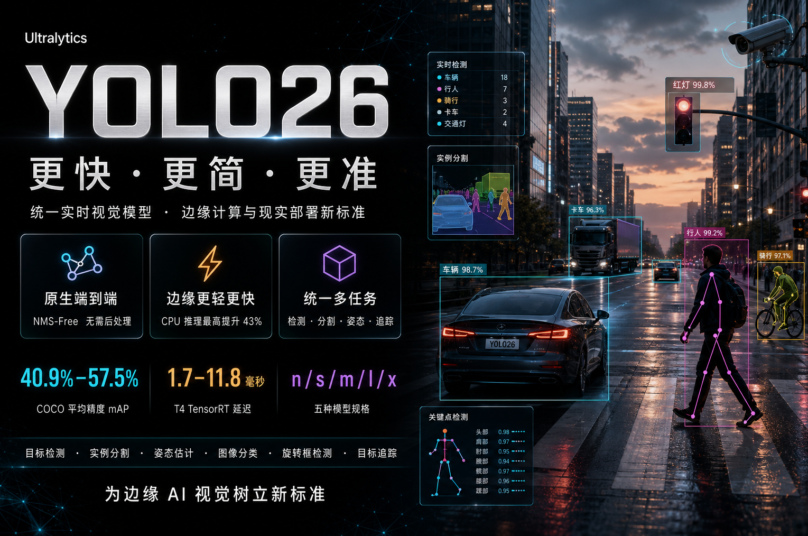

# YOLO26 简介

官网：https://www.ultralytics.com/

中文官方文档：https://docs.ultralytics.com/zh 

YOLO26是Ultralytics团队于2025年9月伦敦 YOLO Vision 2025 大会首次公开演示原型**，**2026‑01‑14，Ultralytics 官方正式对外发布，可直接通过 ultralytics 库使用 `yolo26n.pt` 等权重。它是一个统一的实时视觉模型系列，旨在为边缘计算和现实世界部署树立新标准。

##  核心特点：更快、更简、更准

YOLO26的核心创新在于其架构和训练策略的全面革新，主要特点包括：

1. **原生端到端推理 (NMS-Free)**：这是YOLO26最显著的改变。它默认采用“一对一”（one-to-one）的检测头，**彻底移除了传统目标检测中依赖的非极大值抑制（NMS）后处理步骤**。这简化了部署流程，降低了推理延迟。
2. **更轻量的检测头**：移除了分布焦点损失（DFL），在保持回归精度的同时，大幅降低了模型复杂度，使其更易于在边缘设备上部署。
3. **先进的训练策略**：引入三项关键新技术协同提升精度并降低训练成本：
   - **MuSGD优化器**：融合了Muon与SGD的混合优化器，将大语言模型的训练思想引入计算机视觉，增强了训练稳定性。
   - **渐进式损失平衡（ProgLoss）**：在训练过程中将监督重点逐步转移到推理阶段的头部，优化最终性能。
   - **小目标感知标签分配（STAL）**：改进标签分配策略，确保小目标也能获得正标签，从而提升对小目标的检测能力。

## 性能表现：速度与精度的新高度

与上一代YOLO11相比，YOLO26在速度和精度上均有显著提升：

- **更快的推理速度**：其最小的**nano模型在CPU上的推理速度最高可提升43%**，使其成为边缘CPU部署的理想选择。
- **更高的检测精度**：在著名的COCO数据集上，YOLO26五个模型变体的平均精度（mAP）达到了**40.9%到57.5%**。
- **极低的延迟**：在NVIDIA T4 GPU上使用TensorRT加速时，推理延迟仅为**1.7毫秒到11.8毫秒**。

## 多任务能力与模型选择

YOLO26不仅仅是一个检测器，它是一个**统一的多任务框架**，开箱即用支持以下任务：

- 目标检测 (Detection)
- 实例分割 (Instance Segmentation)
- 姿态估计 (Pose Estimation)
- 图像分类 (Classification)
- 旋转框检测 (Oriented Object Detection)
- 目标追踪 (Tracking)

为了适应不同场景，YOLO26提供了**五种不同大小的模型**：Nano (n), Small (s), Medium (m), Large (l), 和 Extra Large (x)。