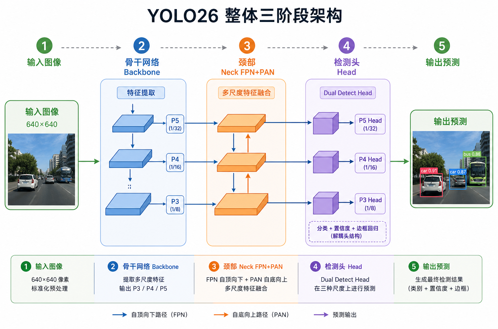
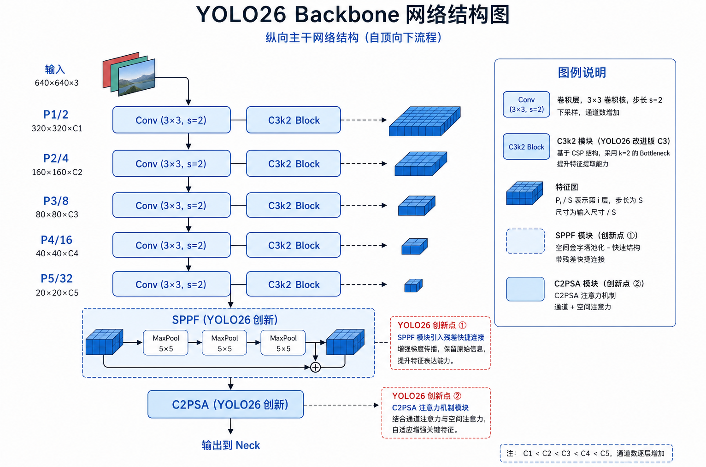
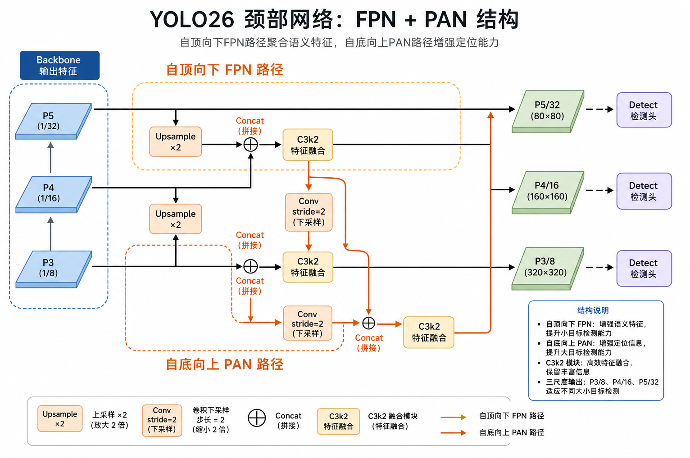
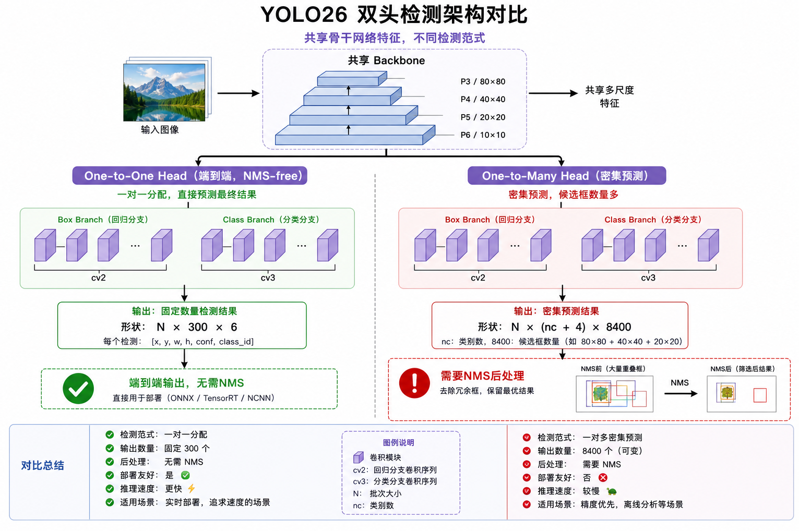

# YOLO26模型架构解析

## 整体架构

`Backbone → Neck → Head`

YOLO26 与所有 Ultralytics YOLO 模型一样，遵循经典的三段式流水线：



## 骨干网络 Backbone 详解

Backbone 负责从输入图像中提取**多尺度语义特征**，YOLO26 的骨干继承 YOLO11 设计并做了 SPPF 残差增强。



*上图 ：YOLO26 骨干网络 — 逐层下采样 + C3k2 特征提取 + SPPF 空间池化 + C2PSA 注意力*

### 各阶段详解

| 层索引 | 模块        | 输出尺度  | 通道数  | 作用         |
| ------ | ----------- | --------- | ------- | ------------ |
| 0      | Conv s=2    | P1/2      | 64      | 初始下采样   |
| 1-2    | Conv + C3k2 | P2/4      | 128→256 | 浅层特征     |
| 3-4    | Conv + C3k2 | **P3/8**  | 256→512 | 小目标特征 ★ |
| 5-6    | Conv + C3k2 | **P4/16** | 512     | 中目标特征 ★ |
| 7-8    | Conv + C3k2 | **P5/32** | 1024    | 大目标特征 ★ |
| 9      | SPPF (残差) | P5/32     | 1024    | 扩大感受野   |
| 10     | C2PSA       | P5/32     | 1024    | 全局注意力   |

> P3、P4、P5 三个尺度的特征图会被 Neck 和 Head 共同使用。P3 负责小物体，P5 负责大物体。

### 基础单元 Conv

所有大模块的基础单元是 **Conv 块**（定义于 `conv.py`）：

```
Conv = Conv2d → BatchNorm → SiLU
```

- **Conv2d**：标准 2D 卷积
- **BatchNorm**：批归一化，稳定训练
- **SiLU**（Swish）：平滑激活函数，`x · sigmoid(x)`

### SPPF 残差连接

SPPF（Spatial Pyramid Pooling - Fast）通过串联 3 次 MaxPool(kernel=5) 等效于 SPP(k=5,9,13)，但计算量更低。

**YOLO26 的创新**：在 SPPF 输出端增加残差连接：

```python
# YOLO26 SPPF 伪代码
def forward(self, x):
    y = self.cv2(torch.cat([x, pool(x), pool²(x), pool³(x)], dim=1))
    return y + x  # ← YOLO26 新增残差 shortcut
```

当 `c1 == c2 == 1024` 时，输入输出通道一致，可以直接相加。这有助于：

- 缓解深层网络的梯度消失
- 保留原始空间信息


## 颈部网络 Neck:FPN + PAN

Neck 的核心任务是让**不同尺度的特征图互相融合**，使小物体也能获得大感受野的语义信息，大物体也能保留精细的空间定位。



*图：Neck 的 FPN（自顶向下）+ PAN（自底向上）双向融合路径*

### FPN自顶向下:Top-Down

FPN 将高层语义信息传递到低层：

```
P5 (1024ch) ──Upsample×2──┐
                          ├── Concat ── C3k2 ──→ 融合 P4
P4 (512ch)  ──────────────┘

融合 P4 ──Upsample×2──┐
                      ├── Concat ── C3k2 ──→ 融合 P3 (小目标)
P3 (512ch) ───────────┘
```

**作用**：让 P3 特征图"看到"全局语义，提升小目标检测能力。

### PAN自底向上:Bottom-Up

PAN 将低层定位信息传递回高层：

```
融合 P3 ──Conv s=2──┐
                    ├── Concat ── C3k2 ──→ 增强 P4
融合 P4 ────────────┘

增强 P4 ──Conv s=2──┐
                    ├── Concat ── C3k2 ──→ 增强 P5 (大目标)
P5 (1024ch) ────────┘
```

**作用**：让 P5 特征图保留精细空间细节，提升大目标定位精度。

### Neck 输出

Neck 最终输出三个融合特征图，分别送入 Detect 头：

| 输出  | 尺度  | 步长 | 适合检测            |
| ----- | ----- | ---- | ------------------- |
| 层 16 | P3/8  | 8    | 小物体 (< 32×32 px) |
| 层 19 | P4/16 | 16   | 中等物体            |
| 层 22 | P5/32 | 32   | 大物体 (> 96×96 px) |


## 检测头 Detect

**双头设计与端到端推理**

YOLO26 检测头最大的架构变革是引入**双头（Dual-Head）**设计，实现原生 NMS-Free 推理。



*图 ：YOLO26 双头检测 — One-to-One（推理）与 One-to-Many（训练辅助）*

### 解耦头结构

每个金字塔层级上，Detect 头运行两个**并行分支**：

```
特征图 ──┬── Box Branch (cv2):  Conv 3×3 → Conv 3×3 → Conv2d(4, 1×1)
        │   输出: 4 个坐标 (x, y, w, h) — 直接回归，无 DFL
        │
        └── Class Branch (cv3): DWConv → Conv 1×1 → DWConv → Conv2d(nc, 1×1)
            输出: nc 个类别分数
```

- **Box Branch**：3 层卷积，最终输出 4 通道（直接坐标回归）
- **Class Branch**：深度可分离卷积（DWConv），更轻量

### One-to-One Head

**默认推理头**

| 属性         | 值                               |
| ------------ | -------------------------------- |
| 输出形状     | `(N, 300, 6)`                    |
| 最大检测数   | 300 个/图                        |
| 是否需要 NMS | **否**                           |
| 标签分配     | TAL topk=7 → topk2=1（唯一匹配） |

每个真实目标只对应**一个预测**，模型内部自行处理重复框，推理时直接输出最终结果。

### One-to-Many Head

**训练辅助头**

| 属性         | 值                           |
| ------------ | ---------------------------- |
| 输出形状     | `(N, nc+4, 8400)`            |
| 锚点数       | 8400 (80×80 + 40×40 + 20×20) |
| 是否需要 NMS | **是**                       |
| 标签分配     | TAL topk=10（多正样本）      |

提供**更丰富的正样本监督**，帮助 One-to-One 头学习更好的特征表示。

### 双头设计的优势

```
训练阶段:  One-to-Many (密集监督) + One-to-One (端到端监督)
                ↓ Progressive Loss 渐进过渡
推理阶段:  仅使用 One-to-One → 无 NMS → 更快更简单
```

这是一个**精度-速度旋钮**：追求极致精度可选 One-to-Many + NMS；追求部署简洁则用 One-to-One。